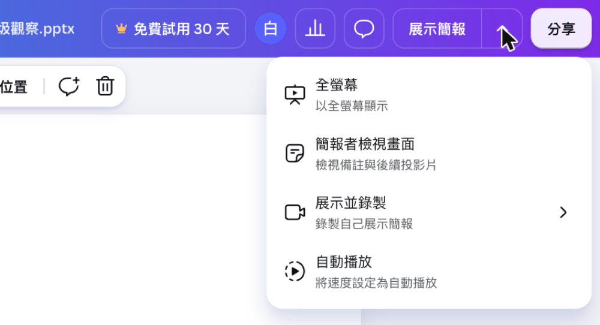

## 內部設計（不進學員頁）

依[正式大綱](../../_outlines/canva-video-teaching.md) v8 與 改寫規格書（內部紀錄，`courses/canva-video-teaching/_local/v8-2026-11-02/`，不進 repo） 重寫。v7（三場景 36 秒教學短片）的正文與講師筆記見 git 歷史。

<!-- learner-content:start -->
# 在簡報裡錄下報告
學生沒時間上台，就讓報告自己播
本節完成物：一支聽得到聲音、翻頁正確，並已下載到電腦的簡報報告錄影。

## 這一頁要做什麼

你手上有學生做好的成果報告簡報，卻沒有足夠的課堂時間讓每組上台。這一頁會用「校園午餐垃圾觀察」示範簡報，帶你把講解和翻頁一起錄下來。

Canva 會同時收錄投影片、聲音與翻頁過程，你不必另外剪接畫面；講稿放在每頁備註，錄製時照著說就能完成。

整個流程是：① 匯入簡報 → ② 進錄製工作室 → ③ 邊講邊翻頁 → ④ 下載錄影。

做完會得到一支可回放的報告影片，第一次操作大約 15 分鐘。

| 項目 | 內容 |
|---|---|
| 簡報 | 「校園午餐垃圾觀察」，6 頁 |
| 頁面內容 | 1 標題（第三組、連續五個上課日）／2 我們想知道（哪種垃圾最多、有沒有容易做到的減量方法）／3 我們怎麼做（一樓與三樓回收站、12:40–13:00、分四類計數）／4 我們的發現（塑膠餐具 196 件、飲料杯 121 件、紙類與廚餘合計 95 件）／5 我們的建議（自備餐具日、分類圖示、自己的杯子）／6 謝謝聆聽 |
| 講稿 | 每頁一到兩句，放在簡報備註，也有文字檔；全部唸完約 1 分鐘 |

## 第 1 步：匯入簡報

先把示範簡報變成 Canva 設計，錄製時就能直接看投影片與備註，不用來回切換講稿。

1. 下載[用來練習錄報告的示範簡報](../../courses/canva-video-teaching/downloads/示範簡報_校園午餐垃圾觀察.pptx)與[示範講稿（純文字）](../../courses/canva-video-teaching/downloads/示範講稿_校園午餐垃圾觀察.txt)。
2. 回到 Canva 首頁，按左上「建立」，在左側選「上傳」→「上傳檔案」，選取示範簡報。
3. 右下角出現「已上傳 1 個項目」後，按那一列右邊的開啟圖示，簡報會在新分頁打開。
4. 按編輯器左下角的「備註」。

做對了，你會看到下方有六頁縮圖，左側備註顯示「講稿：大家好，我們是第三組……」。

## 第 2 步：進錄製工作室

把簡報切換到錄製工作室，Canva 才能收進你的聲音、翻頁和選用的鏡頭畫面。

1. 在編輯器右上按「展示簡報」旁的下拉箭頭，再選「展示並錄製」。
2. 按「前往錄製工作室」，等待「設定你的相機和麥克風」出現。
3. 瀏覽器詢問權限時按允許。在相機選單選要用的鏡頭，不想露臉就選「沒有相機」；在麥克風選單選要用的麥克風。

做對了，你會看到「設定你的相機和麥克風」畫面，對著麥克風說話時，下方的音量條會跳動。

找不到錄製入口或麥克風沒有反應時，請看[卡住時](../../courses/canva-video-teaching/resources/卡住時.md)；「展示並錄製」使用電腦版 Canva。

## 第 3 步：邊講邊翻頁

像對真人報告一樣照備註說明，每頁說完再翻頁，聲音與畫面就會自然對在一起。

1. 按「開始錄製」，從第一頁標題開始講。
2. 看右側的講稿，每頁講完按鍵盤的右方向鍵翻到下一頁。
3. 第四頁說到「塑膠餐具 196 件」後再翻頁，繼續講完建議與謝謝聆聽。
4. 最後一頁講完，按畫面頂角的「結束錄製」，等上傳完成。

做對了，你會看到「你的錄製內容已準備就緒！」，下方有「捨棄」「儲存並退出」「下載」三個按鈕。

## 第 4 步：下載錄影

把錄影存到電腦，下一頁才能搬進影片設計並加上字幕。

1. 在「你的錄製內容已準備就緒！」畫面按「下載」，檔名會和簡報名稱相同。
2. 用電腦播放器開啟下載的 MP4，從第一頁播放到第六頁。

做對了，你會聽到第一頁開場與第四頁的塑膠餐具數字，影片最後停在第六頁。

一份設計只能保留一段錄製，再錄一次會取代原本內容；每位學生或每組可先各自複製一份簡報再錄。

## 換你用：錄自己的課前影片

開啟自己的課前預習或補課簡報，從「展示並錄製」進入錄製工作室，照備註邊講邊翻頁；一段報告可控制在 5 分鐘內，錄完回放並下載，下一頁再替它加字幕。

## 熟練後只看這三行

1. 首頁「建立」→「上傳」→「上傳檔案」匯入簡報，再從「展示簡報」旁的下拉箭頭選「展示並錄製」。
2. 按「前往錄製工作室」，確認麥克風後按「開始錄製」，照備註邊講邊翻頁。
3. 按「結束錄製」，等上傳完成後按「下載」，再用電腦播放器檢查。

先確認聲音與翻頁，再把錄影下載到電腦。

下一頁會建立影片設計，並把這支 MP4 放進時間軸。[卡住時](../../courses/canva-video-teaching/resources/卡住時.md)｜[列印這條流程](../../courses/canva-video-teaching/resources/老師流程卡.md)

<!-- learner-content:end -->
