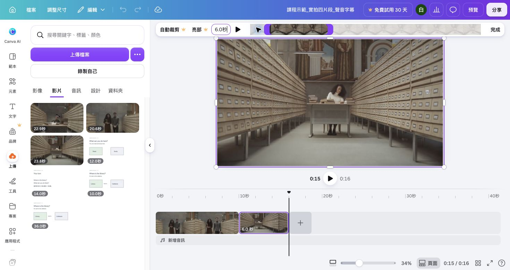
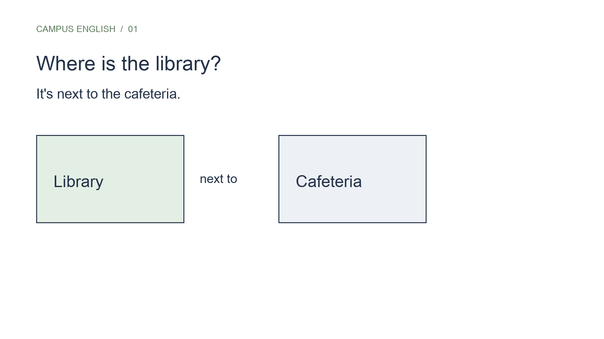

## 內部設計（不進學員頁）

能力進展、成果規格與環境繼承自[正式大綱](../../_outlines/canva-video-teaching.md)。本文為正式講義的學員正文來源，平台操作圖與媒體依[資產規格](../../courses/canva-video-teaching/_design/ASSET-SPEC.md)補齊並實測後發布。

本單元成果：匯入實拍 MP4，裁短十秒、調整構圖，疊加可讀問答與位置圖。

<!-- learner-content:start -->
# 匯入影片，完成第一個場景

開啟自己的 `姓名_圖書館_v1`，準備已解壓縮練習包中的走道影片 [`stock-library-walk.mp4`](../../courses/canva-video-teaching/assets/media/stock-library-walk.mp4)。本單元會完成一個十秒位置場景：實拍影片放在背景，位置圖與問答文字放在前景。`next to` 是示範內容，位置關係以圖形呈現，不代表影片的實際拍攝地點。

## 匯入，讓影片成為主要畫面

先把走道影片放進主畫面，並確認它能正常播放。

1. 在左側「上傳 → 上傳檔案」選 `stock-library-walk.mp4`。等上傳完成再操作；影片縮圖應可預覽。
2. 依時間軸外觀，選擇下方「新版多軌」或「既有頁面」其中一條路徑。

### 新版多軌

如果下方有分層的影片、文字與音訊軌，使用主軌放置背景影片。

1. 將影片拖到下方較粗的主軌，不要拖到文字所在的上層軌。
2. 若主軌仍有原來的空白片段，選取空白片段並按 Delete，只保留走道影片。

### 既有頁面

如果下方主要是一頁頁縮圖與頁面秒數，將影片設為該頁背景。

1. 將影片加入第一頁並選取影片。
2. 點上方素材工具列右端的「更多」（三個點），開啟「位置」，再切換到「圖層」。
3. 點影片旁的三個點，選「設為背景」。影片應填滿畫布。
4. 若影片另外建立一頁，將原本的標題複製到影片頁，再刪除多餘的空白頁。

**完成檢查：** 完成其中一條路徑後，把播放頭移到片段中間並按播放。看到會移動的走道畫面，表示影片已成為主要畫面；若只有小影片浮在白底上，回到所選路徑確認主軌或背景設定。

**用途：** 影片作背景時可能覆蓋文字；先不要反覆新增標題，稍後用圖層把已有文字帶回前方。

## 分清楚「裁短」和「裁切」

裁短會改變保留的時間；裁切會改變可見畫面範圍。例如把原片中約第 2–12 秒留下來，是十秒裁短。保留這十秒、只把構圖移向人物，屬於裁切。

| 要解決的問題 | 選取對象 | 功能 | 預期結果 |
|---|---|---|---|
| 開頭等待或片段太長 | 時間軸上的影片 | 裁短／拖左右邊緣 | 片段剩十秒，仍有連續動作 |
| 人物在邊緣、比例不合 | 畫布上的影片 | 裁切 | 畫面填滿 16:9，人物與書架仍可辨 |
| 標題被背景蓋住 | 標題文字框 | 位置／圖層 | 文字在影片前方 |

### 留下十秒

這一段只調整播放長度，不改變畫面構圖。

1. 在時間軸選取走道影片。
2. 依自己的介面完成其中一條路徑：
   - **新版多軌**：拖左邊緣略過原片開頭約兩秒，再拖右邊緣，讓片段長度顯示十秒。
   - **既有頁面**：開啟影片的剪刀／裁剪功能，把素材起點移到約第 2 秒、終點移到約第 12 秒，再按「完成」。若頁面長度不同，另將頁面設為十秒。
3. 把播放頭移到片段末尾，確認仍看得到走道畫面。
4. 再看一次片段長度，結果應為十秒。

**判斷方式：** 拖動整段中間會改變播放位置，拖動邊緣才會改變長度。既有頁面顯示的素材終點可能是第 12 秒，因為它包含略過的前兩秒；真正要核對的是保留長度為十秒。

### 調整構圖

片段長度確認後，再調整畫面中看得見的範圍。

1. 在畫布上選取影片，開啟工具列的「裁切」；也可以點兩下影片進入裁切模式。
2. 拖動畫面內的影像，讓人物與書架留在可見範圍。
3. 按「完成」或點畫面外側，結束裁切。
4. 播放片段，確認畫面填滿 16:9，而且人物沒有被切掉。

**卡住時：** 找不到「裁切」，先確認選到的是影片而非文字，再查看「更多」。如果影片原本就是 16:9，可以先保留完整畫面，不要用裁切框調整播放時間。

## 疊加問答與位置圖

背景完成後，把問答文字與位置圖放到影片前方。

1. 選原有 `Where is the library?`，拖到上方空白處。若被蓋住，從「位置 → 圖層」選它並移到影片前方。
2. 加入回答 `It's next to the cafeteria.`，先用字級 44，縮小預覽仍應能看清楚。
3. 在「元素」加入矩形，放在文字下方，顏色選深色；文字選白色。用「位置」將矩形放在文字後、影片前。透明度先試 75–90，再播放確認明暗變化不會讓字消失。
4. 從已解壓縮的練習包上傳 `library-map.svg`；需要補抓或預覽時，另開 [`library-map.svg`](../../courses/canva-video-teaching/assets/diagrams/library-map.svg)。將位置圖放在下方、避開人物。此圖表示示範中的 Library 與 Cafeteria 相鄰；不要用它聲稱圖庫拍攝地點的真實位置。
5. 框選文字與底色矩形，選「群組」；拖動群組時兩者一起移動。需要改字時點兩下文字；時間要分開設定時先取消群組。

## 做一次自己的檢查

先從頭播放一次，再檢查前後層級與字幕空間。

1. 從頭播放十秒，確認最後一秒仍有走道畫面。
2. 確認問答文字與位置圖都在影片前方，而且沒有遮住人物。
3. 移動一次文字，為之後的字幕保留空間。

**卡住時：** 若選不到文字，從圖層面板選取；若移動文字時背景也一起移動，檢查群組中是否誤選了影片。

**完成檢查：** 畫面中應同時看見活動影像、問答與相鄰地點圖。

[播放實拍版對照](../../courses/canva-video-teaching/assets/media/footage-v1.mp4)的前十秒可用來檢查資訊與構圖；不必逐像素照抄。下一單元會加入閱讀、自習與提問。

## 對照真正的裁短畫面

這張圖用六秒閱讀片段示範如何辨認素材時間與成片時間，不是要把本頁的十秒設定改成六秒。圖中上方六秒是保留的素材長度，下方時間軸中的六秒則是閱讀場景在成片中的長度。原片的第 2 秒不等於成片的第 2 秒；閱讀場景在成片中從第 10 秒開始。這張圖使用頁面式編輯器；新版帳號可用上層與主軌辨認選取對象。[完整物件對照](../../courses/canva-video-teaching/resources/時間軸與字幕實作.md)另有操作前後檢查。

## 文字與圖形版補充練習

以下保留原文字版操作，供練習基本排版與既有頁面影片使用。已完成上方實拍主流程者，直接前往下一單元。

展開原文字版操作與對照圖

### 把教材整理成第一段畫面

你的專案已有標題。現在要讓學生看到圖書館的位置，請使用[案例原文](../../courses/canva-video-teaching/resources/案例與腳本.md)中的這一句：

> The library is next to the cafeteria.

這句話回答「圖書館在哪裡」。原文中的閱讀、自習與音量提醒各有不同用途；本段先呈現位置，下一段再介紹活動。

### 把一句話放進畫面

這段補充練習用文字與圖形重建位置關係；完成後，只看畫面也應能回答圖書館的位置。

1. 點標題文字框外框。上方會出現字型與字級工具列；點字級數字，輸入 64，按 Enter。拖曳文字框到畫面上方，四周留下空間。
2. 在左側「文字」按「新增文字方塊」，點兩下新框內的字，按 Ctrl+A（Mac 為 Command+A）全選，再貼上 `It's next to the cafeteria.`，字級先設為 44，放在標題下方。
3. 點頁面內沒有物件的空白處，在工具列的顏色按鈕選白色；再選各文字框，在「文字顏色」選深色。先用清楚的色差檢查字句及位置。
4. 開啟「元素」，搜尋「矩形」，挑選可變更顏色的基本矩形。點一下加入畫面，拖曳四角調整大小，再複製一個；將兩個矩形左右並排放在畫面中央。
5. 另外加入兩個文字框，分別輸入 `Library`、`Cafeteria`，放在對應矩形內。將文字設為 36。
6. 在兩個矩形之間加入 `next to`。讓文字與矩形之間保持間距。

你會看到一個問題、一句回答及兩個相鄰地點。圖形提供位置線索，句子提供學生可以說出口的表達。

### 檢查文字能否讀完

將畫面縮放到整頁可見，讀出問題和答案。若文字超出邊界，先把文字框拉寬；仍太擠時，將長句分成兩行。標題與內文分開調整，保留 Library 和 Cafeteria 的辨識空間。

如果文字被矩形蓋住，選取該文字框，在「位置」調整前後順序，移到矩形前方。若無法選到文字，可先移開矩形，修改後再放回。

自己檢查：學生只看這一頁，是否能回答圖書館的位置？本例答案是 `It's next to the cafeteria.`。如果你把兩個地點上下分開且距離很遠，請重新排列成相鄰位置。

下一段會沿用字體與版面，換成學生在圖書館能做的活動。

### 對照第一頁

如果想先完成文字，可從[素材與成品](../../courses/canva-video-teaching/resources/素材與成品.md)下載位置圖再上傳。你仍需核對圖上的地點與教材一致。

<!-- learner-content:end -->

### 講師授課筆記（不進講義）

配時：教材取捨 5 分、文字編輯 8 分、關係圖 8 分、檢查修復 4 分。字級為示範起始值，最終需由實際投影及手機閱讀確認。使用基本圖形完成，不依賴照片或付費元素。

本次強化配時以實拍主流程為準；可展開的文字版操作不列第二次必做。新版入口依官方文件，新增平台路徑尚未完成真人冷讀；既有圖例只證明圖中的頁面編輯器。
