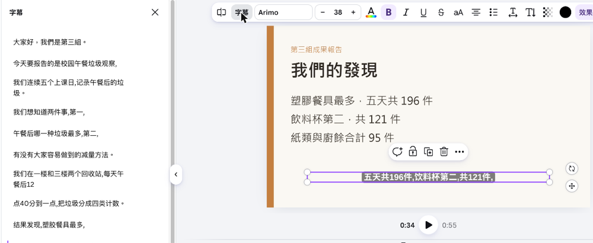

## 內部設計（不進學員頁）

依[正式大綱](../../_outlines/canva-video-teaching.md) v8 與 改寫規格書（內部紀錄，`courses/canva-video-teaching/_local/v8-2026-11-02/`，不進 repo） 重寫。v7（三場景 36 秒教學短片）的正文與講師筆記見 git 歷史。

<!-- learner-content:start -->
# 自動上字幕，改錯字後下載
字幕交給 Canva 聽寫，你只負責改錯
本節完成物：一支字幕已改成繁體、下載後仍看得到字幕的 MP4。

## 這一頁要做什麼

你手上有一份能播放報告錄影的影片設計，現在要讓沒有開聲音或需要文字輔助的學生也能看懂。Canva 會先依聲音產生字幕，你再對照講稿修正錯字和出現時間。

Canva 幫你把聲音聽寫成文字，你不用從頭打字；它產生的是簡體字，對照講稿整句貼上繁體，比逐字修改快。最後用下載的 MP4 確認字幕真的留在成片裡。

整個流程是：① 產生字幕 → ② 對照講稿 → ③ 改成繁體 → ④ 下載 MP4。

做完會得到一支校正過字幕、可在電腦播放的報告影片，大約需要 10～15 分鐘。

## 第 1 步：產生字幕

先指定時間軸上的報告影片，Canva 才知道要聽哪一段聲音並把字幕放回畫面。

1. 點時間軸上的影片片段。
2. 按上方工具列「字幕」；左側「套用輔助字幕至」會顯示已選取的影片。
3. 按「產生輔助字幕」，等待字幕出現在畫面與時間軸。

做對了，你會看到字幕成為時間軸上自己的一層，播放時文字也會出現在畫面上。

「字幕」按鈕是灰色時，先確認目前開的是影片設計，再看[卡住時](../../courses/canva-video-teaching/resources/卡住時.md)。Canva 會自動判斷說話語言，支援中文與英語；中文介面沒有選語言的選項。

## 第 2 步：對照講稿

Canva 的中文字幕聽得很準，但產生的是簡體字，標點也是半形逗號，例如「大家好,我们是第三组,」。所以這一步先把字幕清單和講稿並排，準備一句一句換成繁體。

1. 點畫面上任一句字幕，再按上方工具列最左邊的「字幕」。
2. 開啟[示範講稿（純文字）](../../courses/canva-video-teaching/downloads/示範講稿_校園午餐垃圾觀察.txt)，放在 Canva 旁邊。

做對了，你會看到左側列出全部字幕，順序和講稿一致；數字會直接寫成「196件」這種樣子。

## 第 3 步：改成繁體

最省事的做法是整句貼上講稿，不用逐字改。點清單裡的一句時，播放頭也會跳到那一句，方便邊聽邊對。

1. 在講稿複製一句。
2. 點字幕清單裡對應的那一句，按 Ctrl＋A 或 Cmd＋A 全選，再貼上。
3. 按這一句右邊的打勾完成，其餘句子照做。

做對了，你會看到清單和畫面上的字幕都變成繁體。

Canva 有時會把一句切成兩段，例如「每天午餐後12」和「點40分到一點」；照它的分段貼上對應的文字即可。字幕和聲音對不太上時，可以在時間軸點字幕那一層的片段，拖邊緣微調，這一步可做可不做。字幕漏字或錯很多時，請看[卡住時](../../courses/canva-video-teaching/resources/卡住時.md)。

## 第 4 步：下載 MP4

把校正結果下載成影片檔，再用電腦播放器驗收，避免只在編輯畫面看起來正確。

1. 按右上「分享」→「下載」。
2. 在「檔案類型」選「MP4 影片」，畫質維持預設，再按「下載」。
3. 用電腦播放器開啟 MP4，播放到第四頁。

做對了，你會在下載的 MP4 看見繁體字幕；第四頁的塑膠餐具件數正確，字幕跟著聲音出現。

改畫質出現付費提示時，回到預設設定即可。

## 換你用：替補課影片加字幕

點選時間軸上的補課影片，產生輔助字幕；對照講稿把字幕整句換成繁體、改正課程專有名詞，再調一段字幕時間，最後下載 MP4 並用電腦播放器確認。

## 熟練後只看這三行

1. 點時間軸影片，按「字幕」→「產生輔助字幕」。
2. 點字幕再按「字幕」打開清單，對照講稿整句貼上繁體。
3. 按「分享」→「下載」，選「MP4 影片」，下載後用電腦播放器確認字幕。

下載後再用電腦播放器看一次，才算真的帶著字幕。

下一頁會用「錄製自己」錄下網站操作，再沿用字幕與下載做法。[卡住時](../../courses/canva-video-teaching/resources/卡住時.md)｜[列印這條流程](../../courses/canva-video-teaching/resources/老師流程卡.md)

<!-- learner-content:end -->
