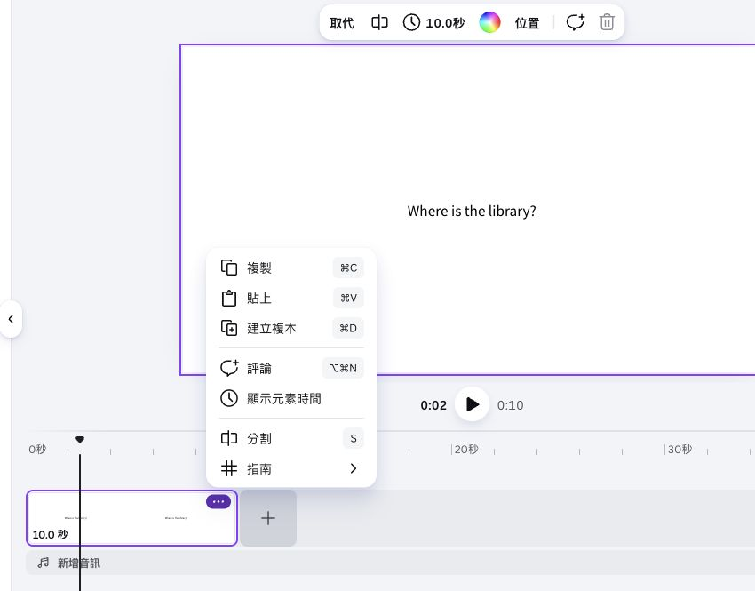
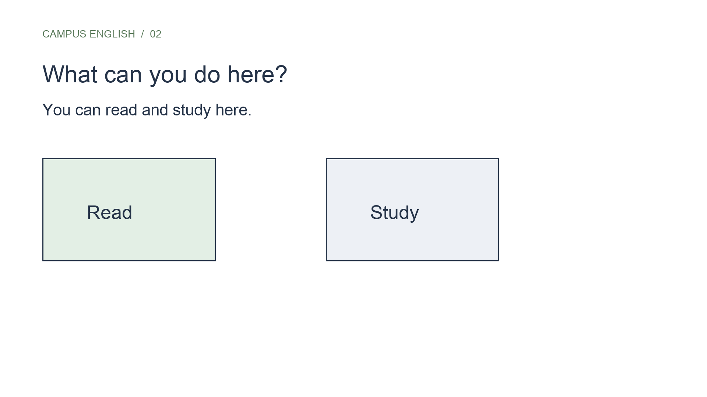

## 內部設計（不進學員頁）

能力進展、成果規格與環境繼承自[正式大綱](../../_outlines/canva-video-teaching.md)。本文為正式講義的學員正文來源，平台操作圖與媒體依[資產規格](../../courses/canva-video-teaching/_design/ASSET-SPEC.md)補齊並實測後發布。

本單元成果：剪接閱讀、自習與提問，分辨三場景與四片段，完成可播放的連續作品。

<!-- learner-content:start -->
# 剪接素材，完成三個教學場景

已完成十秒位置場景。現在加入[閱讀 MP4](../../courses/canva-video-teaching/assets/media/stock-reading.mp4)和[自習 MP4](../../courses/canva-video-teaching/assets/media/stock-study.mp4)，再建立提問。場景表示一個教學重點；活動場景可以由兩個片段組成。這次共有三個場景、四個主片段。

## 對照時間與片段

先用這張表確認四個片段的順序、長度與前景文字，後面的操作都以這組時間為基準。

| 影片區間 | 主畫面 | 長度 | 前景文字 |
|---|---|---:|---|
| 0–10 秒 | 走道＋案例位置圖 | 10 秒 | Where is the library? / It's next to the cafeteria. |
| 10–16 秒 | 閱讀 | 6 秒 | You can read here. |
| 16–22 秒 | 自習 | 6 秒 | You can study here. |
| 22–36 秒 | 走道背景或安靜背景＋提問 | 14 秒 | Your turn；兩個問題與中文指令 |

三個場景表示位置、活動與提問；本片活動含閱讀、自習兩個片段。既有頁面模式的順序是**第 1 頁走道、第 2 頁閱讀、第 3 頁自習、第 4 頁提問**。錄製與字幕都用畫面名稱及實際起點定位，不把「第三個場景」當「第三頁」。

片段加入後的選取與時間控制，見[時間軸與字幕實作](../../courses/canva-video-teaching/resources/時間軸與字幕實作.md)。

## 把閱讀和自習放到後面

沿用上一單元的匯入與裁短方法，把兩個活動片段接在位置場景之後。

1. 在「上傳」加入閱讀與自習檔，確認兩支縮圖都能播放。
2. 新版將閱讀拖到主軌走道片段之後，再將自習拖到閱讀之後。既有頁面將兩支各作一頁背景，頁面順序為走道、閱讀、自習。
3. 各保留原素材約第 2–8 秒，長度都是六秒。使用前頁學過的邊緣裁短；播放確認仍能辨認閱讀和自習的動作。
4. 加入 `You can read here.`，放在閱讀片段的前景；複製文字、修改為 `You can study here.`，放到自習片段。
5. 新版文字在上層軌，先把前句範圍限制到 10–16 秒，後句限制到 16–22 秒。既有頁面各自保留在對應頁，確認前句沒有複製到自習頁。
6. 從第九秒開始播放，應依序看到位置、閱讀、自習。若兩支影片同時出現小視窗，表示放在上層軌；將主要畫面移回主軌。

**判斷方式：** 六秒是練習起始值。並非所有原片的第 2–8 秒都有最好的動作；你可自行選另一段連續六秒，但要說得出畫面如何支持 read 或 study。

## 加上學生提問

活動片段完成後，在影片最後加入提問，讓觀看者使用前面看到的位置與活動資訊作答。

1. 再將走道素材加入主軌末尾，保留十四秒；既有頁面另建一頁背景。也可改成單色背景，讓問題不被動作分散。
2. 加入標題 `Your turn`，下方放 `Where is the library?` 與 `What can you do there?`。
3. 加入「請用兩句英文介紹位置和一項活動。」。文字放在深色矩形上，避免與背景混在一起，底部留給第二場字幕。
4. 新版把提問文字的顯示範圍設定到 22–36 秒；既有頁面確認問題只在最後一頁。不要把 Library 的答案留在提問畫面。
5. 播放這十四秒，讀完題目後試著回答兩句話。若來不及完成，下一單元調整總長。

## 複製、排序與群組的用途

複製文字可保留字型與底色，但新文字也會繼承原來的顯示時間；一定要移到新片段的位置。拖主軌片段可改順序；拖上層標籤只改標籤時間。群組用來一起移動相關物件，不能替你判斷它們應在哪一段出現。

### 自己完成並檢查

最後自行調整第二個活動標籤，再用完整播放核對本單元成果。

1. 找出第二個標籤最適合放置的位置，避免遮住手上的書或筆電。
2. 用時間軸核對四個片段總長為 36 秒。
3. 從頭播放，確認三個教學重點仍為位置、活動、提問。
4. 保存 v1，休息後再調整文字出現方式。

**完成檢查：** 播放時應依序看到走道、閱讀、自習與提問，活動文字只出現在相應片段，最後保留足夠時間回答兩個問題。

## 文字與圖形版補充練習

以下保留原文字版操作，供練習基本排版與既有頁面影片使用。已完成上方實拍主流程者，直接前往下一單元。

展開原文字版操作與對照圖

### 完成三段連續的教學畫面

第一頁已介紹位置。接著加入活動及練習，讓學生看完後能用自己的聲音介紹圖書館。影片中傳達一個重點的一段畫面稱為「場景」；本片用一頁安排一個場景。

### 找到頁面縮圖

編輯器下方依順序排列的畫面與秒數叫「時間軸」。每個小畫面是頁面縮圖；點縮圖可切到該頁。先找到含位置問答的第一頁，再開啟縮圖上的「頁面選項」（三點）。

### 建立活動場景

1. 在時間軸第一頁縮圖上開啟「頁面選項」，選「建立複本」，保留一份相同版面。
2. 將新頁的標題改為 `What can you do here?`。
3. 將回答改為 `You can read and study here.`。
4. 將 Library、Cafeteria 文字分別改成 `Read`、`Study`，刪除 next to 文字，保留兩個矩形。
5. 將物件移到不重疊的位置，檢查英文字尾完整顯示。

現在第一頁介紹位置，第二頁介紹活動。畫面顏色與字體一致，觀看者能把注意力放在新內容。

### 建立練習場景

活動頁完成後，複製它作為提問頁，再刪除不應直接出現的答案。

1. 複製第二頁成為第三頁，點新頁縮圖確認正在改第三頁。
2. 將標題 `What can you do here?` 改為 `Your turn`。
3. 點選回答 `You can read and study here.` 的文字框，按 Delete 刪除整個框。再逐一刪除 Read、Study 文字框與兩個矩形。第三頁先只保留 Your turn 標題。
4. 在「文字 → 新增文字方塊」加入下列兩行問題：

> Where is the library?
> What can you do there?

問題下方加入中文指令：「請用兩句英文介紹位置和一項活動。」這行字提醒學生要做的事。

檢查第三頁沒有留下 `You can read and study here.`、Read 或 Study。第三頁應只看到標題、兩個問題及中文指令。

檢查頁面順序是否為位置、活動、練習。若順序錯置，拖曳頁面縮圖到正確位置，再逐頁查看內容。刪除多出的空白頁，保留三頁。

### 自己整理版面

第三頁的兩個問題由你安排位置，沿用前兩頁的字體與深色文字。將右上角與畫面底部留出空間，第二場會加入講解影像及字幕。

讀完三頁後試答：`The library is next to the cafeteria. I can read there.`。如果問題無法由前兩頁回答，回到第二頁補上相應資訊。

完成這三頁後，先確認專案名稱仍為 `姓名_圖書館_v1`。下一段會設定每頁播放多久。

<!-- learner-content:end -->

### 講師授課筆記（不進講義）

配時：複製及活動場景 10 分、練習場景 10 分、排序與自主排版 7 分、保存 3 分。休息安排在本單元之後 10 分鐘。可加入自有照片的方式留給課後技巧包，不延長此段。

本次強化配時以實拍主流程為準；可展開的文字版操作不列第二次必做。新版入口依官方文件，新增平台路徑尚未完成真人冷讀；既有圖例只證明圖中的頁面編輯器。
