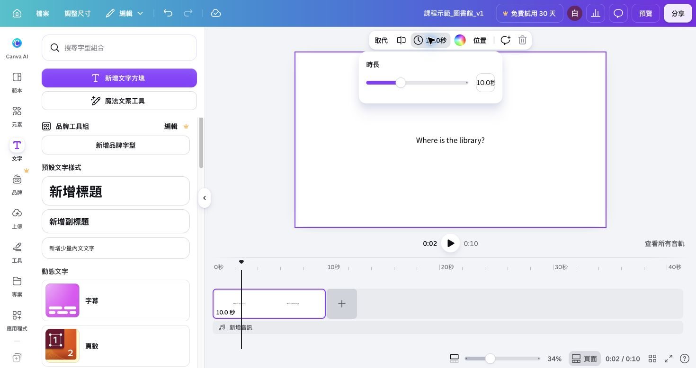

## 內部設計（不進學員頁）

能力進展、成果規格與環境繼承自[正式大綱](../../_outlines/canva-video-teaching.md)。本文為正式講義的學員正文來源，平台操作圖與媒體依[資產規格](../../courses/canva-video-teaching/_design/ASSET-SPEC.md)補齊並實測後發布。

本單元成果：設定影片和文字起訖，套用並評估動畫與轉場，修正播放節奏。

<!-- learner-content:start -->
# 設定時間、動畫與轉場

開啟自己的實拍 v1，確認已完成 10、6、6、14 秒四個主片段。片段總長是 36 秒。接著用 Canva 時間軸讓資訊在需要時出現，再為一個重點加動畫。

## 拖邊緣與拖整段的差別

先分清楚每種拖曳會改變什麼，避免調整文字時誤改主影片長度。

| 動作 | 改變的事情 | 例子 |
|---|---|---|
| 拖文字軌左邊緣 | 開始顯示的時間 | 位置答案延後到第 2 秒 |
| 拖文字軌右邊緣 | 結束顯示的時間 | 位置答案在第 10 秒結束 |
| 拖整個文字軌 | 起點、終點一起移動，長度不變 | 八秒答案由 0–8 改為 2–10 秒 |
| 選「動畫」調速度 | 進場／退場動作的快慢 | 字由淡入變為立即顯示 |
| 拖主影片邊緣 | 保留的素材時間和片段長度 | 十秒走道裁成九秒 |

物件顯示時間與動畫速度要分開設定。把動畫變慢，不會自動替文字留出更多閱讀時間。

## 讓位置答案晚兩秒出現

先用位置答案練習設定起訖，再把同一方法套到自習標籤。

1. 新版在上層軌選取 `It's next to the cafeteria.`，把左邊緣拖到第 2 秒，右邊緣拖到第 10 秒。先保留問題從 0–10 秒顯示。
2. 既有頁面選答案文字，開啟「顯示所有素材音軌」或「更多 → 顯示元素時間」，將文字條設定到該頁第 2–10 秒。沒有時間控制時，確認專案為影片並展開時間軸。
3. 將播放頭停在第 1 秒：只看到問題；停在第 3 秒：答案已出現。從第 9 秒播放至下一個片段：位置答案應結束。
4. 若底色矩形也要隨答案出現，設定相同的 2–10 秒；只改文字而沒改底色會留下空白框。若物件已群組，就先一起設定，再確認文字可讀。

自行把 `You can study here.` 限制在 16–22 秒，並檢查它不會出現在閱讀片段。你應能說明自己拖的是邊緣還是整段。

## 為關鍵文字加動畫

這次只替一個重點加動畫，先確認動畫沒有改變文字原本的顯示時間。

1. 選取 `next to` 或位置圖，點上方「動畫（Animate）」。
2. 在元素／文字的動畫選項預覽一個沒有付費標示的淡入效果，再點選套用。
3. 從第 1 秒開始播放，確認提示在介紹位置時出現。

**卡住時：** 選取文字時會看到文字動畫；選背景或頁面時，選項可能不同。若整個畫面都在移動，先移除動畫，重新選取要強調的文字。若進場太慢而讀不完，選較快的預設或直接移除動畫，保留正確的顯示時間。

延伸技巧：選箭頭 →「動畫 → 建立動畫」，拖箭頭形成短路徑，按完成。播放時箭頭應指向同一個地點；移動途中不要越過錯誤地點。入口不存在時改用靜態箭頭配合定時顯示；主成果不依賴自訂動畫。

## 試一次轉場，再判斷是否保留

轉場控制兩段畫面的接合；元素動畫控制文字或圖形的動作。這次先試一個短轉場，再依播放結果決定是否保留。

1. 先保存目前版本。
2. 新版選主軌閱讀片段的「更多 → 新增轉場」；既有頁面在相鄰頁的接合處找「新增轉場」。只有頁面模式看不到時，切到影片時間軸。
3. 挑選免費的簡單效果，設定較短的時長。
4. 從第 15 秒開始播放，觀察閱讀與自習的交接。
5. 重新讀取全片秒數，檢查活動標籤是否仍對到正確片段。

**判斷方式：** 交接更清楚而且人物、文字沒有被遮住時可以保留；效果妨礙閱讀時移除轉場，改回直接剪接。

## 片長改了，後面的文字也要重排

這段練習用副本測試：主片段變長後，後面的文字是否仍在正確時間。

1. 把位置片段由十秒延長到十二秒，其餘長度維持 6、6、14 秒。
2. 重新讀取時間軸，結果應為位置 0–12、閱讀 12–18、自習 18–24、提問 24–38 秒。
3. 新版檢查主軌移動後，上層軌是否跟著移動；沒跟著移動時，把閱讀、自習、提問的文字與底板整段向右移兩秒。既有頁面保留文字在對應頁，重新檢查頁內起訖。
4. 將位置答案維持從第 2 秒出現，終點改為第 12 秒。若使用轉場，以時間軸實際顯示的接點為準。
5. 在第 11、13、19、25 秒各停一次，依序核對位置、閱讀、自習、提問。
6. 將結果記入[時間對照 CSV](../../courses/canva-video-teaching/downloads/片段與聲音時間表.csv)，第二場錄音會從這份實際時間開始。

**卡住時：** 若第 11 秒已出現 read，代表標籤還在舊時間。將閱讀文字及底板移到新起點，再從第 9 秒播放。[重排聲音與字幕的完整例子](../../courses/canva-video-teaching/resources/時間軸與字幕實作.md)可用來核對。

先依示範調整閱讀標籤，再自行調整自習與提問，並說明「保留長度」與「移動起點」各改了什麼。最後可保留 38 秒版，或復原到原 36 秒，兩者都可接第二場。

## 用完整播放確認成果

時間、動畫與轉場都設定後，從頭播放一次，確認這些效果沒有破壞原本資訊。

1. 從第零秒完整播放。
2. 用一段話說出位置，再讀出閱讀、自習兩句，最後試答。
3. 確認作品包含會動的實拍畫面、至少一個正確設定起訖的標籤，以及一個有理由的動畫選擇。
4. 讀取總長，確認維持 30–45 秒；本課對照為 36 秒。

**完成檢查：** 文字在相應片段出現，動畫不妨礙閱讀，場景交接後仍能依序理解位置、活動與提問。

**卡住時：** 如果背景素材結束後出現黑畫面，增加可用素材、重選較長片段，或縮短該場景；不能只把文字條拉長。提問需停留更久時，可改用單色背景。[功能與技巧頁](../../courses/canva-video-teaching/resources/Canva功能與技巧.md)另有速度、循環與素材替換的用法。

平台入口與新舊差異依[功能查找表](../../courses/canva-video-teaching/resources/Canva功能與技巧.md)選擇；[實拍版對照](../../courses/canva-video-teaching/assets/media/footage-v1.mp4)顯示素材與文字的時間關係。

## 文字與圖形版補充練習

以下保留原文字版操作，供練習基本排版與既有頁面影片使用。已完成上方實拍主流程者，直接前往下一單元。

展開原文字版操作與對照圖

### 設定播放時間與閱讀節奏

三頁畫面已準備好，現在要決定各段停留多久。時間太短時，觀眾來不及讀完；你可以一邊朗讀、一邊播放，找出需要延長的位置。

時間軸依先後排列畫面與聲音。播放頭是標示目前播放位置的直線，拖曳播放頭可以回到指定時間。

### 先做一支 36 秒影片

先用 10、12、14 秒建立可朗讀的三頁版本，再依實際閱讀速度微調。

| 場景 | 設定長度 | 本段要完成的事 |
|---|---:|---|
| 位置 | 10 秒 | 讀完問題、答案與位置圖 |
| 活動 | 12 秒 | 讀出例句並看懂兩個活動 |
| 練習 | 14 秒 | 讀題並留出作答時間 |

1. 在下方時間軸點選第一頁的畫面縮圖。先點文字框外的空白處，再點頁面縮圖，避免只改到一個文字物件。
2. 點上方工具列的秒數按鈕，開啟「時長」，在數字欄位輸入 10，按 Enter。第一頁下方應顯示 10.0 秒。
3. 依序點第二、第三頁縮圖，用相同方法設為 12 秒與 14 秒。
4. 把播放頭移回開頭，按播放，觀察畫面是否依序切換。
5. 從第一頁開始讀出所有英文。若話還沒讀完就換頁，暫停並延長該頁。
6. 第三頁讀完題目後，用兩句英文試答。需要更長停頓時，增加第三頁時間。

範例計算為 10 + 12 + 14 = 36 秒。個人作品可以依閱讀速度調整，總長維持 30–45 秒。

### 處理播放問題

如果改完後全片明顯變長，逐頁查看長度，確認只有預定場景被修改。如果畫面只停在一頁，先查看你啟動的是單頁預覽還是整支影片播放，回到完整時間軸再播放。

本例用直接換頁呈現順序。想提醒觀眾注意位置時，先用框線或顏色標示 next to，再播放確認提示與閱讀時間相容。

自行找出最需要調整的一頁，改一次時間，再從前一頁開始播放。你應能說出理由，例如「第三頁多留四秒，讓學生說完兩句話」。

改完時間後，再逐頁播放，確認文字在需要時完整顯示。若文字提早消失，選取該文字，展開時間軸的「顯示所有素材音軌」，將文字音軌的結束邊緣拉到該頁結尾。

<!-- learner-content:end -->

### 講師授課筆記（不進講義）

配時：時間軸概念 5 分、三頁時間 10 分、朗讀預覽 10 分、自主修正 5 分。2026-10-11 以三頁 PPTX 匯入後轉為影片，實測選取背景頁後在時長欄輸入 10、12、14 秒，總長 36 秒。截圖已提供，其他編輯器與學員帳號另需確認。保留直接換頁為主路徑。

本次強化配時以實拍主流程為準；可展開的文字版操作不列第二次必做。新版入口依官方文件，新增平台路徑尚未完成真人冷讀；既有圖例只證明圖中的頁面編輯器。
