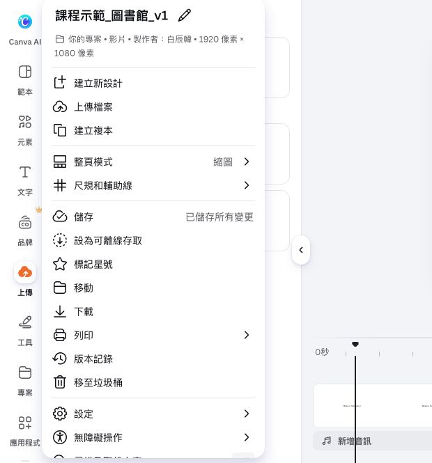

## 內部設計（不進學員頁）

能力進展、成果規格與環境繼承自[正式大綱](../../_outlines/canva-video-teaching.md)。本文為正式講義的學員正文來源，平台操作圖與媒體依[資產規格](../../courses/canva-video-teaching/_design/ASSET-SPEC.md)補齊並實測後發布。

本單元成果：在副本中替換活動影片，重新裁切並同步調整文字、場景起點與總長。

<!-- learner-content:start -->
# 換素材，沿用製作方法

現在保留原 v1，練習把既有作品轉成另一個主題版本。本頁用「圖書館自習介紹」示範：原影片同時介紹 read 與 study，新條件改為只介紹 study，活動場景只保留一段十秒實拍。核心任務是同步修改素材、文字、構圖與時間；你也可以使用具備同等素材的中文或其他學科主題完成。

## 建立副本並替換活動

先保留原版，再在副本中替換素材、文字與時間，避免失去可比較的起點。

1. 從「檔案 → 建立複本」建立 `姓名_圖書館自習_v1`，確認名稱和專案網址都已改變。
2. 使用[自習原片](../../courses/canva-video-teaching/assets/media/stock-study.mp4)，自行選一段連續十秒，替換原本閱讀六秒和自習六秒的活動區間。新版可刪除原活動主軌片段，再在走道之後加入新片；既有頁面刪除兩個活動頁，加入一個自習頁。
3. 活動文字改成 `You can study here.`。不要留下 `read` 或閱讀片段的文字軌；重新裁切，讓筆電／書本與標籤都清楚。
4. 這次自習版將位置設定為十秒、提問維持十四秒；若上一單元保留了十二秒位置，先調回十秒並重查答案終點。總長預計 10 + 10 + 14 = 34 秒。提問原本從第 22 秒開始，現在應移到第 20 秒；新版要檢查提問文字軌是否也跟著移動。
5. 完整播放並獨立修正一處，例如舊答案仍跨到活動片段、素材比十秒短、或文字擋住書本。把問題和修法記在專案紀錄。

**完成檢查：** 自習版應只保留 study 的影像與文字，提問由第 20 秒開始，全片約 34 秒，而且沒有沿用原版的 read 內容。

## 用結果驗收替換

完成替換後，依下列四項逐一核對，不以檔名改變當作完成。

| 檢查 | 通過狀態 | 失敗時回到哪裡 |
|---|---|---|
| 活動影像 | 自習動作可辨，與 study 一致 | 重新選段或調整裁切 |
| 活動文字 | 只有 study，沒有 read | 查看複製留下的文字／上層軌 |
| 時間 | 三個主片段約 34 秒，提問由 20 秒開始 | 修正片段長度與提問軌位置 |
| 題材一致性 | 觀眾看到的素材、文字與提問互相對應 | 核對示範腳本或自己的教材內容 |

**用途：** 最後選原圖書館版或自習版作為第二場起點。使用自習版時，講解也要刪除 read，不能套用原本的 read and study 旁白。

下方保留電腦教室作另一個示範。需要其他主題影片時，可在 Canva 元素的影片分類搜尋合適關鍵字，或按[網路素材取得流程](../../courses/canva-video-teaching/resources/免費素材.md)下載；選素材前先確認畫面能表現要說的內容。

## 選做：將同一套工具用於概念比較

自習版練的是替換素材與重算時間。若要看英語教材如何改變版面與資訊出現順序，可選做[概念比較完整案例](../../courses/canva-video-teaching/resources/案例與腳本.md)：它用 next to 與 across from 的兩張關係圖，先示範，再讓學生判斷新圖；圖形保留、答案延後、字幕不提前洩題。這是題材示例，不是完成本單元的必要條件。

本單元先選一個變化，說明它如何影響裁切、圖層或顯示時間；完整有聲版可於課後完成。不要只將 library 改成另一個名詞。

## 文字與圖形版補充練習

以下保留原文字版操作，供練習基本排版與既有頁面影片使用。已完成上方實拍主流程者，直接前往下一單元。

展開原文字版操作與對照圖

### 換一份教材，沿用製作方法

你已完成圖書館的三場景影片。現在用[電腦教室案例](../../courses/canva-video-teaching/resources/案例與腳本.md)練習替換教材：電腦教室在圖書館對面，學生可以使用電腦與練習打字。

### 保存原作品

在 Canva 的「檔案」選單選「建立複本」，把新設計命名為 `姓名_電腦教室_v1`。檢查名稱已改好，再修改內容。原本的圖書館影片仍可從首頁開啟。

### 依新內容調整

請自己完成以下修改，版面位置由你判斷：

- 第一頁改為電腦教室的位置，兩個方框呈現相對的位置，加入 `across from`。
- 第二頁介紹使用電腦與練習打字，將原本的 Read、Study 改成對應標籤。
- 第三頁改成詢問電腦教室位置及活動，保留讓觀眾用兩句英文回答的指令。
- 播放一次，檢查較長的 computer room 和 practise typing 是否需要拉寬文字框、換行或增加時間。

你可以在案例包找到完整例句。先依自己選擇排版，再用例句核對內容。

### 用觀眾的回答檢查

看完後應能回答：`The computer room is across from the library. I can practise typing there.`。

若畫面仍出現 Library 與 Cafeteria 並排，回到第一頁修改關係圖；若聲稱能閱讀但素材介紹打字，回到第二頁統一活動文字。時間修正後，再完整播放一次。

選定圖書館或電腦教室其中一支作為第二場續作。保留選定專案的網址，下一段會將它下載成影片。

<!-- learner-content:end -->

### 講師授課筆記（不進講義）

配時：複製作品 3 分、獨立修改 12 分、核對內容與時間 7 分、選定續作 3 分。新條件同時涉及較長文字、地點關係及活動語句，具有轉移判斷。跟不上者保留圖書館作為續作，在本單元至少獨立修改一個活動句。

本次強化配時以實拍主流程為準；可展開的文字版操作不列第二次必做。新版入口依官方文件，新增平台路徑尚未完成真人冷讀；既有圖例只證明圖中的頁面編輯器。
