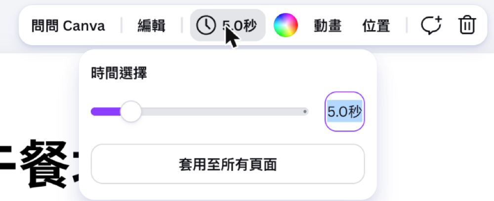

## 內部設計（不進學員頁）

依[正式大綱](../../_outlines/canva-video-teaching.md) v8 與 改寫規格書（內部紀錄，`courses/canva-video-teaching/_local/v8-2026-11-02/`，不進 repo） 重寫。v7（三場景 36 秒教學短片）的正文與講師筆記見 git 歷史。

<!-- learner-content:start -->
# 不講話也能做：簡報直接下載成輪播影片
成果展、公告看板，讓簡報自己換頁
本節完成物：一支沒有聲音、會依設定秒數自動換頁的簡報 MP4。

## 這一頁要做什麼

你手上有一份成果展、單字快閃或公告簡報，想讓它在螢幕上自己播放。這和錄報告不同：輪播影片沒有聲音，Canva 會依每頁設定的秒數自動換頁。

你不用開麥克風，也不用邊講邊翻頁；把每頁留到主要文字讀得完，再直接下載成 MP4 就能播放。

整個流程是：① 打開簡報 → ② 設定每頁秒數 → ③ 下載並播放。

做完會得到一支可用於成果展或公告看板的輪播影片，大約需要 10 分鐘。

## 第 1 步：打開簡報

先開啟要輪播的簡報並看過頁面順序，後面才能依每頁內容安排停留時間。

1. 下載[用來製作輪播影片的示範簡報](../../courses/canva-video-teaching/downloads/示範簡報_校園午餐垃圾觀察.pptx)。
2. 回到 Canva 首頁，按左上「建立」→ 左側「上傳」→「上傳檔案」選取簡報，再按右下「已上傳 1 個項目」那一列的開啟圖示。
3. 等匯入完成後開啟設計，從第一頁翻到第六頁。

做對了，你會依序看到標題、問題、做法、發現、建議與謝謝聆聽六頁內容。

使用自己的簡報時，直接從 Canva 首頁開啟它，後面的秒數設定與下載方法相同。

## 第 2 步：設定每頁秒數

替每頁留下足夠閱讀時間，觀眾才能在畫面自動切換前讀完主要內容。

1. 點下方第一頁的縮圖，上方工具列會出現時鐘和秒數（預設「5.0秒」），點它。
2. 輸入該頁要停留的秒數，完成後再換下一頁。
3. 按「展示簡報」旁的下拉箭頭 →「自動播放」，從第一頁看一輪；文字讀不完就增加秒數，停得太久就縮短。

做對了，你會看到六頁依序自動切換，資料較多的第四頁也留有足夠時間讀完三組數字。

每頁可依內容使用不同秒數，判斷標準是主要文字是否讀得完。

## 第 3 步：下載並播放

把簡報下載成 MP4，再用成片確認自動換頁與無聲播放都符合用途。

1. 按右上「分享」→「下載」，在「檔案類型」選「MP4 影片」。
2. 畫質維持預設，按「下載」。
3. 用電腦播放器從第一頁看到第六頁。

做對了，你會得到一支自動從標題播到謝謝聆聽的 MP4；第四頁有時間讀完「塑膠餐具 196 件」「飲料杯 121 件」與紙類、廚餘的數字。

下載選單沒有 MP4 或改畫質出現付費提示時，請看[卡住時](../../courses/canva-video-teaching/resources/卡住時.md)，並維持預設畫質。

## 換你用：做成果展、單字快閃或公告

成果展可讓每頁呈現一組作品，單字快閃可讓每頁放一個詞，公告可讓每頁放一件事。設定各頁秒數後下載 MP4，再從頭播放確認文字都有時間讀完。

## 熟練後只看這三行

1. 開啟示範簡報或自己的簡報，逐頁查看要讓觀眾閱讀的內容。
2. 點頁面縮圖，從上方工具列的時鐘「5.0秒」替每頁輸入秒數；要全部一樣就按「套用至所有頁面」。
3. 按「分享」→「下載」，選「MP4 影片」，再用電腦播放器確認自動換頁。

輪播影片沒有聲音，靠每頁停留秒數帶觀眾讀完內容。

下一頁會改用 Canva 影片範本，讓現成版面接住活動照片與短片。[卡住時](../../courses/canva-video-teaching/resources/卡住時.md)｜[列印這條流程](../../courses/canva-video-teaching/resources/老師流程卡.md)

<!-- learner-content:end -->
