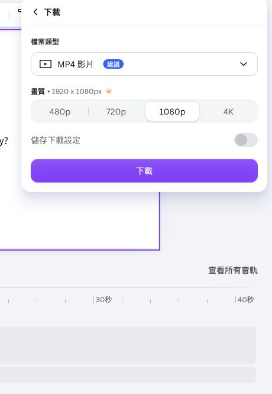

## 內部設計（不進學員頁）

能力進展、成果規格與環境繼承自[正式大綱](../../_outlines/canva-video-teaching.md)。本文為正式講義的學員正文來源，平台操作圖與媒體依[資產規格](../../courses/canva-video-teaching/_design/ASSET-SPEC.md)補齊並實測後發布。

本單元成果：匯出可播放的 v1 MP4，保存專案網址並能重新開啟。

<!-- learner-content:start -->
# 下載畫面版，留好下次的入口
把可播放的影片和可修改的專案分開保存
本節完成物：一個已用電腦播放器檢查的畫面版 MP4，以及一筆能重新開啟 Canva 設計的專案網址。

## 回到要接續製作的畫面版

你現在多了一份電腦教室練習複本，但第二場要接的是原來的圖書館畫面版。回到 Canva 首頁，從「專案」搜尋並開啟 `姓名_圖書館_畫面版`。從第 0 秒播放到第 36 秒，確認走道、閱讀、自習與提問依序出現，答案在第 2 秒才出現，活動文字也各自停留在自己的片段。

這次下載前的檢查集中在能否完整播放：影片填滿畫面，文字與位置圖可讀，背景沒有提早結束，片尾停在第 36 秒。確認目前開啟的是畫面版後，接著把 Canva 設計製作成可以用一般播放器開啟的影片檔。

## 下載成 MP4，再從頭播放

畫面版已確認可完整播放，接著開啟右上角「分享」，選「下載」。在檔案類型選「MP4 影片」，再按「下載」。Canva 完成製作後，瀏覽器會把影片存到電腦的下載位置。

用電腦播放器開啟剛下載的 MP4，從頭看到片尾。第 0–10 秒是位置，第 10–16 秒是閱讀，第 16–22 秒是自習，第 22–36 秒是提問；第 36 秒正常結束，而且畫面沒有缺字或黑畫面，就表示可播放檔已經保存成功。

再把播放器分別停在第 1、3、11、17、23 秒。第 1 秒只有位置問題，第 3 秒多了答案，第 11 秒是閱讀，第 17 秒是自習，第 23 秒已進入提問。這組停點能快速確認下載檔保留了 Canva 裡設定的元素時間與四段順序。

如果下載時出現付費素材提示，回到設計中選取帶有付費標示的素材，換成沒有皇冠的圖庫項目後再下載。播放器中的結果確認完成後，還要另外保存 Canva 設計入口，因為 MP4 和可編輯專案是兩種不同成果。

## 把設計網址存進專案紀錄

MP4 已能離開 Canva 獨立播放，接著[下載專案紀錄](../../courses/canva-video-teaching/downloads/專案紀錄.txt)，用電腦上的文字編輯器開啟。回到 Canva 編輯器，選取瀏覽器網址列並複製完整網址，再貼到專案紀錄中畫面版的欄位，儲存文字檔。

MP4 把目前看得到的影片、文字與圖形合成一個播放檔，適合交付與觀看。Canva 設計網址則會帶你回到仍可分別選取文字、影片與圖形的專案，適合下一次繼續修改。兩者放在同一個課程資料夾，就能分清楚哪一個用來播放，哪一個用來續作。

| 保存內容 | 打開後能做什麼 | 這次怎麼確認 |
|---|---|---|
| 畫面版 MP4 | 用一般播放器觀看完整影片 | 從頭播放，並停在五個時間點核對畫面 |
| Canva 設計網址 | 回到時間軸，分別修改影片、文字與圖形 | 從首頁重新開啟，再選取不同物件 |

網址存好後，接著實際用一次，確認它不是一筆無法回到作品的紀錄。

## 從首頁搜尋並重新開啟

專案紀錄已經保存網址，接著回到 Canva 首頁。在「專案」搜尋剛才的畫面版名稱並重新開啟。點一下主軌影片，再點一下上方文字；兩個物件都能各自亮起並顯示對應工具列，就表示回到的是可編輯設計。

接著可以關閉編輯器分頁，保留下載的 MP4 與專案紀錄。MP4 已通過播放器檢查，設計網址也已保存並用首頁搜尋驗證，第一場的畫面版到這裡完整收好。

第二場會從這份可編輯的畫面版建立複本，做成有聲字幕版。畫面與 36 秒時間軸會原樣帶過去，再加入英文 AI 語音、自己錄的中文講解、配樂與字幕。

<!-- learner-content:end -->

## 講師授課筆記（不進講義）

配時：下載 5 分、播放及修復 5 分、保存連結與重新開啟 5 分。下載等待與個別補救已含於本段。第一場無必做課間作業。當堂未完成者第二場使用依 ASSET-SPEC 製作的三場景起始檔；該媒體未製作前為交接缺口。

本次強化配時以實拍主流程為準；可展開的文字版操作不列第二次必做。新版入口依官方文件，新增平台路徑尚未完成真人冷讀；既有圖例只證明圖中的頁面編輯器。

### 2026-11-01 改寫紀錄（不進講義）

依 `courses/canva-video-teaching/_review/2026-11-01/改寫規格書.md` 重寫：補足 Canva 影音功能、每頁一條成功路徑、前後頁承接。上方講師筆記的配時與平台說明以改寫前內容為準，現行配時見正式大綱。驗收：PM 腳本檢查與事實抽查；新功能尚未在授課帳號實跑。
