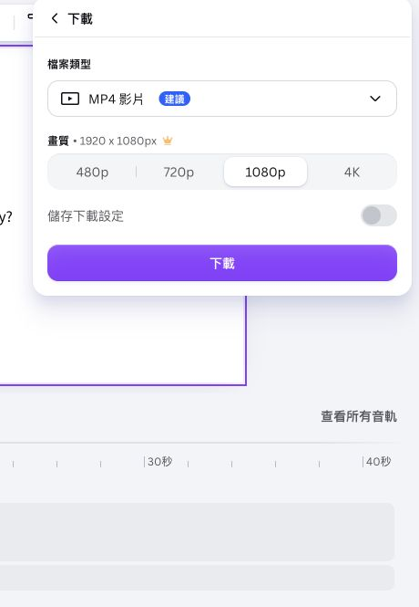

## 內部設計（不進學員頁）

能力進展、成果規格與環境繼承自[正式大綱](../../_outlines/canva-video-teaching.md)。本文為正式講義的學員正文來源，平台操作圖與媒體依[資產規格](../../courses/canva-video-teaching/_design/ASSET-SPEC.md)補齊並實測後發布。

本單元成果：匯出可播放的 v1 MP4，保存專案網址並能重新開啟。

<!-- learner-content:start -->
# 下載影片並保存續作入口

選定要繼續製作的影片後，把它下載到自己的電腦。「匯出」會把 Canva 設計製作成檔案，本課使用的影片格式叫 MP4。

## 下載與播放

先把目前設計匯出成可獨立播放的 MP4，再檢查下載結果。

1. 在專案開啟「分享」，選「下載」。
2. 檔案類型選「MP4 影片」，確認包含三個場景，開始下載。
3. 下載完成後，在瀏覽器的下載清單開啟檔案；也可到電腦的「下載」資料夾找最新影片。
4. 將檔名改為 `姓名_圖書館_v1.mp4`。使用電腦教室題材時，把地點名稱一併更換。
5. 從頭播放，確認三個場景順序正確、文字完整、片長為 36 秒。

**完成檢查：** 下載的 MP4 能從頭播放，三個場景順序正確、文字完整，片長為 36 秒。第一場以畫面與播放節奏為完成項目；第二場會從同一份標準作品建立 v2。

## 保存可編輯專案

MP4 不能保留可分別修改的物件，因此還要把 Canva 編輯網址寫進專案紀錄。

1. [下載專案紀錄.txt](../../courses/canva-video-teaching/downloads/專案紀錄.txt)，在電腦的下載資料夾找到它。Windows 用「記事本」開啟；Mac 用「文字編輯」開啟。
2. 回到目前的 Canva 編輯器，按 Ctrl+L（Mac 為 Command+L）選取瀏覽器網址列，複製整個網址。
3. 回文字檔，把網址貼在「v1 專案網址：」後方，填入主題、v1 檔名與想改善的一處。「v2 專案網址」留待第二場填入。
4. 按 Ctrl+S（Mac 為 Command+S）儲存，將檔案與 MP4 放入同一個課程資料夾。需要另存或更改檔名時，依[操作與檔案技術卡](../../courses/canva-video-teaching/resources/操作與檔案技術卡.md)辦理。

**完成檢查：** 在新的瀏覽器分頁貼上這個網址。登入原帳號後仍能編輯，表示第二場可以從這裡接續。專案網址與 MP4 一起放進容易找到的資料夾。

**卡住時：** 如果下載出現付費素材提示，返回該頁，把標示付費的素材換成自己的文字、圖形或已確認免費的素材，再下載。若檔案無法播放，查看下載是否完成，回 Canva 重新匯出。

下次打開專案時，先保留 v1，再建立用來加聲音與字幕的 v2。

## 匯出前檢查影片素材

這次 v1 應含可辨識的走道、閱讀／自習動作，標籤在相應片段出現，背景沒有提早結束。MP4 會合成所有可見影像與文字；重新上傳 MP4 後，原本的標籤與字幕不能再各自修改，所以必須保存 Canva 設計網址。要做第二場時，從設計網址接續，避免把已匯出的參考 MP4 當成可編輯專案。

保存目前[片段與聲音時間表](../../courses/canva-video-teaching/downloads/片段與聲音時間表.csv)，確認走道、閱讀、自習、提問的起點仍為 0、10、16、22 秒。34／38 秒實驗副本留作課後比較，不接入第二場。

<!-- learner-content:end -->

## 講師授課筆記（不進講義）

配時：下載 5 分、播放及修復 5 分、保存連結與重新開啟 5 分。下載等待與個別補救已含於本段。第一場無必做課間作業。當堂未完成者第二場使用依 ASSET-SPEC 製作的三場景起始檔；該媒體未製作前為交接缺口。

本次強化配時以實拍主流程為準；可展開的文字版操作不列第二次必做。新版入口依官方文件，新增平台路徑尚未完成真人冷讀；既有圖例只證明圖中的頁面編輯器。
