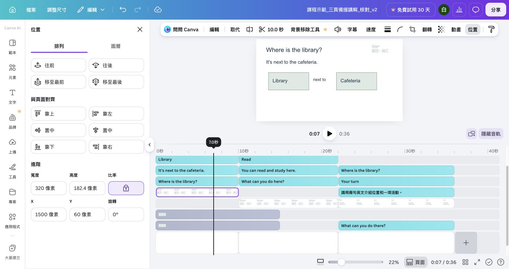

## 內部設計（不進學員頁）

能力進展、成果規格與環境繼承自[正式大綱](../../_outlines/canva-video-teaching.md)。本文為正式講義的學員正文來源，平台操作圖與媒體依[資產規格](../../courses/canva-video-teaching/_design/ASSET-SPEC.md)補齊並實測後發布。

本單元成果：錄製並對齊三個場景的講解，選擇真人或 AI 旁白，控制素材原音。

<!-- learner-content:start -->
# 分段錄下你的教學講解

在自己剛建立的 v2 加入講解。旁白是配合畫面播放的說明聲音。本段使用 Canva 攝影機錄製，把你的影像和聲音一起放在對應場景右上方。準備有麥克風、攝影機的筆電及耳機，開啟[講解稿](../../courses/canva-video-teaching/resources/案例與腳本.md)。

## 先選聲音製作方式

本單元先完成「這是聲音測試」與一段自己的錄製，練習 Canva 的錄製與回聽。其餘講解可繼續真人錄製，或在設備、入鏡條件不合適時使用 AI 語音。兩種方式都接同一套音訊對齊、音量和字幕操作。

1. 開啟[配音與聲音製作](../../courses/canva-video-teaching/resources/配音與聲音製作.md)，比較子晴、彥廷同稿短樣。
2. 先完成本頁的真人聲音測試與一段自己的錄製。
3. 其餘場景選擇繼續真人錄製，或在設備、入鏡條件不合適時使用 AI 語音。
4. 使用 AI 時，由「元素 → 音訊 → 產生 AI 語音」進入；中文選台灣中文，英文選英文（美國），各生成一句並回聽。
5. 確認時間軸出現獨立音訊條，再繼續後面的對齊操作。

**判斷方式：** 付費聲線不是本課前提。無論使用真人或 AI，都必須能回聽、對齊畫面並在後續建立字幕。完整分段、重疊聲音修復及外部工具選擇在資源頁。

## 將講解放到正確的場景

先開啟自己的[片段與聲音時間表](../../courses/canva-video-teaching/downloads/片段與聲音時間表.csv)，按目前作品讀取起點。原 36 秒版為走道 0、閱讀 10、自習 16、提問 22 秒；延長位置兩秒的 38 秒版為 0、12、18、24 秒；自習轉用版為位置 0、自習 10、提問 20 秒。這些是對照值，錄音採你的實際時間。

| 要錄的畫面 | 原 36 秒版 | 頁面式四片段版本 | 定位方式 |
|---|---:|---|---|
| 走道與位置圖 | 0 秒 | 第 1 頁 | 點走道縮圖，移到本段開頭 |
| 閱讀 | 10 秒 | 第 2 頁 | 點閱讀縮圖，移到本段開頭 |
| 自習 | 16 秒 | 第 3 頁 | 點自習縮圖，移到本段開頭 |
| 提問 | 22 秒 | 第 4 頁 | 點最後的提問縮圖，移到本段開頭 |

新版以主片段名稱與起點定位。頁面式先看縮圖內容再確認頁序；自習轉用版只有三頁，提問是最後一頁。[實際軌道對照](../../courses/canva-video-teaching/resources/時間軸與字幕實作.md)可協助辨認背景、講師影像和旁白。

錄製完的講師影片加入**上層軌**，拖到對應起點，再縮小放右上角。主軌的實拍背景保留；講師影像放上層才會形成畫中畫。選這個錄影片段調整起訖，讓它在本場景內結束。若錄影被放成新的全畫面主片段，將它移到上層軌；若手上的物件是單獨音訊，就放音訊軌並對齊它所講解的片段起點；完整 36 秒 WAV 才從零秒開始。從該句前一秒回聽，確認沒有接到上一段。

這組實拍練習檔已移除原音。使用其他網路素材時，先選背景影片，把「音量」設為 0，再回聽，避免片中音樂或談話與自己的聲音重疊。保留講師錄影的音量；不要誤把錄音也靜音。

沒有可用攝影機時，可錄純聲音；帳號沒有錄音入口或設備不許錄製時，可先上傳[36 秒 Canva 新版講解 WAV](../../courses/canva-video-teaching/assets/media/reference-narration.wav)到音訊軌，從第零秒開始配合原圖書館版。這只練習音訊匯入和對齊，自己的錄製能力仍需另補做。自習轉用版需自行錄製修改過的稿。

## 錄一句話檢查聲音

1. 點走道位置片段縮圖；新版把播放頭拖到位置場景開頭。開啟左側「上傳（Uploads）→ 錄製自己（Record yourself）→ 錄製半身說話影片」。
2. 在錄製畫面選攝影機與麥克風；瀏覽器詢問裝置權限時允許存取，確認能看到自己的影像。
3. 按「錄製（Record）」，說「這是聲音測試」，再按「完成（Done）」。
4. 在結果預覽按播放，戴耳機回聽。確認完整聽到這六個字，再按「儲存並退出（Save and exit）」回到設計。
5. 測試錄影會保存到「上傳」並加入目前頁面。點選頁面上的測試錄影，按 Delete 移除。保留原本問答、位置圖和頁面。

**卡住時：** 沒有聲音時，回錄製畫面檢查麥克風選項，再錄一次測試。若瀏覽器顯示未允許使用麥克風，點網址列旁的網站設定，允許後重新開啟錄製入口。音量過大而破裂時，稍微遠離麥克風再試。確認測試通過，再錄教材。

## 按畫面分段錄下教材

圖書館三場景講解如下，實拍活動分成閱讀與自習兩段；完成自習轉用版者，活動句改為 You can study here；選其他題材者使用自己的稿：

| 對應畫面 | 要說的內容 |
|---|---|
| 位置 | Where is the library? It's next to the cafeteria. 圖書館在餐廳旁邊。 |
| 閱讀 | You can read here. 你可以在這裡閱讀。 |
| 自習 | You can study here. 你可以在這裡自習。 |
| 練習 | 請用兩句英文介紹圖書館的位置和一項活動。現在換你說。 |

1. 選走道位置片段，把播放頭移到本段起點，重新進入錄製入口，錄位置句。說完按「完成」，回聽後按「儲存並退出」。
2. 回頁面後點錄影外框，拖曳四角縮小，移到右上方預留空間。播放確認問題、答案和圖形仍看得清楚。
3. 選閱讀片段，移到它的實際起點，只錄 read 的英文與中文；再選自習片段，只錄 study 的英文與中文。最後選提問片段錄指令。頁面式原圖書館版依序為第 2、3、4 頁；自習轉用版略過閱讀，提問在最後一頁。每次存回設計後先回聽，確認只在目前畫面出現。
4. 說錯時只重錄該段。新錄影確認能用後，點舊錄影外框，按 Delete 移除；播放該頁，確認只聽到一份講解。

**完成檢查：** 每一段講解只在相應畫面出現，文字與位置圖仍可讀，而且沒有新舊錄影同時播放。

Canva 會把錄影保存在「上傳」。[錄製功能說明](https://www.canva.com/help/recording-videos/)

## 暫時無法錄製時接著練習

完整原圖書館實拍版優先使用上方 36 秒 WAV，或[配音資源](../../courses/canva-video-teaching/resources/配音與聲音製作.md)的九個分句 WAV。下列三段 MP4 是**舊三頁圖形版**，只在該版或獨立剪輯練習使用；它的活動句合併 read and study，不能直接依三頁步驟放進四頁實拍版。

展開舊三頁版備援匯入步驟

1. 依序下載[位置練習片段](../../courses/canva-video-teaching/assets/media/practice-clip-1.mp4)、[活動練習片段](../../courses/canva-video-teaching/assets/media/practice-clip-2.mp4)、[提問練習片段](../../courses/canva-video-teaching/assets/media/practice-clip-3.mp4)。
2. 在「上傳 → 上傳檔案」選取下載的 MP4，等到「影片」分頁出現縮圖。
3. 點第一頁縮圖，將播放頭移到該頁開始，再把位置片段的上傳縮圖拖到目前畫面的右上方，放開後確認它是有外框的影片物件。用四角縮小，放右上方；第二、第三頁同樣先把播放頭移到頁面開始，再拖入相應片段。直接點上傳縮圖可能新增一頁；若頁數增加或影片變成背景，立即復原，重新拖入畫面。保留原來三頁及可移動的影片物件。

   
4. 每頁若已有無聲或失敗的錄影，先選到舊錄影物件再刪除。播放整片，確認每段各有一份聲音，文字可讀。

展開「顯示所有素材音軌」，檢查各影片條起點對齊相應頁面。36 秒範例的位置片段為 0–10 秒、活動為 10–22 秒、練習為 22–36 秒。若拖入時從頁面中間開始，將整條影片移到該頁起點，再播放前後兩頁，確認沒有兩段同時說話。

這組片段保留舊合成語音與既定切點，供接續剪輯與字幕練習；新版配音品質比較請用上方資源頁的短樣。將「自己的講解待補錄」記入專案紀錄；設備恢復後，回「按畫面分段錄下教材」替換片段，並重新檢查字幕。

下一頁會裁掉錄影頭尾等待，並練習移除中間停頓。使用真人錄影或獨立音訊時，字幕的選取對象不同；[兩條字幕路徑](../../courses/canva-video-teaching/resources/時間軸與字幕實作.md)會接到同一份 MP4 交付。

<!-- learner-content:end -->

## 講師授課筆記（不進講義）

配時仍為 25 分：讀稿與錄音測試 5 分、首段自己的錄製 7 分、其餘場景真人錄製或 AI 分段 8 分、回聽替換 5 分。先示範同稿短樣的語言／聲線選擇，AI 不另加第二輪必做。無設備時使用 WAV 繼續，但錄製能力記待補做。主路徑為 Web Chrome／Safari 攝影機錄製，避免桌面螢幕錄製版本差異。須使用學員帳號實測。若不便入鏡，課前另驗收裝置錄音匯入路徑並製作對應卡，不在正文杜撰關閉鏡頭入口。錄製失敗可用備援講解片段續做剪輯，但記錄錄製能力待完成。

本次強化配時以實拍主流程為準；可展開的文字版操作不列第二次必做。新版入口依官方文件，新增平台路徑尚未完成真人冷讀；既有圖例只證明圖中的頁面編輯器。
