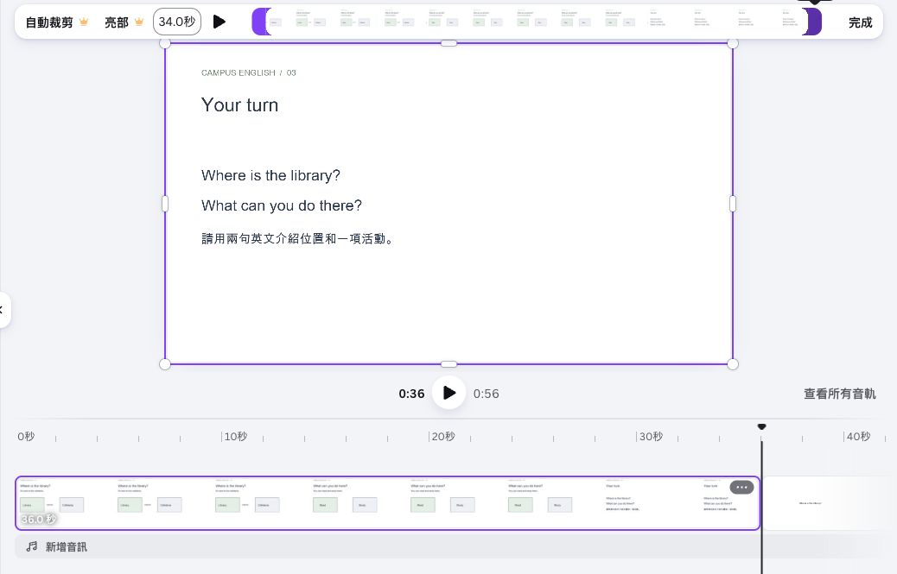
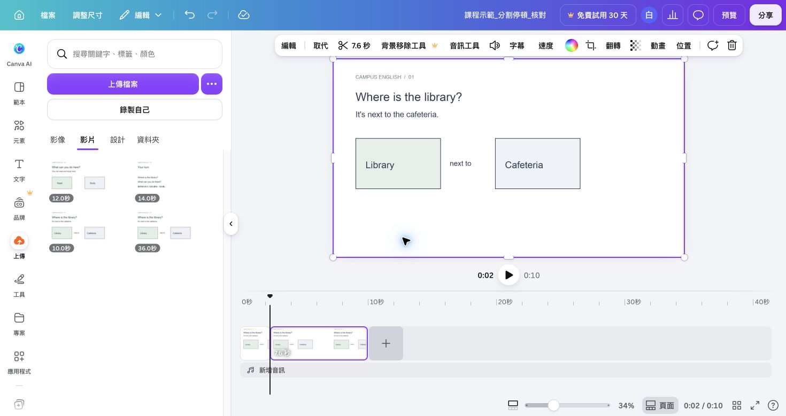

## 內部設計（不進學員頁）

能力進展、成果規格與環境繼承自[正式大綱](../../_outlines/canva-video-teaching.md)。本文為正式講義的學員正文來源，平台操作圖與媒體依[資產規格](../../courses/canva-video-teaching/_design/ASSET-SPEC.md)補齊並實測後發布。

本單元成果：裁短與分割錄影片段，移除停頓，調整原音、旁白與配樂並回聽。

<!-- learner-content:start -->
# 剪掉多餘片段，對齊聲音與畫面

你的三個場景已有講解錄影。錄製開始和結束時常有等待，現在把等待裁掉，再檢查畫面切換是否配合說話。

「裁短」用來移除片頭或片尾；「分割」會在選定時間將片段切開，讓你處理中間的一小段。

## 新版多軌：裁短與分割的選取對象

新版在時間軸直接拖講師錄影／旁白片段的邊緣裁短，選取片段後把播放頭放到切點，開啟「更多 → 分割」或按 S。分割後應看到同一軌上兩個片段。只刪要移除的片段；主畫面、字幕與旁白在不同軌，不能假設它們會同時分割。下方十秒練習使用問題句約 2.3 秒結束、後句約 4.3 秒開始的聲音，新版也可按這兩個位置分割，刪中段，再把後段移到前段後方，得到約八秒。

如果刪掉上層錄影中間段後仍有兩秒空白，那是上層軌保留的間隔。將後段往左接合；若因此與主畫面的活動起點不符，重新移動錄影並播放接合處。主軌和上層軌的接合效果可能不同，以自己的完整播放確認。

## 先修好接句，再加配樂

播放第 10 秒閱讀與第 16 秒自習：英文和中文各在對應畫面內說完，下一句不搶話。AI 生成的句長與自己的錄音都會改變，請依實際字音裁短；下方十秒片段的 2.3／4.3 秒只屬於舊分割練習。新版旁白的分句檔、接句範例和聲音修復可查[配音與聲音製作](../../courses/canva-video-teaching/resources/配音與聲音製作.md)。

先關配樂，從每句前一秒回聽。開頭子音或句尾被切掉就放寬切點；重疊出聲就檢查舊錄影和音訊副本。兩種語言之間先保留約半秒，再按聽懂的程度調整。結尾提問說完保留作答時間，與剪掉意外等待分別判斷。

## 練習原音、旁白和配樂的平衡

先保存無配樂版本，再加入練習配樂比較音量，避免直接覆蓋可用的旁白成果。

1. 先保存沒有配樂的版本，再下載[本課自製 36 秒配樂 WAV](../../courses/canva-video-teaching/assets/media/practice-music.wav)，從「上傳」加入。
2. 新版拖到音訊軌，從零秒開始；既有頁面加入音訊後確認覆蓋全片。配樂不是背景影片，應看到單獨音訊條。
3. 選配樂條的音量，先試 10%；自己的講解先維持 100%。這是練習起始值，並非所有錄音通用標準。播放一段英文，調到每個詞都聽得清楚。
4. 選音訊條查看音訊效果／淡入淡出，入口可用時設定短淡入與淡出，再回聽首尾。本次生成音訊條也顯示「減弱」入口，先在副本預覽並回聽；沒有此控制時，先保留低音量、裁掉不需要的頭尾。
5. 暫時把配樂調到 100%，回聽它如何搶過旁白，再調回合適音量。如果提高旁白只讓聲音破裂，重新錄製，或直接移除配樂。

**完成檢查：** 實拍原音不搶話、旁白完整、配樂不遮英文，且下載後仍維持這個結果。常用的音量與音訊條操作可查[功能技巧頁](../../courses/canva-video-teaching/resources/Canva功能與技巧.md)。

下方剪刀、頁面選項與截圖示範既有頁面編輯器；新版依前述片段邊緣與更多選單操作，練習切點相同。

## 裁掉頭尾等待

先從第一段錄影練習裁短，確認字音完整後再處理其他片段。

1. 選取第一頁的錄影片段，按上方工具列剪刀圖示旁的秒數，開啟裁剪控制。
2. 播放並找到第一個字開始的位置，將起點拖到說話前，保留一點呼吸空間。
3. 找到最後一句結束的位置，將終點移到語句結束後。
4. 播放裁剪結果，確認開頭與結尾的字都完整，再按「完成」。其他兩段依相同方式處理。

假設一段錄影長 12 秒，前面 2 秒在等待、後面 1 秒已說完，保留中間 9 秒就是這次裁短的結果。實際切點以回聽為準。

## 在練習專案移除中間停頓

先保存目前自己的 v2。接下來使用另一份 `姓名_剪輯練習` 專案，練習移除句子之間的停頓。

1. [下載位置練習片段](../../courses/canva-video-teaching/assets/media/practice-clip-1.mp4)。回 Canva 首頁建立空白橫式影片，命名為 `姓名_剪輯練習`。
2. 在「上傳 → 上傳檔案」選這個 MP4。等影片縮圖出現，點縮圖加入影片；這次要讓影片成為獨立的一頁。若仍留有原來的空白五秒頁，開啟該空白頁的「頁面選項 → 刪除」，只保留含位置練習片段的十秒頁。
3. 播放確認前面是問題句，後面是位置句及中文。第一句約在 2.3 秒結束，第二句約在 4.3 秒開始。請回聽兩句之間的停頓。
4. 點這段影片所在的頁面縮圖，將播放頭移到整片約 2.3 秒處。在工具列按「分割」，此時時間軸會變成前後兩頁。
5. 把播放頭移到整片約 4.3 秒，再分割一次。現在應有前段、停頓、後段三頁。
6. 點中間約兩秒的停頓頁，回聽確認沒有語句，開啟「頁面選項 → 刪除」。保留前段約 2.3 秒、後段約 5.7 秒，共兩頁、約八秒。
7. 從接合處前一秒開始播放，確認問題句與位置句的字音完整；切到字音時按復原，重新選切點。

| 練習狀態 | 頁數 | 總長 |
|---|---:|---:|
| 原位置片段 | 1 | 約 10 秒 |
| 切開停頓的兩端 | 3 | 約 10 秒 |
| 刪掉中間停頓 | 2 | 約 8 秒 |

[播放八秒分割結果](../../courses/canva-video-teaching/assets/media/split-practice-result.mp4)，對照問題句與位置句是否完整。這兩頁都在介紹位置，合起來仍是一個場景。將練習結果下載為 `姓名_剪輯練習.mp4`，回到紀錄檔中的 v2 編輯網址，確認開啟的是自己的三場景作品，再繼續下方檢查。

頁面縮圖與畫面內的小錄影物件各有自己的時間。此練習選影片所在頁的縮圖分割；選到右上方小錄影時，分割可能只切影片物件。先確認選取對象及分割後頁數，避免刪到其他內容。自己的講解中間說錯時，可回前一頁重錄該段，再裁短頭尾；日後使用整頁錄影片段時，可沿用這次的分割方法。[Canva 裁剪與分割說明](https://www.canva.com/features/video-trimmer/)

## 對齊三個場景

剪輯完成後，把整支影片從頭播放，依序核對畫面、講解與音量。

1. 從開頭播放整支影片。介紹位置時應保留位置圖；說到活動時，畫面應出現 Read、Study。
2. 若講解還沒結束就換場景，延長該場景；原片不足時接補充畫面或縮短講解。
3. 若前後兩段同時出聲，檢查並移除重複的錄影或音訊。
4. 選取三段錄影，先設定為相同音量再依序播放；某段明顯太大時，降低該段後重新回聽。
5. 保存專案，保留這一版聲音供下一單元建立字幕。

**卡住時：** 音量調高仍聽不清楚時，回前一頁重錄並維持相同麥克風距離。自己的錄影已含聲音，加入音樂前先確認語句清楚可辨。

**完成檢查：** 每段聲音與相應畫面一致，沒有重疊講解，音量可辨。後續若重新剪輯，字幕時間也要重新檢查。

## 修改後重新記錄起點

只裁上層錄影或音訊的空白，不一定改背景片長；改主畫面、速度或轉場時，則重新讀取後續片段起點並核對文字、聲音。[38 秒時間重排例子](../../courses/canva-video-teaching/resources/時間軸與字幕實作.md)接續這個檢查。

<!-- learner-content:end -->

## 講師授課筆記（不進講義）

配時：裁短示範及練習 10 分、分割 10 分、聲畫及音量 10 分、保存 5 分。本單元結束休息 10 分鐘。2026-10-11 實測：背景頁與浮動影片物件的分割不同；練習改採獨立十秒整頁影片，在 2.333 與 4.333 秒分割後刪除中段，結果兩頁八秒。自己的 v2 只做頭尾裁短、重錄及聲畫配合。練習後確認回到自己的 v2，避免字幕套到練習專案。

本次強化配時以實拍主流程為準；可展開的文字版操作不列第二次必做。新版入口依官方文件，新增平台路徑尚未完成真人冷讀；既有圖例只證明圖中的頁面編輯器。
