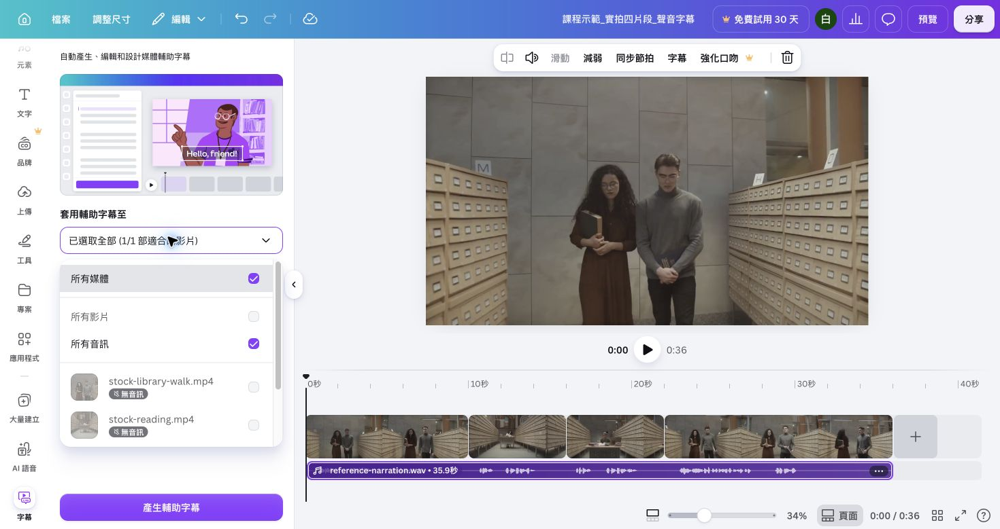
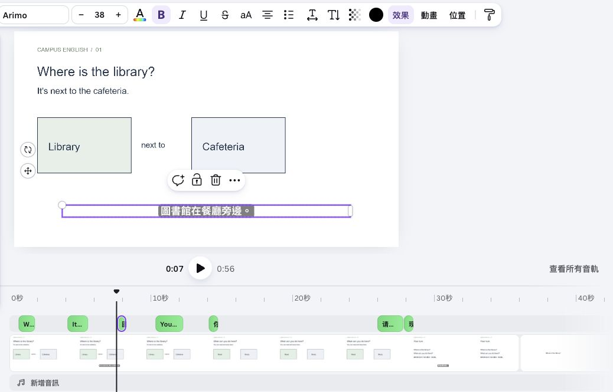

## 內部設計（不進學員頁）

能力進展、成果規格與環境繼承自[正式大綱](../../_outlines/canva-video-teaching.md)。本文為正式講義的學員正文來源，平台操作圖與媒體依[資產規格](../../courses/canva-video-teaching/_design/ASSET-SPEC.md)補齊並實測後發布。

本單元成果：在有聲影片中建立字幕，校正內容及位置，保存無字幕母片與字幕版本。

<!-- learner-content:start -->
# 加上字幕並校正內容

先在自己的 36 秒 v2 從頭回聽一次，確認四個旁白群組與配樂已完成。這一節會在同一支作品產生、校訂並檢查字幕，不切換到另一個練習專案。

## 先分清楚兩種字幕

「觀看／無障礙字幕」由觀看者在 Canva 播放時開啟，目前不會跟著下載到 MP4。本課要使用可編輯字幕，或用上層文字手動補句，讓下載後的成片仍看得到字幕。[Canva 可編輯字幕說明](https://www.canva.com/help/generate-edit-captions-on-videos/)提供現行入口；[有聲字幕版對照](../../courses/canva-video-teaching/assets/media/footage-v2.mp4)可用電腦播放器檢查成片結果。

## 先保存沒有字幕的母片

先留下可回復的有聲版本，再開始產生字幕。

1. 開啟「分享 → 下載」，選「MP4 影片」。
2. 下載全部 36 秒，命名為 `姓名_圖書館_母片.mp4`。
3. 用電腦播放器從頭播放，確認位置、閱讀、自習與提問的聲音都完整。

母片保留目前的畫面與聲音。之後字幕需要重做時，可以回到這個版本核對，不必重新錄音。

## 對準真正有聲的物件產生字幕

字幕要跟著實際旁白，不要讓配樂或無聲素材成為辨識來源。

1. 在時間軸點一下第一段旁白音訊。看到音訊條亮起後，從工具列開啟「字幕（Captions）」；若側邊欄有「文字 → 動態文字 → 字幕」，也可由該處進入。
2. 在套用清單中選擇實際含旁白的音訊。真人旁白、AI Voice 或上傳 WAV 都要選音訊本身，不要只選無聲的主軌影片。
3. 按「產生字幕」，等句子出現在畫布與字幕清單，再播放位置段。
4. 依序將其餘旁白加入字幕來源；已處理的音訊不要重複選。

清單沒有顯示獨立音訊時，先確認音訊已上傳完成並直接選中。仍無法產生，可在 v2 依講解稿建立手動字幕；不要只開啟觀看字幕就繼續。[時間軸與字幕實作](../../courses/canva-video-teaching/resources/時間軸與字幕實作.md)保留實測的音訊選取與匯出畫面。

## 在主作品完成一次文字校訂

先修一個真實辨識結果，再逐句檢查同類問題。

1. 選取畫面上的字幕，開啟字幕句子清單。
2. 找到一個實際需要修正的辨識結果。若系統全部辨識正確，可把 `cafeteria` 暫時改成 `coffee area`，播放看見錯誤後再改回 `cafeteria`。
3. 中文逐字核對繁體字、標點與教材意思；例如把「图书馆在餐厅旁边」改成「圖書館在餐廳旁邊」。
4. 回聽該句，確認修改後文字與聲音一致。

這次校訂發生在標準 v2，因此成品與操作證據留在同一支作品中。

## 在主作品補一個漏句或調整起訖

先播放整支 v2，找一個字幕太早、太晚或沒有出現的句子。若自動字幕都正確，可選位置段中文句做一次手動重建。

1. 聽出句子開始與結束時間，記下播放頭讀值。
2. 自動字幕可編輯起訖時，拖句子左右邊緣對齊聲音；不能直接調整時，刪除該句並新增上層文字。
3. 手動字幕輸入正確句子，放在底部預留區。拖文字條左端到句子開始、右端到句子結束；深色底板使用相同起訖。
4. 把播放頭停在字幕開始前、顯示中、結束後，各看一次。開始前不應出現，說話時可讀，結束後應消失。

實拍背景有明暗變化；至少檢查最亮與最暗的一幀。字幕遮到題目時，先移到預留底部區域，或上移教材例句；畫面複雜時加深色底板。

## 下載後再驗一次

編輯器內看起來正確還不夠，最後要用下載檔確認交付結果。

1. 從頭播放，逐句回聽字幕與旁白。
2. 確認閱讀與自習字幕只出現在自己的片段，沒有與下一句重疊。
3. 下載一次 MP4，命名為 `姓名_圖書館_v2_字幕檢查.mp4`。
4. 用電腦播放器查看同一句的開始前、顯示中與結束後，確認字幕確實存在於下載檔。

如果重錄或重新分割旁白，字幕時間可能失效。先完成聲音剪輯，再回本頁重做受影響的句子。

## 需要重練手動補句時

可使用[十秒補句示例](../../courses/canva-video-teaching/assets/media/manual-caption-example.mp4)與[位置片段](../../courses/canva-video-teaching/assets/media/practice-clip-1.mp4)，練習讓中文句約在 6.3–8.8 秒出現。這份素材只供補做；下一單元仍使用已完成字幕的標準 v2。

需要獨立 SRT 時，再使用[WhisperDesktop 課後練習](../../courses/canva-video-teaching/EXT1.html)。

<!-- learner-content:end -->

## 講師授課筆記（不進講義）

修復：手動補句已在 Canva 設定 6.291666 秒起、2.5 秒長，下載十秒 MP4 並檢查第七秒中文。已新增步驟、字幕時間與剪後時間差。

本次強化配時以實拍主流程為準；可展開的文字版操作不列第二次必做。新版入口依官方文件，新增平台路徑尚未完成真人冷讀；既有圖例只證明圖中的頁面編輯器。
