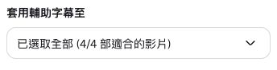
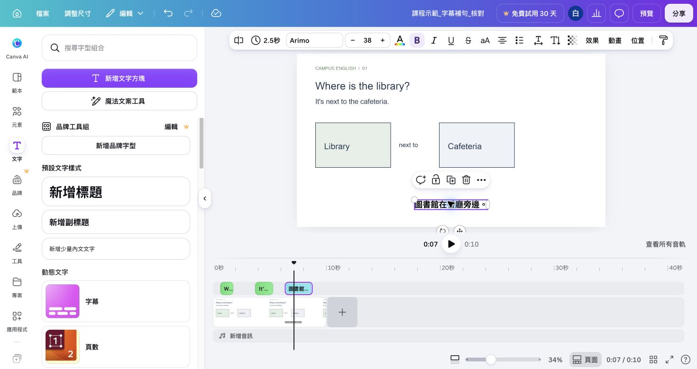

## 內部設計（不進學員頁）

能力進展、成果規格與環境繼承自[正式大綱](../../_outlines/canva-video-teaching.md)。本文為正式講義的學員正文來源，平台操作圖與媒體依[資產規格](../../courses/canva-video-teaching/_design/ASSET-SPEC.md)補齊並實測後發布。

本單元成果：在有聲影片中建立字幕，校正內容及位置，保存無字幕母片與字幕版本。

<!-- learner-content:start -->
# 加上字幕並校正內容

先回到自己的三場景 v2，完整播放確認各場景都有講解。接著加入跟隨說話出現的字幕。

## 分辨字幕的兩種結果

「觀看／無障礙字幕」可能只在 Canva 播放時由觀看者開啟；這次需要的是下載到 MP4 仍能看到的字幕。不要只看編輯器中的字幕開關就認定完成。可編輯的生成字幕入口若在你的帳號可用，依下方產生與校訂；若沒有，就用手動文字起訖完成。本課[實拍字幕版成果對照](../../courses/canva-video-teaching/assets/media/footage-v2.mp4)可直接用電腦播放器查看，字幕已在畫面裡。

新版手動補句選上層文字軌，拖左邊緣到句子開始、右邊緣到句子結束。下方的「時長」數字入口適用於既有頁面編輯器；新版沒有此按鈕時，不必切回簡報，直接用時間軸邊緣設定。字幕與其深色底板要有相同起訖；已剪掉停頓時，以目前聲音為準。

背景是實拍時，字幕更容易遇到亮暗變化；每句至少檢查最亮和最暗的一幀，放在底部預留區，避免蓋住教材例句。完成後下載一次 MP4，分別查看字幕開始前、顯示中與結束後。

## 配音換版後，字幕跟著重做

本課新版實拍旁白將活動拆成「You can read here.」與「You can study here.」，搭配各自中文，共九句字幕；[新版配音 SRT](../../courses/canva-video-teaching/assets/media/footage-corrected.srt)記錄目前的起訖。舊 `library-corrected.srt` 及下方 6.3–8.8 秒補句示例仍供原十秒練習使用，不能直接套在新版聲音上。

自己的作品換聲線、重錄、接句或延長場景後，先保存新母片，再重新生成受影響片段的字幕，或按新聲音調文字起訖。至少核對閱讀、自習兩句各在對應畫面出現，沒有與下一句重疊。

## 保存字幕前的母片

母片保留目前的畫面與聲音，日後可以重新製作字幕。

1. 開啟「分享 → 下載」，檔案類型選「MP4 影片」。
2. 選取所有頁面，下載為 `姓名_主題_母片.mp4`。
3. 用電腦播放器從頭播放，確認每個場景的聲音完整。
4. 保存母片，再回 Canva 製作字幕。

**完成檢查：** 母片能獨立播放，而且包含目前版本的完整畫面與聲音。

## 產生並修訂字幕

先選真正含講解聲音的物件，再產生字幕並逐句校正。

1. 開啟「文字（Text）」，找到「動態文字（Dynamic text）→ 字幕（Captions）」。若側邊欄已有「字幕」，也可由該入口進入。
2. **真人有聲錄影：**在「套用輔助字幕至」選取需要字幕的有聲影片；曾分割的前後段都納入。**AI／上傳旁白：**先在時間軸選獨立音訊條，從工具列「字幕」進入，依實際面板選取該音訊；不要只勾無聲實拍背景。展開清單核對旁白檔名；收合標籤可能仍稱「適合的影片」，實測展開後有「所有音訊」。清單沒有旁白時才改用下方母片路徑或手動文字字幕。已生成字幕的素材不重複選。
3. 按「產生輔助字幕」，等字幕出現，再播放同一段。
4. 選取畫面上的字幕，在上方工具列按「字幕」開啟句子清單。找到錯字，按該句旁的「編輯說明文字」，修改後點欄位外，再回聽這一句。

### 面板沒有列出獨立音訊時

先依上方步驟匯出包含目前聲音的母片 MP4。建立另一個影片設計 `姓名_主題_字幕交付`，上傳母片、加入主畫面，移除多餘空白頁，確認聲音完整後選這支有聲影片生成字幕。此副本可以修改字幕，但已合成的原文字與影片不能各自拆開；原 v2 編輯網址保留用於修改素材。修改 v2 後，重匯母片並更新字幕副本。

若這條路徑仍沒有生成入口，就用手動字幕；先完成一句的起訖及下載檢查，再完成其餘句子。[音訊字幕的實測圖與逐步操作](../../courses/canva-video-teaching/resources/時間軸與字幕實作.md)說明選取狀態、句子清單與匯出結果。

例如錄音說 `It's next to the cafeteria.`，字幕卻寫 coffee area，將這兩個詞改成 cafeteria。中文「图书馆在餐厅旁边」改為「圖書館在餐廳旁邊」。修改時以實際錄音確認意思、繁體字、英文大小寫與標點。[Canva 自動字幕說明](https://www.canva.com/features/auto-caption/)

## 補上自動辨識漏掉的一句

先[播放十秒補句示例](../../courses/canva-video-teaching/assets/media/manual-caption-example.mp4)，注意約 6.3–8.8 秒的「圖書館在餐廳旁邊。」。本練習使用未剪輯的[位置片段](../../courses/canva-video-teaching/assets/media/practice-clip-1.mp4)。回 Canva 首頁建立另一份空白橫式影片，命名為 `姓名_字幕練習`。上傳後點片段縮圖，刪除原來的空白五秒頁，只保留含片段的十秒頁；練習後再回自己的 v2。

| 練習影片時間 | 應看到的狀態 |
|---|---|
| 5 秒 | 尚未出現這句中文 |
| 7 秒 | 顯示「圖書館在餐廳旁邊。」並聽到相應聲音 |
| 9 秒 | 這句中文已結束 |

1. 選這段影片所在頁，在「文字 → 新增文字方塊」輸入 `圖書館在餐廳旁邊。`。放在底部空白區，先用 38 的字級及深色字，確認縮小預覽時可讀。
2. 點選新文字框外框，再按時間軸右側的「顯示所有素材音軌」。每個物件會有一條表示顯示時間的橫條；找到標示這句中文的文字條。
3. 拖動這條文字的左邊緣到約 6.3 秒。文字條只會從左邊緣之後顯示；可把播放頭停在附近，依旁邊時間讀數微調。
4. 保持選取文字，點上方「秒數，編輯時長」，在「時長」欄輸入 `2.5`，按 Enter。開始約 6.3 秒，加上 2.5 秒，結束約 8.8 秒。避免選到頁面背景，頁面長度應仍為 10 秒。
5. 將播放頭依序停在 5、7、9 秒，核對表格；再從 6 秒開始回聽。太早出現就將整條往右移，話還沒說完就消失則增加文字時長。

回自己的 v2，先聽出漏句的起訖時間，再用同一方法補句。在前一頁的剪輯練習中移除中間兩秒後，這句會提早到約 4.3–6.8 秒。自己的錄音速度也會改變時間，以目前剪好的聲音為準。

## 自動字幕無法使用時

依講解稿，每一句建立一個文字框，用上述方法設定顯示範圍。先完成三個場景最重要的句子，再補齊其他講解。每句的結束時間不超過下一句開始，播放時確認字幕沒有重疊。

字幕遮到題目時，將字幕移到預留底部區域，或上移原本例句。淺色背景可用深色字；畫面色彩複雜時，在字後方加矩形底色。縮小整頁預覽，確認最後一行和標點仍完整。

## 重新播放整片

字幕完成後，從編輯器與下載檔各檢查一次，避免只在 Canva 畫面中看見字幕。

1. 從頭播放，逐句回聽字幕與聲音。
2. 確認每段講解都有字幕，而且字幕出現時間與聲音一致。
3. 檢查字幕沒有遮住教材例句、人物或提問。
4. 下載一次 MP4，分別查看字幕開始前、顯示中與結束後。

**卡住時：** 字幕完成後若重錄或剪輯，回本頁重新核對受影響片段。下一單元會請觀眾看完並檢查能否回答問題。

需要獨立 SRT 檔時，使用[WhisperDesktop 課後練習](EXT1.md)。SRT 會另外保存每句字幕的文字與時間。

<!-- learner-content:end -->

## 講師授課筆記（不進講義）

修復：手動補句已在 Canva 設定 6.291666 秒起、2.5 秒長，下載十秒 MP4 並檢查第七秒中文。已新增步驟、字幕時間與剪後時間差。

本次強化配時以實拍主流程為準；可展開的文字版操作不列第二次必做。新版入口依官方文件，新增平台路徑尚未完成真人冷讀；既有圖例只證明圖中的頁面編輯器。
