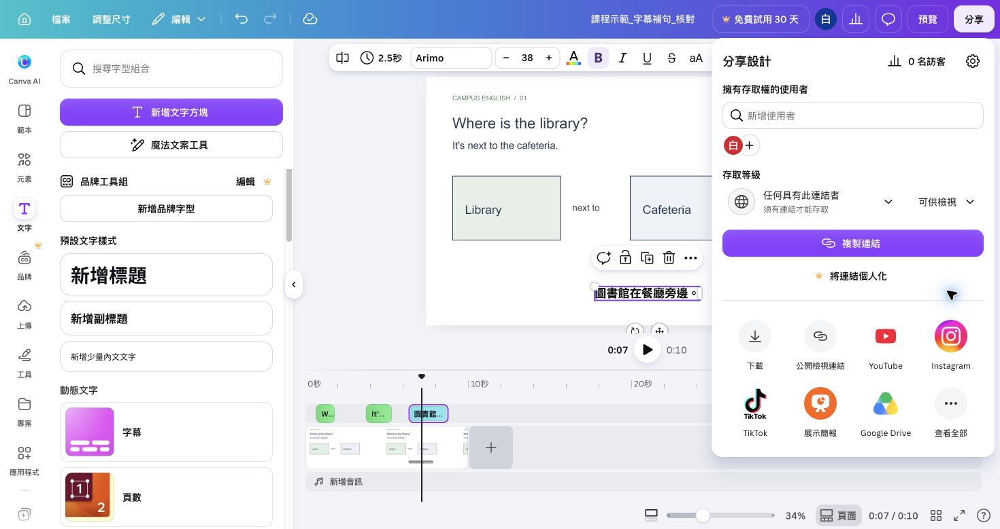

## 內部設計（不進學員頁）

能力進展、成果規格與環境繼承自[正式大綱](../../_outlines/canva-video-teaching.md)。本文為正式講義的學員正文來源，平台操作圖與媒體依[資產規格](../../courses/canva-video-teaching/_design/ASSET-SPEC.md)補齊並實測後發布。

本單元成果：下載可播放的 v2，設定接收者可檢視的連結，保存後續修改所需資料。

<!-- learner-content:start -->
# 交付作品與課後製作資源

開啟修正好的 v2，先下載成能直接播放的影片，再保存觀看連結與可編輯專案。

## 下載完成影片

先下載最終影片並獨立播放，確認交付檔不是只有時間軸中的單一片段。

1. 開啟「分享 → 下載」，檔案類型選「MP4 影片」，確認下載範圍是完整 36 秒作品，而非單一片段。
2. 下載完成後，把檔案命名為 `姓名_主題_v2.mp4`。從頭播放，確認片長為 36 秒，而且畫面、旁白和字幕都在檔案中。
3. 若只下載到一段，回下載面板重新選完整作品；影片無法播放時，確認下載已完成再重新開啟。

**完成檢查：** `姓名_主題_v2.mp4` 能從頭播放，片長為 36 秒，畫面、旁白與字幕都在下載檔中。

## 建立供觀看的連結

本練習使用虛構校園素材，讓收到連結的人觀看：

1. 回到 v2，按右上角「分享」。
2. 在「存取等級」下方開啟選單，選「任何具有此連結者」。
3. 開啟旁邊的「連結分享權限」，選「可供檢視」。若目前顯示「可供編輯」，先改成「可供檢視」。
4. 等「複製連結」可按，點它，把網址貼入專案紀錄的「分享檢視網址：」欄並儲存。
5. 請同伴在自己的瀏覽器開啟，確認可看到作品、能播放且有字幕。同伴遇到要求存取時，回「分享」重新檢查存取等級。

**完成檢查：** 獨自練習時，先把連結貼入新分頁，確認進入觀看畫面。這次只能完成自己的開啟檢查；紀錄「接收者測試待完成」，交付前再請實際接收者測試。學校限定觀看對象時，依校內提供的分享方式設定並請指定對象開啟確認。[Canva 分享說明](https://www.canva.com/help/share-via-link-or-email/)

## 保存下次要用的材料

交付完成後，把可播放檔、可編輯網址與重建素材收在同一處。

1. 開啟專案紀錄，核對 v1 編輯網址、v2 編輯網址與分享檢視網址都在相應欄位。
2. 將 v1 MP4、母片 MP4、v2 MP4、腳本、素材來源及紀錄放進同一資料夾。
3. 開啟[課後資源入口](../../courses/canva-video-teaching/resources/課後資源入口.md)，下載文字工作包、影音練習包與離線講義。
4. 帶學生使用時，附上[三頁起始檔](../../courses/canva-video-teaching/resources/三頁起始檔.md)與自己的任務單，讓每組在自己的帳號匯入並改名。
5. 先用一個學生帳號確認能修改文字、下載 MP4，再交給全班使用。

**用途：** 下次修改時從 v2 編輯網址開啟，先建立複本再換教材。需要維護舊頁面式作品時查[舊專案相容處理](../../courses/canva-video-teaching/resources/舊專案相容處理.md)；需要檔案保存或上傳步驟時查操作與檔案技術卡。

## 帶回可重用的影片製作方式

保存原素材、素材來源、Canva 可編輯網址、無字幕母片與字幕影片。下次改教材時，先在副本中替換主影片，再調裁切、文字時間和聲音；若重剪影片，重新檢查字幕。需要查模板替換、速度、自訂動畫、直式影片與付費工具時，開啟 [Canva 功能與技巧](../../courses/canva-video-teaching/resources/Canva功能與技巧.md)。

保存目前時間表與個人操作紀錄。若字幕另在母片副本生成，專案紀錄同時保存「v2 原素材編輯網址」及「字幕交付副本網址」；下一次換素材先改 v2，再匯母片更新字幕。

## 課後完成一次新題材遷移驗收

這項作業不占本課 5 小時配時。從標準 v2 建立副本，命名 `姓名_新題材_v2_轉用`，完成一支仍為 36 秒、但內容已真正換題材的影片：

1. 更換至少一支主影片，並把地點、活動或教學主題改成新內容；不能只換標題。
2. 同步修正畫面文字與提問，逐段核對 0、10、16、22 秒的內容關係。若保留原時間配置，仍須確認新句子能在各段內說完。
3. 重新錄製或生成受影響的旁白，移除所有不再符合新題材的舊聲音。
4. 依新旁白重新生成或校訂字幕，至少檢查一個起訖與一個文字內容。
5. 匯出 `姓名_新題材_v2_轉用.mp4`，從頭播放；再保存可編輯網址與一行修改說明。

**完成檢查：** MP4 可完整播放 36 秒；新素材、文字、旁白與字幕互相一致；作品中沒有殘留舊題材的地點、活動、提問或聲音。繳交 MP4、可編輯網址與修改說明，作為完整轉用證據。

<!-- learner-content:end -->

## 講師授課筆記（不進講義）

配時：下載及重播 6 分、接收者測試 4 分、資源入口與保存 5 分。不得以作者帳號可見推定學生可見。檢視連結測試與範本複製分開記錄；不用公開編輯權限測試。學生帳號無法用範本時採空白建立流程。新題材完整遷移為課後驗收，不壓縮本單元 15 分鐘；收件時核對 MP4、可編輯網址與修改說明三項。

本次強化配時以實拍主流程為準；可展開的文字版操作不列第二次必做。新版入口依官方文件，新增平台路徑尚未完成真人冷讀；既有圖例只證明圖中的頁面編輯器。
