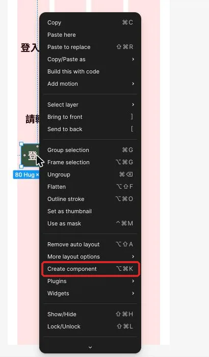
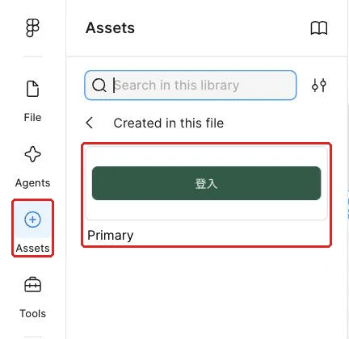
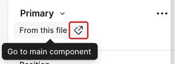
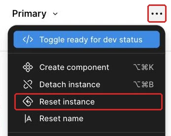

## 內部設計（不進學員頁）

本課新增能力：驗證主元件同步、個別Override及錯誤修復，讓來源與使用處關係可觀察。依 `_design/COURSE-BLUEPRINT.md` 的同檔案整合路徑；保留 99h 行政配置，未以真人試跑鎖定分鐘。

| 活動 | 素材／產物 | 操作與決策 | 認知工作／支援 |
|---|---|---|---|
| Demo | 正文提供的完整輸入／方法示範 | 講師建模本課首次方法與可見結果 | 完整理由及步驟 |
| Together | 同一工作室任務清單／學員自己的完成物 | 正文「跟著做」需自行選層、設定與判斷 | 支援遞減，自己定位欄位、解釋檢查結果 |
| Solo | 本課不同條件／修正後完成物 | 正文「自己完成」依新限制選擇方法 | 獨立診斷與遷移，依完成條件判斷 |

素材：正式正文的可複製資料、每課 START-HERE、完成檢查表、共用視覺參考，B7 有 PSD，B8 有下載 ZIP。素材存在／版本由驗證紀錄確認，不以本段自填 PASS。

<!-- learner-content:start -->
# 改一次來源，讓多個按鈕一起更新
副標：工作室的登入、詳情與確認畫面都需要按鈕，這堂建立共用來源，讓外觀更新不必逐顆修改。
本堂完成物：一個可共用的按鈕主元件；三個保留各自文字的使用處；一份來源修改與使用處覆寫紀錄

## 從會自動排列的登入按鈕接著做

工作室待處理清單接下來會出現更多動作：登入畫面要有「登入工作室」，任務詳情要有「標記完成」，確認畫面也需要「取消」。若每次都複製一般 Frame，三顆按鈕看起來相似，彼此卻沒有關係；日後修改圓角或字重時，很容易漏掉其中一顆。這堂要建立一個共用來源，再讓各個畫面使用它。

先找出上次做好的登入卡片與其中的練習按鈕，確認按鈕外框包住 `Label` 文字，並以 Auto Layout 維持置中與內距。開啟[本堂起始材料](../../courses/uiux-designer/assets/A4-component-instance/START-HERE.html)，對照主元件、三個使用處與測試區的圖層命名；完成後，用[完成檢查表](../../courses/uiux-designer/assets/A4-component-instance/reference/EXPECTED-CHECK.html)核對同步、覆寫與修復結果。主元件會留在手機畫面外的元件區，使用處才放進各個產品畫面。

這次的核心是分清楚兩種修改。所有按鈕都應共享的外觀回到主元件調整；只屬於某個情境的文字留在使用處。每次動手前先說出「這是共用規則，還是單一畫面的差異」，就能減少改錯位置。

## 先想清楚：來源管共同規則，使用處保留情境差異

這一節要理解 Main component（主元件）與 Instance（使用處）的關係。主元件保存共同結構與預設外觀；使用處帶著來源連結，可以放在不同畫面中。修改主元件的共同屬性時，未被個別改過的使用處會同步更新。

Override（覆寫）是使用處自己的差異。例如詳情畫面的按鈕把 Label 改成「標記完成」，這個文字只屬於該情境。主元件圓角改變時，詳情按鈕仍會跟著變圓，但文字會保留。這讓設計同時具有一致性與彈性。

| 要修改的內容 | 適合修改的位置 | 原因 |
|---|---|---|
| 所有按鈕共同的圓角 | 主元件 | 每個使用處都應遵守同一形狀規則 |
| 所有按鈕共同的內距 | 主元件 | 觸控範圍與文字留白要一致 |
| 某個畫面的動作文字 | 該使用處 | 文案要符合當下工作情境 |
| 某個使用處誤改的填色 | 重設該項覆寫 | 回到來源的共同設定 |
| 共用結構新增一個內層 | 主元件 | 所有使用處需要同一層級 |

一般複製 Frame 只產生一個獨立副本。它不記得來源，因此修改原物件後，副本維持原樣。使用處則保留與主元件的連結；在 Layers 或右側設定中選到使用處時，可以回到來源，也能看出哪些內容已經覆寫。

這種關係適合處理重複、結構相同的介面元素。按鈕是最容易觀察的例子：共同的高度、內距、對齊、填色和圓角由來源管理，Label 依登入、完成或取消等情境調整。若未來某個按鈕需要完全不同的結構，應先判斷它是否仍屬同一家族，而不是立即把連結拆開。

元件關係也讓設計決策有清楚的放置位置。想讓整套產品的按鈕更圓，這是共同規則；想讓詳情頁說「標記完成」，這是情境內容。把兩者混在使用處逐顆修改，短期看起來很快，畫面增加後就難以知道哪一顆遵守來源、哪一顆保留舊值。

覆寫可以視為使用處在共同規則上留下的一張便條。文字覆寫告訴 Figma 這裡要使用自己的 Label；填色覆寫則表示這一顆暫時採用自己的顏色。主元件更新時，未覆寫屬性繼續同步，已覆寫屬性維持自己的值。理解這個繼承關係，就能預測同步結果，而非看到不同才逐顆修。

命名則幫助你在 Layers 判斷角色。`Button / Base` 指向來源，`Button / Login` 指向登入畫面的使用處，其他名稱也直接說出工作用途。當畫面中同時出現多顆按鈕時，清楚名稱能讓你先選到正確外框，再決定要回來源或保留覆寫。

把主元件放在畫面外的元件區也有實際好處：它不會被誤認成產品畫面的一部分，又能和三個使用處並排比較。元件區旁可以放一段簡短說明，記錄哪些屬性由來源控制、哪些內容允許使用處調整，後續加入更多狀態時仍能沿用。

## 示範：建立來源，再放入三個使用處

這一節會先整理主元件，再用三種方式取得使用處。所有主線名稱與設計值集中在表格，步驟則專注於建立連結、修改來源與觀察同步。

| 類型 | 圖層名 | 規格 | 用途 |
|---|---|---|---|
| 主元件 | `Button / Base` | H 48、水平 Padding 16、垂直 Padding 12 | 共用按鈕來源 |
| 按鈕文字 | `Label` | 16／24、Medium 500、Auto width | 各使用處可覆寫的文案 |
| 共用外觀 | `Button / Base` | `#245B45` 底、白字、圓角 8 | 全課按鈕規則 |
| 登入使用處 | `Button / Login` | 寬度 Fill container | 「登入工作室」 |
| 完成使用處 | `Button / Complete` | 寬度 Hug contents | 「標記完成」 |
| 取消使用處 | `Button / Cancel` | 寬度 Hug contents | 「取消」 |
| 同步測試 | 主元件圓角 | 8 → 16 → 8 | 觀察三個使用處更新 |

1. 複製上次的練習按鈕到手機畫面外，命名為 `Button / Base`（按鈕基底）；完成後，畫布上會有一顆可作為共用來源的完整按鈕。
2. 依規格表檢查外框、`Label`、尺寸、內距、對齊、填色與圓角，再在按鈕上按右鍵選 **Create component**（快捷鍵 Ctrl+Alt+K，Mac 為 Option+Command+K）；完成後，Layers 裡的圖示會變成元件符號，物件成為可供插入的來源。

3. 打開左側 **Assets**，搜尋 `Button / Base`，把元件拖入登入卡片；完成後，卡片裡會出現一個與主元件連結的使用處。
4. 把登入使用處命名為 `Button / Login`（登入按鈕），再雙擊進入它的 `Label` 文字層，改成規格表文案；完成後，文字會符合登入情境，來源保持原本預設。
5. 回到左側 **Assets** 的「Created in this file」，再拖一次同一元件到手機外的測試區，再命名為 `Button / Complete`（完成按鈕）；完成後，畫布會出現第二個連結到相同來源的使用處。

6. 把完成按鈕的 Label 改成規格表文案；完成後，兩個使用處會有不同文字，但共同外觀仍一致。
7. 複製一個既有使用處，命名為 `Button / Cancel`（取消按鈕），再修改 Label；完成後，第三個使用處會保留同一來源連結。
8. 選取主元件，把圓角從規格值改成測試值；完成後，三個使用處會一起呈現更圓的外觀，各自文字仍保留。
9. 把主元件圓角恢復為規格值；完成後，三個使用處會同步回到全課共用的形狀。
10. 選取完成按鈕，點右側元件名稱下方「From this file」旁的箭頭圖示（Go to main component）；完成後，畫布視角會回到 `Button / Base`，讓你確認來源位置。

這次同步測試刻意只改一個屬性。若同時改顏色、圓角與字重，使用處結果不同時就難以判斷是哪個覆寫造成。先改圓角、觀察三個使用處、再恢復原值，就能把來源連結和個別文字覆寫分開驗證。

紀錄時可以使用四欄：修改位置、修改屬性、預期影響、實際結果。第一筆寫主元件圓角，預期三個使用處同步；第二筆寫完成按鈕的 Label，預期只有目前使用處改變。這份紀錄把畫面變化和你的判斷連在一起，日後遇到不同步時就知道先查來源或覆寫。

取得使用處的兩種方式各有適合時機。正在 Assets 尋找元件時，直接拖入最直觀；畫面中已有正確使用處時，複製它可以保留來源連結。留意一件事：在主元件上按複製，得到的也是使用處，新的主元件要用下一堂的 Add variant 產生。無論採哪種方式，完成後都要確認它能回到同一個主元件。

主元件預設圓角直接設為 8。由 Shift+A 建立的 Frame 預設圓角是 0，因此不能把預設外觀當成按鈕規格。全課按鈕、卡片與彈窗都使用相同的圓角基準，這裡完成同步測試後要回到共同值。

## 跟著做：先預測，再分別改來源與使用處

這一節會減少操作提示，讓你在每次修改前先預測影響範圍。紀錄「改哪裡、預期誰改變、實際誰改變」，比只看最後三顆按鈕長得一樣更能理解元件關係。

1. 在登入按鈕把 Label 改成另一句登入文案，先預測其他兩個使用處會不會改變；完成後，把實際結果寫進紀錄。
2. 回到主元件修改共同字重，先預測三個使用處的結果；完成後，觀察未覆寫字重的文字是否同步。
3. 在取消按鈕暫時覆寫填色，再回主元件修改共同填色；完成後，比較取消按鈕與另外兩個使用處的反應。
4. 選取取消按鈕，點右側元件名稱列的 **⋯**，選 **Reset instance**（也可以在按鈕上按右鍵選 Reset instance）；完成後，使用處會回到來源的共同設定，Label 也會回到來源預設。

5. 還原取消按鈕需要的情境文字，再只重設一個個別屬性做比較；完成後，紀錄全部重設與單項重設對文案的不同影響。
6. 從完成按鈕使用 **Go to main component** 回到來源，修正一個真正屬於所有按鈕的共同屬性；完成後，三個使用處會呈現一致變化。
7. 將所有測試屬性恢復為規格表設定，保留三種情境文字；完成後，主線畫面可繼續沿用同一來源。

完成這組測試後，把紀錄中的「預期」和「實際」逐列比較。兩者不同時，先看該屬性是否已在使用處覆寫，再看目前選到的是主元件還是使用處。這個順序能把問題縮小到一個屬性，避免把三顆按鈕全部重新製作。

最後再新增一個暫時使用處，只改文字後刪除。新增與移除使用處都不會改變主元件，也不會影響現有三顆按鈕；這能幫你區分「增加使用位置」和「改變共同來源」是兩種獨立行為。

不確定該改哪裡時再展開

先問這個改動是否應出現在每個按鈕；答案是肯定時回主元件，只有目前畫面需要時留在使用處。

## 看兩組按鈕，判斷哪一組更容易維護

這一節要判斷的不只是外觀，而是更新關係。版本一有三顆看起來一樣的綠色按鈕，每顆都是一般 Frame；設計者把其中兩顆圓角改大，第三顆仍是舊值，於是再逐顆尋找。版本二有一個主元件與三個使用處，三顆各自顯示登入、標記完成與取消；主元件圓角改變時三顆同步，文字保持原樣。

請判斷哪一版更適合工作室後續新增畫面，並從「更新範圍、情境文案、錯誤修復」三個角度說明。再想一想：如果其中一顆填色沒有同步，你會先檢查來源，還是先檢查該使用處的覆寫？

看完自己的判斷再展開

版本二較好。共同外觀集中在主元件，情境文字留在各使用處；單一使用處未同步時，先檢查該屬性是否被覆寫，再視需要重設該項或回來源修改。

## 卡住時，先判斷是來源、使用處還是覆寫

這一節把不同步現象分成可定位的原因。先選中出問題的按鈕，確認它是不是使用處，再查看它連到哪個主元件與哪些屬性有自己的值。

| 看到的現象 | 通常的原因 | 怎麼修 |
|---|---|---|
| Assets 找不到按鈕 | 目前物件仍是一般 Frame | 回元件區確認 `Button / Base` 已建立為主元件 |
| 只有一顆沒有同步顏色 | 該使用處曾覆寫填色 | 重設該項覆寫，讓它重新採用來源值 |
| 三顆都沒有跟著改 | 修改到某個使用處而非主元件 | 用 Go to main component 回來源後再改共同屬性 |
| 重設後情境文字消失 | Reset instance 會清掉這個使用處的所有覆寫 | 重新填入該使用處文案 |
| 使用處無法回到來源 | 物件可能是一般複製 Frame | 從 Assets 重新拖入元件，或快速插入新的使用處 |
| 新增內層後只有一顆有 | 把共用結構加在使用處 | 回主元件新增共用層級，再觀察同步結果 |

修復後要再做一次單一屬性的同步測試。來源改變、使用處跟著更新、情境文字仍保留，三項同時成立，才表示元件關係回到預期狀態。

## 換你做：報名確認 App

現在把元件關係用在報名確認工作。行政人員在報名詳情中需要「確認報名」，遇到特殊需求時也可能要「聯絡報名者」。請把這兩個動作做成同一個按鈕主元件的兩個使用處，讓共同外觀由來源控制，各自 Label 則符合工作情境。

要達成的條件：

- 有一個按鈕主元件，內含文字層與完整 Auto Layout 結構。
- 「確認報名」與「聯絡報名者」是同一來源的兩個使用處。
- 兩個使用處各自保留情境文字，Layers 名稱能看出用途。
- 修改一次主元件的共同外觀，兩個使用處都會同步。
- 將共同外觀恢復後，兩個 Label 仍維持原本內容。

合格的結果要能通過這些自我檢查：

- 從任一使用處都能回到同一個主元件。
- 改主元件圓角時，兩個使用處同步且情境文字不變。
- 改其中一個 Label 時，另一個 Label 不受影響。
- 紀錄能清楚分出「來源修改」與「使用處覆寫」。

真的卡住再看：提示

先從 Assets 插入兩次同一個來源，再分別修改文字；驗證同步時只改主元件的一個外觀屬性，完成觀察後再恢復。

## 把共用按鈕帶進更多工作畫面

回到工作室情境，你現在有一個能管理共同外觀的按鈕來源，也有登入、完成與取消三個使用處。圓角或字重從來源修改時能同步，各畫面的動作文字則保持自己的意思。下一次會在這個來源上加入主次與停用狀態，讓同一家族的按鈕不只共用外觀，還能依情境切換不同組合。

完成條件：

- `Button / Base` 包含完整 Label、Auto Layout 與共用外觀。
- 三個使用處都連到同一個主元件，並保留各自情境文字。
- 圓角同步測試完成後已恢復共同規格。
- 修改紀錄能說明來源修改、使用處覆寫與重設結果。

想一想：為什麼三顆外觀完全一樣的一般 Frame，仍不能算是「改一次來源就全更新」？

展開參考答案

一般Frame之間沒有來源連結，只是目前外觀相同；主元件與使用處保留更新關係，共同屬性可從來源同步，而各使用處仍能保存自己的情境文字。

## 本堂查證來源

- [Figma：主元件與使用處](https://help.figma.com/hc/en-us/articles/360038662654-Guide-to-components-in-Figma)

來源查證：2026-11-02。
<!-- learner-content:end -->

## 講師授課筆記（不進講義）

先用正文入口題檢查前提，再以短示範讓學員同步操作。每次核心狀態改變立即檢查；主要時間用於自行製作、同儕解釋、錯誤修復與新條件作品。先核對學員真實工具權限與檔案；未達完成條件回到本堂修復位置，不以教師代做當成完成。此稿為作者設計與自審，真人理解／遷移與平台實測須另留證據。
