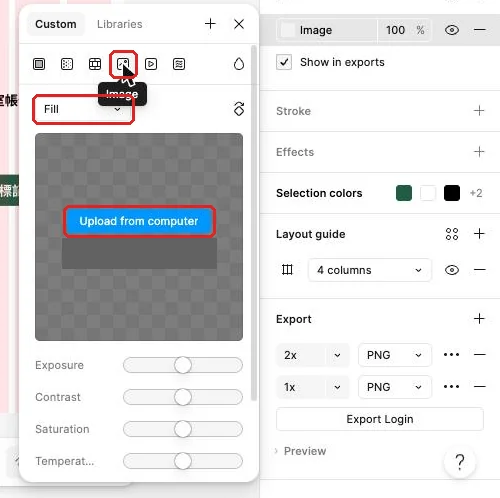

## 內部設計（不進學員頁）

本課新增能力：完整Row父子層級、清單增刪與空狀態，並建立真實Detail畫面供原型串接。依 `_design/COURSE-BLUEPRINT.md` 的同檔案整合路徑；保留 99h 行政配置，未以真人試跑鎖定分鐘。

| 活動 | 素材／產物 | 操作與決策 | 認知工作／支援 |
|---|---|---|---|
| Demo | 正文提供的完整輸入／方法示範 | 講師建模本課首次方法與可見結果 | 完整理由及步驟 |
| Together | 同一工作室任務清單／學員自己的完成物 | 正文「跟著做」需自行選層、設定與判斷 | 支援遞減，自己定位欄位、解釋檢查結果 |
| Solo | 本課不同條件／修正後完成物 | 正文「自己完成」依新限制選擇方法 | 獨立診斷與遷移，依完成條件判斷 |

素材：正式正文的可複製資料、每課 START-HERE、完成檢查表、共用視覺參考，B7 有 PSD，B8 有下載 ZIP。素材存在／版本由驗證紀錄確認，不以本段自填 PASS。

<!-- learner-content:start -->
# 把任務做成會增高、可增刪的清單
副標：工作室任務有長有短，清單要能隨資料增減重排，也要在載入中與沒有任務時說清楚現在的狀態。
本堂完成物：可隨內容增高的任務清單；有說明的空清單與載入中畫面；含附件縮圖的任務詳情

## 從會長高的表單，接到會變動的任務資料

工作室每天收到的任務數量不同，標題長度也不同。若每一列都靠手動定位，長標題會撞到期限，新增資料又得把後面所有列往下搬；當最後一筆被移除時，整張畫面還可能只剩一片空白。這堂要把任務內容包成有層級的 Row（任務列），再用 List（清單容器）管理多筆資料。

這項工作會接著使用上次在表單裡練過的 Auto height（自動增高）、Hug contents（貼合內容）與 Fill container（填滿容器）。先開[本堂起始材料](../../courses/uiux-designer/assets/A7-list-content/START-HERE.html)，了解任務資料與要保留的畫面；完成清單、空狀態、載入中畫面與詳情後，再用[完成檢查表](../../courses/uiux-designer/assets/A7-list-content/reference/EXPECTED-CHECK.html)逐項核對。沒有上次成果時，先回到[完成表單與錯誤修正](CH6-button-form.html)依規格表補做，約需二十到三十分鐘。主線資料來自[任務資料](../../courses/uiux-designer/assets/shared/TASK-DATA.csv)，所有畫面仍放在同一個 Figma 檔案的同一頁。

先在畫布空白處規劃一個新的清單區，保留已完成的登入表單。這樣能保留「登入」與「待處理清單」兩個工作階段，後面做原型時再把它們串起來。按鈕元件也繼續沿用，詳情畫面會插入「標記完成」作為主要動作。

## 清單由兩層規則組成

這一節要看懂 Row 與 List 各自解決什麼問題。每一個 Row 包住同一筆任務的標題、期限狀態、標籤與前往詳情的線索；外層 List 再包住多個 Row，負責列與列之間的間距。內外兩層各管一件事，資料變長或筆數改變時，版面才知道該推開誰。

例如，「整理交付包」只佔一行，而「確認活動報名資料並補上聯絡電話」在同樣寬度下可能換成兩行。兩筆任務都使用相同字級與內距，長標題所在的 Row 自然增高，下一列由外層 List 往下排。這比為每一列指定固定高度更能保留內容，也不用為了塞進一行而縮小文字。

| 層級 | 包含內容 | 負責的變化 | 用得對的畫面線索 |
|---|---|---|---|
| `Row / Task` | Title、Meta、Tags、Link | 同一筆內容變長或變短 | 標題與標籤換行時該列增高 |
| `List / Content` | 多個 Row | 任務增加、刪除與排序 | 增刪後其他列自動重排 |
| `Screen / List` | 畫面標題、List | 手機頁面的整體閱讀順序 | 畫面標題留在清單上方 |
| `Screen / List Empty` | 空狀態標題與說明 | 沒有資料時解釋目前情況 | 使用者看得懂目前沒有任務 |
| `List / Loading` | 三列 Skeleton | 資料尚未回來時保留版面輪廓 | 看得出清單正在準備 |

空狀態也是清單的一種結果。好的空狀態要回答「現在怎麼了」與「接下來會發生什麼」；例如「目前沒有待處理任務」說明狀態，「新任務會顯示在這裡」建立預期。只留下空白框，使用者會猜測資料是否還在載入、是否被刪掉，或畫面是否壞了。

載入中則是另一種狀態。資料還在取得時，Skeleton（骨架）用幾塊灰色矩形先表示標題、摘要與標籤大約會出現的位置。它比單獨一個轉圈更容易讓人預期內容結構，也能減少資料出現時整個畫面突然跳動的感覺。骨架只表達形狀，不放看似真實的任務文字。

詳情畫面把一筆任務展開。清單列只保留掃讀需要的標題、狀態、期限與前往線索；較長的說明、附件縮圖和主要動作放進 Detail。這種資訊分工讓清單保持可掃讀，也讓詳情有足夠空間說清楚任務內容。

## 示範：先做一列，再讓三筆資料自動排列

這一節會從第一筆任務建立可重複的 Row，再把三列放進 List。規格表列出名稱與設計值，步驟中只要確認內容是否進入正確層級。

| 圖層或畫面 | 規格 | 內容或用途 |
|---|---|---|
| `Screen / List` | 402 × 874；Surface 底色 | 待處理清單畫面 |
| 畫面標題 | x 24、y 48；字級 24、行高 32 | 「待處理清單」 |
| `Row / Task` | Vertical；Gap 8；四邊 Padding 16；寬 354；Hug 高；白底；圓角 8 | 單筆任務容器 |
| `Row / Title` | 字級 18、行高 28；Fill；Auto height | 任務名稱 |
| `Row / Meta` | 字級 14、行高 22；Fill；Auto height | 狀態與期限 |
| `Row / Tags` | 沿用既有 `Tags`；Wrap | 高優先、客戶、本週等標籤 |
| `Row / Link` | 字級 14、行高 22；Primary 色；Fill | 「檢視詳情 →」 |
| `List / Content` | x 24、y 110；Vertical；Gap 12；寬 354；Padding 0；Hug 高 | 多筆任務容器 |
| `Screen / Detail` | 402 × 874 | 任務詳情畫面 |
| 詳情內容 | x 24、y 120；寬 354；Vertical；Gap 20；Hug 高 | 說明、附件與主要動作 |

1. 按 **F** 建立手機 Frame（畫框），命名為 `Screen / List`（清單畫面），再套用規格表中的尺寸與底色。完成後會得到一張獨立的工作室清單畫面。
2. 加入「待處理清單」標題。完成後使用者會先知道自己位於哪一類任務中。
3. 建立 `Row / Title`（任務標題），輸入「整理交付包」。完成後會看到第一筆任務的主要識別文字。
4. 建立 `Row / Meta`（任務摘要），輸入「待處理 · 今天18:00」。完成後狀態與期限會集中在次要文字中。
5. 從 Assets 插入 `Icon / Clock`（時間圖示），放在期限前。完成後期限會多一個能快速辨認的視覺線索。
6. 從既有元件插入 `Tags`（標籤列），保留「高優先」與「交付」。完成後兩個標籤會在同一列，寬度縮小時可以換行。
7. 建立 `Row / Link`（詳情線索），輸入「檢視詳情 →」。完成後這一列會表明還有更完整內容。
8. 同時選取標題、摘要、標籤與詳情線索按 **Shift+A**，命名為 `Row / Task`（任務列），再套用規格表中的 Auto layout。完成後第一筆資料會被同一個白色容器包住。
9. 複製任務列兩份，依資料改成「確認活動報名資料並補上聯絡電話」與「更新本週任務說明」。完成後會看到三筆內容各自留在自己的 Row 中。
10. 將第二筆 Meta 改為「待處理 · 明天12:00」，第三筆改為「待處理 · 星期五17:00」。完成後每一列都能直接讀到自己的期限。
11. 同時選取三列按 **Shift+A**，命名為 `List / Content`（清單內容），再套用規格表中的外層排列。完成後三列會依固定間距垂直排列。
12. 把清單內容放進清單畫面。完成後它會位於標題下方，長標題與換行標籤會讓所屬列增高並推開後續資料。

短標題時，一列高度可以用一個例子理解：上下內距、標題、各段間距、摘要、標籤與詳情線索會共同決定高度。當標題變成兩行，Auto height 會增加文字高度，Row 的 Hug 會跟著增高，外層 List 再重新排列後續內容。

完成後打開 Layers（圖層面板），依序展開 `List / Content`、第二個 Row 與 `Row / Title`。你應該能清楚看到「清單包列、列包內容」的階層。若第二筆文字看似在卡片上，卻是清單外的孤立圖層，下一次增加內容時它不會跟著排版；把它移回所屬 Row 才能恢復規則。

## 跟著做：測試增刪，再補空清單與詳情

這一節要主動改變資料筆數。每次修改後先觀察外層 List 怎麼重算，再決定要修 Row、List 或 Screen。

1. 複製最後一列，改成「核對本週發票」，期限改成「明天17:00」。完成後清單會增加一列，原有列不需手動移動。
2. 刪除「確認活動報名資料並補上聯絡電話」。完成後下面兩列會自動上移，列與列之間仍只有一段 Gap。
3. 復原刪除，再移除剛新增的「核對本週發票」。完成後主線會回到原本三筆資料。
4. 複製整張清單畫面，命名為 `Screen / List Empty`（空清單畫面），移除其中的所有 Row。完成後會保留畫面結構與標題。
5. 在原本清單內容的位置放入「目前沒有待處理任務」與「新任務會顯示在這裡」。完成後空畫面會交代狀態與後續預期。
6. 複製「整理交付包」那一列，把狀態改為「已完成」，並加入文字或圖示線索。完成後會得到後續完成清單可使用的版本。
7. 建立 `Screen / Detail`（任務詳情畫面），加入「← 返回清單」。完成後畫面會提供回到上一層的明確線索。
8. 在詳情內容放入「整理交付包」、任務說明與「今天18:00」。完成後這筆任務的完整資訊會集中在同一區。
9. 從 Assets 插入 Primary／Default 的 Button，Label 改為「標記完成」，命名為 `Button / Complete`（完成按鈕）。完成後詳情畫面會有清楚的主要動作。
10. 將詳情文字與按鈕包成垂直 Auto layout。完成後說明變長時，按鈕會隨內容往下排列。

增刪測試完成後，將三張畫面排在畫布上：待處理清單、空清單、任務詳情。這三張圖各回答不同問題：有資料時怎麼掃讀、沒資料時看到什麼、需要更多資訊時去哪裡。互動連線會在後面的原型階段處理，這裡先把內容與層級做完整。

## 把附件放進詳情，再補一張載入中畫面

清單結構完成後，這一節加入兩種會影響使用感受的內容：詳情裡可辨認的附件縮圖，以及資料到達前的 Skeleton。附件讓工作室人員先看出交付物大致內容；骨架則讓等待中的畫面和真正清單保持相近輪廓。

| 圖層或畫面 | 規格 | 內容或用途 |
|---|---|---|
| `Detail / Attachment` | 矩形；寬度 Fill；圓角 8 | 任務附件縮圖 |
| 圖片縮放 | Fill、Fit、Crop 比較 | 依縮圖用途保留重點 |
| `List / Loading` | 三列 Skeleton；Vertical | 待處理清單載入狀態 |
| `Skeleton / Row` | 白底；圓角 8；四邊 Padding 16 | 一列任務的灰色輪廓 |
| 骨架色塊 | 灰色；標題、摘要、標籤三種長度 | 只表示內容位置 |

1. 在任務詳情的說明下方畫一個矩形，命名為 `Detail / Attachment`（附件縮圖）。完成後詳情會留出一塊固定的附件位置。
2. 選取矩形，在 Fill 的類型圖示列選 **Image**。完成後 Fill 會從純色切換成圖片設定。
3. 點 **Upload from computer**，從 `../../courses/uiux-designer/assets/shared/images/` 選一張範例圖片。完成後圖片會出現在矩形範圍內。

4. 先選 **Fill** 觀察圖片鋪滿矩形的結果。完成後矩形不會留白，邊緣可能有部分圖片被裁掉。
5. 改選 **Fit** 觀察完整圖片。完成後整張圖片都會顯示，比例不同時四周可能留下空間。
6. 切到 **Crop**，移動裁切範圍讓附件重點落在中央。完成後縮圖會兼顧填滿與主體位置。面板中的其他按鈕本課不用。
7. 複製清單畫面，命名為 `List / Loading`（清單載入中畫面），保留頁首。完成後會得到與清單相同的外框。
8. 用灰色矩形排出一列標題、摘要與標籤的輪廓，再包成 `Skeleton / Row`。完成後會看出一筆任務即將出現的大致結構。
9. 複製骨架列兩份，調整各列灰色矩形的長短。完成後三列看起來像不同內容的佔位，而非重複貼上的真實資料。
10. 比較載入中、空清單與正常清單。完成後三種狀態會共用頁首和版面節奏，但各自用文字或輪廓交代目前情況。

Fill 適合固定比例的小縮圖，因為畫面整齊比看見每一個邊角更重要；Fit 適合完整內容不能缺角的附件，例如版面截圖。Crop 則在 Fill 基礎上讓你主動調整保留區域。選擇時先回答「使用者要辨認主體，還是要檢查完整內容」，再決定縮放模式。

## 看兩版附件，判斷各自適合哪種工作

這一節要做取捨，而非只找一個固定答案。版本一使用 Fill，把三張附件縮圖排成等寬等高，列表看起來整齊，但圖片邊緣被裁掉。版本二使用 Fit，每張附件都完整顯示，比例不同時會出現留白，列表輪廓較不一致。

請分別判斷「快速辨認照片主體」與「檢查整張版面截圖」該選哪一版，再說明 Crop 何時能改善版本一。答案要依工作目的決定，而不是依留白多少決定。

查看判斷理由

快速掃讀照片主體時可選版本一，固定縮圖讓清單更整齊，並用 Crop 把重要主體留在中央。檢查完整截圖時可選版本二，因為 Fit 會保留所有邊緣與文字。兩版都合理，關鍵是使用者需要辨認主體還是核對完整內容。

## 卡住時，先找內容屬於哪一層

這一節用症狀判斷修復層級。清單問題常由內層一路影響外層，因此先從文字開始，再看 Row 與 List，會比拖曳座標更快找到原因。

| 看到的現象 | 通常的原因 | 怎麼修 |
|---|---|---|
| 長標題只顯示一行 | Title 是固定高度 | 在 Layout（版面區塊）將文字設為 Auto height，寬度設 Fill |
| 標題變高但白卡沒變高 | Row 使用固定高度 | 將 Row 高度改為 Hug contents |
| 新增一列後與舊列重疊 | 新 Row 不在 List 內 | 在 Layers 把它移入 `List / Content` |
| 標籤超出卡片 | Tags 沒有開 Wrap | 選標籤列，在 Flow 右側開啟 Wrap |
| 圖片出現留白或主體被切掉 | 縮放模式不符合用途 | 比較 Fit 與 Fill，再用 Crop 調整重點 |
| 空清單像載入失敗 | 畫面只剩空白容器 | 加入清楚的狀態標題與後續說明 |

修完後用最長的「確認活動報名資料並補上聯絡電話」再測一次，接著刪除它。能同時通過內容變長與筆數變少，代表三層規則都在正確位置。

## 換你做：你的題目

現在把清單、圖片與載入狀態移到你選定的題目，完成十二筆可掃讀資料、空狀態、長文字詳情與一張載入中畫面。

| 預約 | 點餐 | 會員 |
|---|---|---|
| 用 `BOOKING-DATA.csv` 做十二筆服務清單；空狀態是「我的預約：還沒有預約」；詳情使用「大型犬全套洗澡美容」，並放入 `pet-grooming.png`。 | 用 `ORDER-DATA.csv` 做十二筆菜單清單；空狀態是「訂單：還沒有訂單」；詳情使用「季節限定・柚香蜂蜜冷萃咖啡」，並放入 `coffee-cup.png`。 | 用 `MEMBER-DATA.csv` 做十二筆兌換品清單；空狀態是「點數紀錄：還沒有紀錄」；詳情使用「青田書店二十週年紀念帆布袋（附手寫書籤）」，並放入 `bookshelf.png`。 |

要達成的條件：

- 依[預約需求](../../courses/uiux-designer/assets/shared/practice/BOOKING-BRIEF.html)、[點餐需求](../../courses/uiux-designer/assets/shared/practice/ORDER-BRIEF.html)或[會員需求](../../courses/uiux-designer/assets/shared/practice/MEMBER-BRIEF.html)使用對應的十二筆資料。
- 每張卡片呈現題目指定的名稱、資料欄位與狀態，並加入合適的圖示或圖片。
- 外層清單能在新增、刪除或重新排序時自動重排。
- 清單列沿用會換行的標籤，期限或狀態前可使用[圖示包說明](../../courses/uiux-designer/assets/shared/icons/README.html)中的合適圖示。
- 用題目的長文字資料測試卡片增高，再將完整內容放進詳情。
- 製作題目指定的空狀態，以及有三列 Skeleton 的載入中畫面。

合格的結果要能通過以下自我檢查：

- 十二筆名稱與狀態都和對應 CSV 一致，最後一筆也能找到。
- 長文字完整換行，標籤換行後沒有蓋住下一筆。
- 詳情只展開一筆資料，圖片縮放模式符合「辨認主體」或「檢查完整內容」的目的。
- 刪除任一列後，下面資料會自動補上，沒有遺留空白高度。
- 空狀態有明確文字；載入中狀態有骨架；兩者不會被誤認為同一情況。

真的卡住再看：提示

先用一筆短資料完成 Row 結構，再換成題目指定的長文字測試；如果下一列沒有移動，沿著 Title、Tags、Row、List 四層檢查 Auto height、Wrap 與 Hug。

## 收回工作室清單，下一步補上操作回饋

這堂把工作室任務從散落文字整理成兩層清單規則。長標題與標籤會讓自己的 Row 增高，資料增刪會由 List 自動重排；沒有任務與還在載入也各有清楚狀態。「整理交付包」詳情則加入附件縮圖，能依目的選 Fill、Fit 或 Crop。

下一堂會為「標記完成」加入成功、警告與錯誤回饋，再製作確認彈窗、頂部標題列和導覽。今天留下的待處理清單、空清單、載入中畫面與詳情會直接成為那些回饋的背景，因此請保留清楚的圖層名稱與內容層級。

想一想：載入中畫面與空狀態都沒有真實資料，為什麼仍要設計成兩種不同畫面？

查看答案

載入中表示資料正在取得，使用者預期稍後會出現內容；空狀態表示取得完成但目前沒有資料，需要說明現況與可能的下一步。骨架和明確文字分別傳達這兩種不同預期。

完成條件：

- 三筆工作室任務都有 Title、Meta、Tags、Link 與自己的 Row。
- 長標題與標籤會增高，新增與刪除資料會讓清單自動重排。
- 空清單、載入中與詳情畫面各自說清楚目前狀態。
- 自選題目包含十二筆資料、空狀態、長文字詳情、圖片與載入中畫面。

## 本堂查證來源

- [Figma：Auto layout](https://help.figma.com/hc/en-us/articles/360040451373)
- [Figma：文字尺寸與 Layout](https://help.figma.com/hc/en-us/articles/27378154668951)

來源查證：2026-11-02。
<!-- learner-content:end -->

## 講師授課筆記（不進講義）

先用正文入口題檢查前提，再以短示範讓學員同步操作。每次核心狀態改變立即檢查；主要時間用於自行製作、同儕解釋、錯誤修復與新條件作品。先核對學員真實工具權限與檔案；未達完成條件回到本堂修復位置，不以教師代做當成完成。此稿為作者設計與自審，真人理解／遷移與平台實測須另留證據。
