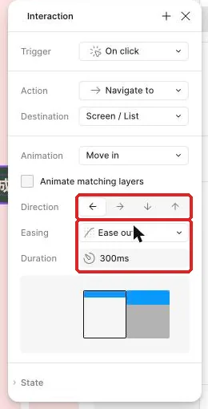

## 內部設計（不進學員頁）

本課新增能力：依用途選轉場與引數，製作同名同層級的前後狀態並診斷Smart Animate配對。依 `_design/COURSE-BLUEPRINT.md` 的同檔案整合路徑；保留 99h 行政配置，未以真人試跑鎖定分鐘。

| 活動 | 素材／產物 | 操作與決策 | 認知工作／支援 |
|---|---|---|---|
| Demo | 正文提供的完整輸入／方法示範 | 講師建模本課首次方法與可見結果 | 完整理由及步驟 |
| Together | 同一工作室任務清單／學員自己的完成物 | 正文「跟著做」需自行選層、設定與判斷 | 支援遞減，自己定位欄位、解釋檢查結果 |
| Solo | 本課不同條件／修正後完成物 | 正文「自己完成」依新限制選擇方法 | 獨立診斷與遷移，依完成條件判斷 |

素材：正式正文的可複製資料、每課 START-HERE、完成檢查表、共用視覺參考，B7 有 PSD，B8 有下載 ZIP。素材存在／版本由驗證紀錄確認，不以本段自填 PASS。

<!-- learner-content:start -->
# 用轉場說明畫面去向，再做一段 Smart Animate
副標：工作室行政人員進入任務詳情、返回清單與更新狀態時，動畫要幫助理解發生了什麼。
本堂完成物：進入與返回方向一致的主線轉場；一段狀態改變的 Smart Animate；從開頭畫面走到我的紀錄的完整流程；一份動畫版與即時切換版的比較

## 從正確目的地開始談移動

工作室行政人員已經能從登入進入待處理清單，點「整理交付包」查看詳情，再返回清單。這條流程目前使用 Instant，畫面會立刻切換；操作已經正確，接下來要用動畫補充空間關係，讓人知道自己是往更深一層前進，還是回到上一層。

這一頁沿用上次連好的主線，先用[本堂起始材料](../../courses/uiux-designer/assets/B3-transition-motion-purpose/START-HERE.html)核對動畫分支需要的畫面與名稱，再用[本堂完成檢查表](../../courses/uiux-designer/assets/B3-transition-motion-purpose/reference/EXPECTED-CHECK.html)比較實際預覽。若手上沒有前一次成果，先打開[連好登入、清單、詳情與返回](../part2/CH2-trigger-navigation-action.html)，依該頁規格表補做基本流程，約需二十到三十分鐘。開始前先用 Instant 走一次「清單 → 整理交付包詳情 → 返回」，確認標題、內容與目的地都正確；動畫只能說明正確流程，無法替錯誤目的地補救。

本頁會先處理兩種不同的動畫問題。主線轉場說明整張畫面的去向；Smart Animate 則表現同一個狀態物件如何從前一個外觀連續變成下一個外觀。完成兩種動畫後，再把分開製作的畫面串成從開頭走到我的紀錄的完整流程。

## 先決定要表達什麼，再選動畫

這一節要建立動畫的判斷順序。先說清楚畫面之間的關係，再選 Move in、Move out、Dissolve 或 Smart animate；最後才調整方向、時間與 Easing（速度變化）。如果先挑最顯眼的效果，動畫容易變成裝飾，反而讓頻繁操作顯得拖延。

例如，從待處理清單進入整理交付包詳情，代表從總覽深入單筆內容。詳情由右側進入，能傳達「向前看下一層」；按返回時讓詳情往右離開，則與進入方向相反，畫面關係比較連貫。若只是兩個沒有空間層級的狀態切換，短暫 Dissolve 或 Instant 往往更清楚。

| 情境 | 適合先比較的 Animation | 要觀察的意義 |
|---|---|---|
| 清單進入詳情 | Move in | 詳情從一側進入，表示向內深入 |
| 詳情返回清單 | Move out | 詳情向相反方向離開，回到總覽 |
| 不強調空間關係 | Dissolve 或 Instant | 內容改變，但不暗示左右層級 |
| 同一物件狀態改變 | Smart animate | 尺寸、位置、填色或透明度連續變化 |

Duration（持續時間）控制動畫花多久完成，Easing 控制過程中的速度變化。Ease out 會先快後慢，物件接近終點時柔和停下。本頁用 200ms 作為主線比較值，因為這是現稿的示範起點；它不是所有產品都必須採用的答案。真正的判斷仍要回到操作頻率、方向是否看得懂，以及等待感是否合理。

Smart Animate 的配對方式不同。Figma 會在兩張 Frame 中尋找名稱與層級對應的物件，再把可動畫屬性的前後值連起來。若同一個標籤在前後畫面分別放在不同父層，外觀看似一樣，仍可能配對不到；配不到的物件會以淡入淡出處理。這就是為什麼命名與 Layers 結構會直接影響動畫結果。

Smart Animate 不會讓數字一格一格變化；兩個不同數字只會交叉淡入淡出。要讓數值更新更容易被注意，可以另外讓徽章縮放，或讓代表增減量的小字移動與淡出。

動畫也需要保留可比較的基準。Instant 版本能讓你確認最終內容與位置是否相同，Smart Animate 版本則用來觀察中間過程。兩版的資訊結果一致，才能把差異歸因於動畫，而非其中一張畫面漏了內容。

## 示範：讓詳情進入與返回方向一致

這一節先在已連好的主線調整 Animation。規格表集中列出方向、時間與物件名稱；實際操作時一次只改一條連線，做完立刻預覽。

| 類別 | 圖層或設定 | 本堂值 |
|---|---|---|
| 進入熱區 | `Row / T01`（整理交付包任務列） | 通往整理交付包詳情 |
| 進入 Animation | Move in | 從右進入 |
| 返回熱區 | `Button / Back`（返回圖示鈕） | 44 × 44；通往待處理清單 |
| 返回 Animation | Move out | 往右離開 |
| Easing | Ease out | 進入與返回一致 |
| Duration | 200ms | 主線比較值 |
| 比較設定 | Dissolve、Instant | 保留內容與目的地不變 |
| 預覽 | Preview | Shift+Space |

1. 從「完成一筆任務」流程開啟 Preview，先用 Instant 走過整理交付包的進入與返回。做完會確認兩條連線的目的地仍正確。
2. 回到畫布，選取整理交付包任務列通往詳情的原型連線。做完會看見這條 Interaction 的觸發、動作、目的地與動畫設定。
3. 保留 On click、Navigate to 與原本目的地，只把 Animation 改為 Move in。做完後，互動內容仍相同，只有進場方式改變。

4. 依規格表選擇從右進入的方向。方向箭頭的樣子以畫面為準，稍後用 Preview 確認實際起點。
5. 將 Easing 設為 Ease out。做完會看到速度曲線設定套用在這條轉場。
6. 將 Duration 設為規格表中的比較值。做完後，進入詳情會有短暫、可觀察的移動。
7. 選取詳情中的返回連線，把 Animation 改為 Move out。做完後，目的地仍是待處理清單。
8. 將返回方向設為往右離開，並使用相同 Easing 與 Duration。做完後，進入與返回會形成相反方向。
9. 從登入開始預覽，點整理交付包再返回。做完應能用「向內深入」與「退回總覽」說明兩段動畫。
10. 將兩條連線暫時改為 Dissolve，再完整走一次。做完會得到一版較少空間暗示的比較結果。
11. 將主線恢復成你能說明理由的版本，並記錄選擇。做完會留下一段由任務關係支持的動畫決定。

比較時請把注意力放在理解，而非喜好。若第一次看到就能判斷詳情是從哪裡來、返回後回到哪一層，動畫完成了說明工作；若目光只追著移動，或每次點擊都在等待效果結束，就應回到更短或更簡單的設定。

## 跟著做：用同名同層級物件完成 Smart Animate

接下來做一條獨立的狀態動畫。這條分支不改主線任務資料，專門讓你看清楚名稱、層級與前後值如何影響 Smart Animate。

| 類別 | 名稱 | Before | After |
|---|---|---|---|
| 外框 | `Motion / Before`、`Motion / After` | 402 × 300 | 402 × 300 |
| 狀態標籤 | `Status / Badge`（狀態標籤） | x24、y70、W160、H48 | W280、H48 |
| 狀態標籤外觀 | 文字與填色 | 「待處理」、主要綠色 | 「已完成」、Success 色 |
| 完成記號 | `Status / Check`（完成記號） | x312、y85、Opacity 0% | 同位置、Opacity 100% |
| 測試按鈕 | `Button / Animate`（播放狀態按鈕） | y180 | y180 |
| Animation | Smart animate | Ease out、200ms | 返回同設定 |
| Flow | 狀態動畫 | Before | — |

1. 在畫布空白處建立 `Motion / Before`，依規格表設定 Frame。做完會得到一張獨立於主線的動畫起始畫面。
2. 在起始畫面建立 `Status / Badge`（狀態標籤），放入「待處理」。做完會看到固定大小的綠色狀態區塊。
3. 建立 `Status / Check`（完成記號），依規格表放置並將透明度設為起始值。做完後，Layers 中看得到完成記號，畫面上暫時看不見。
4. 加入 `Button / Animate`（播放狀態按鈕），文字寫「看看變化」。做完會得到啟動動畫的明確熱區。
5. 複製整張起始 Frame，命名為 `Motion / After`。做完後，兩張畫面的內部圖層名稱與層級完全相同。
6. 在 After 把狀態標籤文字改成「已完成」，再調整寬度並套用 `Success`。做完會看到標籤變寬並呈現成功狀態。
7. 在 After 將完成記號的透明度調到結束值。做完會看到勾號出現在標籤右側，兩者不會重疊。
8. 將 Before 的播放按鈕連到 After，設定 On click、Navigate to 與 Smart animate。做完會看到這條互動指向狀態完成畫面。
9. 將 After 的播放按鈕連回 Before，使用同樣的 Animation、Easing 與 Duration。做完後，兩種狀態可來回比較。
10. 第一次把 Before 連到 After 時，Figma 會自動建立新流程；把它改名為「狀態動畫」。做完後，Flows 清單會出現可辨認的中文入口。
11. 從「狀態動畫」開啟 Preview，來回點擊播放按鈕。做完應看到標籤連續伸縮，完成記號淡入與淡出。

如果畫面只是整張淡入淡出，先把兩張 Frame 並排，沿著 Layers 路徑核對 `Status / Badge` 與 `Status / Check`。名字相同只是第一層，還要確認它們位於對應的父層之下。前後屬性也要真的不同，Figma 才有可補間的變化。

接著做一次單一變因診斷。把 After 的 `Status / Badge` 暫時改成 `Different / Badge`，預覽一次並觀察伸縮是否變成淡入淡出；再把名稱改回原值重測。這次只改名稱，其他位置、尺寸與連線維持原樣，因此你能把結果直接連回配對規則。

最後把 Duration 暫時改為 600ms，再與 200ms 比較等待感。做完後調回主線規格值，保留一行觀察紀錄。速度變慢會讓中間狀態更容易看見，也可能讓高頻操作顯得拖延；這個比較能幫你理解「看得清楚」與「回應俐落」之間需要取捨。

## 把所有畫面串成一條完整流程

關鍵畫面完成後，要把先前分開製作的登入、清單、詳情與完成清單接成一條任務。工作室行政人員應能從登入開始，完成「整理交付包」，最後在完成清單看到剛處理的任務。

| 流程位置 | 畫面或熱區 | 目的地與核對內容 |
|---|---|---|
| 起點 | `Screen / Login`（登入畫面） | 登入後前往待處理清單 |
| 選擇任務 | `Screen / List`（待處理清單） | 整理交付包列前往自己的詳情 |
| 查看內容 | `Screen / Detail`（任務詳情） | 標題、期限與說明符合清單所點項目 |
| 完成任務 | `Button / Complete`（完成按鈕） | 前往 `Screen / List Done` |
| 查看結果 | `Screen / List Done`（完成清單） | 看見整理交付包，上方顯示成功 `Toast` |

1. 將「完成一筆任務」的 Flow starting point 放在登入畫面。做完後，Preview 會從帳號與密碼欄開始。
2. 核對登入按鈕的 Destination 是待處理清單。做完後，登入會進入十二筆任務的清單。
3. 將整理交付包任務列連到內容相符的詳情。做完後，標題、期限與說明會對應所點項目。
4. 將詳情裡的完成按鈕直接連到 `Screen / List Done`（完成清單）。確認彈窗在下一堂加入，這次先直接連。做完後，行政人員會看見整理交付包已完成。
5. 核對完成清單上方的成功 `Toast`。做完後，任務結果會同時由清單狀態與提示文字交代。
6. 為詳情的返回動作指定原本的待處理清單。做完後，返回仍能保留任務脈絡。
7. 從起點開啟 Preview，依畫面上的熱區走到完成清單。做完會在最後一張畫面看見整理交付包，途中不必回編輯畫布換起點。

## 看兩段都合理的動畫，判斷各自適合哪種情況

版本一用 Instant 顯示狀態結果。按下動作後，文字與數值立刻換成更新後內容；畫面沒有移動，連續處理多筆資料時很俐落，也容易把注意力留在下一個任務。

版本二使用 Smart animate。更新前後的物件保持同名同層級，狀態標籤的尺寸或填色連續改變；數字本身交叉淡入淡出，再由徽章跳動或「－300」小字移動指出變化。操作花的時間稍長，但第一次使用時較容易看出「是哪個東西變了」。哪一版適合高頻、熟悉的操作？哪一版適合需要特別提醒結果的關鍵狀態？

看完自己的判斷再展開

高頻而且結果文字已很清楚時，版本一能減少等待；變化容易被忽略、數值去向需要交代，或使用者需要確認哪個物件更新時，版本二較有幫助。兩版都應保留完整的更新後文字，選擇取決於動畫帶來的理解是否大於等待成本。

## 卡住時，先分辨是連線、配對還是速度

這一節把動畫問題拆成三類。完全沒切換先看互動；能切換但沒有連續變化時看配對；效果存在但感受不對時再看方向與時間。

| 看到的現象 | 通常的原因 | 怎麼修 |
|---|---|---|
| 點按鈕完全沒反應 | 熱區沒有 Interaction 或流程起點選錯 | 核對按鈕連線，再從「狀態動畫」開啟 Preview |
| 畫面切換但標籤只淡入 | 名稱或父層路徑不同 | 比對兩張 Frame 的 Layers，恢復同名同層級 |
| 勾號突然出現 | 前後物件未配對，或透明度沒有前後差異 | 核對圖層名稱與 Opacity 起訖值 |
| 進入與返回都往同一方向 | 兩條連線用了相同方向 | 讓詳情進入與離開形成相反關係 |
| 動畫看不出變化 | 前後尺寸、位置或透明度相同 | 選一項可觀察屬性建立前後差異 |
| 操作顯得拖延 | Duration 過長或動畫使用過多 | 與 Instant 比較，再縮短或簡化效果 |

## 換你做：你的題目

從你的畫面清單挑出這次對應的畫面。先完成狀態動畫，再把自己的畫面串成從開頭到我的紀錄的完整流程。

為題目關鍵畫面做一段 Smart Animate，再用相同起點與結果做一版 Instant，比較加動畫與不加動畫時，使用者是否更容易看出狀態改變。

動畫比較完成後，回到自己的畫面清單，找出開頭、清單、詳情、表單、確認、成功與我的紀錄各自對應的畫面。依畫面上的熱區把它們連起來，最後在我的紀錄核對剛送出的內容。

**三個題目的建議對應**

| 預約 | 點餐 | 會員 |
|---|---|---|
| 選擇時段：讓同一個時段由 Available 變成 Selected，並保留已選文字 | 品項詳情與訂單入口：加入後讓右上徽章換成新數字並放大，再縮回原尺寸 | 兌換確認與結果：兌換後讓點數淡入新值，並讓「－300」往上移後淡出 |

要達成的條件：

- 先寫一句這段動畫要幫使用者理解的變化，並確認起點與終點內容都正確。
- 準備更新前與更新後兩張對應畫面，兩張畫面的核心資料來自自己的需求頁。
- 動畫的主要物件在兩張畫面中保持相同名稱與相同父層路徑。
- 讓題目指定的狀態或數字改變，並集中動畫在最接近結果的物件。
- 點餐題在 After 把徽章放大到 1.2 倍並換成新數字，再用 After delay 連到第三個狀態，將徽章縮回 1 倍；完整效果看起來會像跳一下。
- 會員題讓點數數字淡入新值，同時把一條「－300」小字從數字下方往上移並淡出。
- 從題目的主要動作啟動 Smart animate，觸發位置與實際任務一致。
- 更新後以文字或數字直接表達結果，動畫只補充變化過程。
- 保留一份 Instant 比較結果，兩版的起點、終點與資料相同。
- 記錄兩版是否容易找到變化、是否有等待感、最終結果是否清楚，再選一版並寫下理由。
- 開頭、清單、詳情、表單、確認、成功與我的紀錄都來自自己的畫面清單；清單沒有的，先補進清單並寫一句理由。
- 將 Flow starting point 放在開頭畫面，沿畫面上的熱區走到我的紀錄。
- 我的紀錄會顯示剛送出的預約、訂單或兌換結果，前後數量與餘額一致。

合格的結果要能通過以下自我檢查：

- Preview 中能看見目標物件的連續變化，且不會誤以為整張畫面只是換頁。
- 預約題清楚顯示 Selected；點餐題清楚顯示徽章放大後縮回；會員題清楚顯示新餘額與往上淡出的「－300」。
- 前後畫面的服務或品項名稱一致，改變集中在這次要說明的狀態。
- 主要物件的名稱與 Layers 路徑前後一致，配對失敗時能找到差異位置。
- Instant 與動畫版的最終資訊相同，因此比較的是呈現過程而非兩份不同內容。
- 關閉動畫仍能讀懂結果；加入動畫後，徽章跳動或減值小字會指出變化位置。
- 選擇理由能連回使用者需要理解的變化，而非只寫個人喜好。
- Preview 從開頭畫面開始，前進、返回與確認都能由畫面上的熱區完成。
- 成功畫面之後能進入我的紀錄，並看見本次送出的內容。

真的卡住再看：提示

先沿 Layers 比對前後畫面的目標物件路徑，再只選一個屬性建立差異。動畫走通後，從最後的我的紀錄倒著核對每張畫面是否有前一張入口；預約題找時段元件，點餐題找數量徽章，會員題找點數文字。

## 用動畫補足關係，不讓動畫取代內容

你已經為工作室主線建立進入與返回方向一致的轉場，也完成一段可觀察的 Smart Animate。前者說明清單與詳情的層級，後者說明同一個狀態如何改變；Instant 比較版則確保最終資訊本身仍然完整。接著串好的主線會從登入走到完成清單，自選題目也會從開頭走到我的紀錄。

下一頁會把詳情上的確認彈窗真正開成 Overlay，讓取消、確認與外側關閉各有清楚結果，並加入選單交換與底部面板。屆時動畫仍服務畫面關係：彈窗保留背景，底部面板由下方進入，使用者能從出現方式理解它們是暫時疊在原畫面上的內容。

想一想：兩張 Frame 都有同樣外觀的狀態物件，為什麼 Smart Animate 仍可能只顯示淡入淡出？

看參考答案

外觀相似不代表 Figma 能把它們視為同一物件。Smart Animate 需要前後圖層名稱與層級對應，並且可動畫屬性有差異；配對不到時，物件會改用淡入淡出。

完成條件：

- 整理交付包詳情的進入與返回轉場能用層級關係說明。
- 狀態動畫中的標籤與完成記號同名同層級，Preview 可見連續變化。
- 動畫版與 Instant 版最終資訊一致，並留下速度與理解的比較。
- 從「完成一筆任務」起點可由登入走到完成清單，並看見整理交付包。
- 自選題目的狀態動畫能以文字或數字說清楚更新結果，完整流程能由開頭走到我的紀錄。

## 本堂查證來源

- [Figma：Smart animate layers between frames](https://help.figma.com/hc/en-us/articles/360039818874-Smart-animate-layers-between-frames)
- [Figma：Prototype actions](https://help.figma.com/hc/en-us/articles/360040035874-Prototype-actions)

來源查證：2026-11-02。
<!-- learner-content:end -->

## 講師授課筆記（不進講義）

先用正文入口題檢查前提，再以短示範讓學員同步操作。每次核心狀態改變立即檢查；主要時間用於自行製作、同儕解釋、錯誤修復與新條件作品。先核對學員真實工具權限與檔案；未達完成條件回到本堂修復位置，不以教師代做當成完成。此稿為作者設計與自審，真人理解／遷移與平台實測須另留證據。
