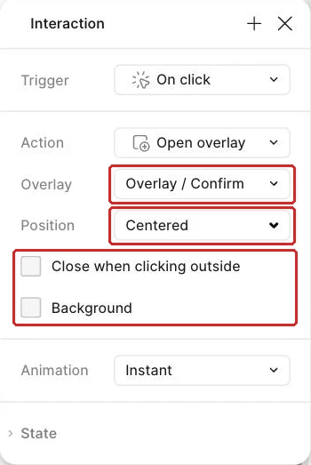
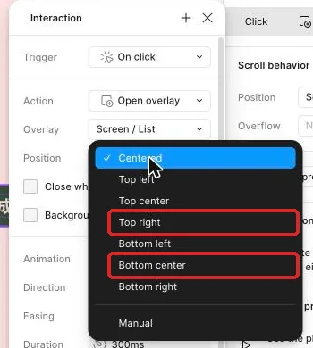
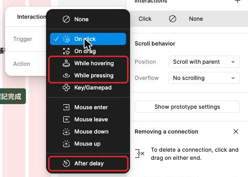

## 內部設計（不進學員頁）

本課新增能力：完整Overlay開關／確認、可取消規則與在已開彈層內Swap的實際路徑。依 `_design/COURSE-BLUEPRINT.md` 的同檔案整合路徑；保留 99h 行政配置，未以真人試跑鎖定分鐘。

| 活動 | 素材／產物 | 操作與決策 | 認知工作／支援 |
|---|---|---|---|
| Demo | 正文提供的完整輸入／方法示範 | 講師建模本課首次方法與可見結果 | 完整理由及步驟 |
| Together | 同一工作室任務清單／學員自己的完成物 | 正文「跟著做」需自行選層、設定與判斷 | 支援遞減，自己定位欄位、解釋檢查結果 |
| Solo | 本課不同條件／修正後完成物 | 正文「自己完成」依新限制選擇方法 | 獨立診斷與遷移，依完成條件判斷 |

素材：正式正文的可複製資料、每課 START-HERE、完成檢查表、共用視覺參考，B7 有 PSD，B8 有下載 ZIP。素材存在／版本由驗證紀錄確認，不以本段自填 PASS。

<!-- learner-content:start -->
# 讓確認彈窗能開啟、取消、確認與交換
副標：工作室行政人員準備完成任務時，需要在保留詳情背景的情況下確認選擇，並能安全取消或看見完成結果。
本堂完成物：確認彈窗的開啟、取消與確認路徑；能交換內容的說明選單；會自動消失的成功提示與底部面板

## 把做好的彈窗接回任務詳情

工作室行政人員已經能進入「整理交付包」詳情並返回清單。現在要把「標記完成」接上確認步驟：彈窗保留詳情背景，取消回到原處，確認後看見完成狀態與成功提示。

這一頁會用到先前做好的確認彈窗、完成後清單、成功提示與詳情按鈕。沒有上次成果時，先打開[轉場與狀態動畫那一頁](CH3-transition-motion-purpose.html)的本堂規格表補做，約需二十到三十分鐘。接著開啟[本堂起始材料](../../courses/uiux-designer/assets/B4-overlay-single-action/START-HERE.html)，核對這些畫面與圖層；完成互動後，再用[本堂完成檢查表](../../courses/uiux-designer/assets/B4-overlay-single-action/reference/EXPECTED-CHECK.html)分別走過取消、確認與外側關閉。

本頁還會做三種 Overlay（彈層）：交換內容的說明選單、從清單底部進入的 Bottom sheet（底部面板），以及顯示後自己關閉的成功提示。這三種例子都讓暫時內容疊在原畫面上。

## Overlay 保留背景，Navigate 換掉整張畫面

這一節先分清楚 Open overlay、Close overlay、Swap overlay 與 Navigate to。選擇哪個 Action，取決於使用者是在原工作上暫時處理一件事，還是要前往另一張完整畫面。

例如，行政人員在整理交付包詳情按「標記完成」時，仍需要看得出自己正在處理哪一筆任務。Open overlay 會把確認彈窗疊在詳情上，背景仍可辨認；按取消使用 Close overlay，彈窗消失後回到原詳情；按確認則用 Navigate to 前往完成清單，因為這一步代表任務狀態與主要畫面都已改變。

| Action | 解決的工作情境 | 本頁例子 | 預期結果 |
|---|---|---|---|
| Open overlay | 在目前畫面上暫時顯示內容 | 開啟確認彈窗、說明選單、排序面板、成功提示 | 背景保留，彈層出現在指定位置 |
| Close overlay | 結束目前彈層 | 取消確認、關閉說明、收起成功提示 | 回到開啟彈層前的背景 |
| Swap overlay | 在原位置換成另一個彈層 | 任務說明換成詳細說明 | 背景與彈層位置保留，內容被替換 |
| Navigate to | 前往另一張完整畫面 | 確認後到完成清單 | 原畫面換成有完成狀態的畫面 |

Swap overlay 必須從已開啟的彈層內觸發，才會在原位置交換另一個彈層；從一般畫面觸發時，效果接近整頁切換。它的返回紀錄規則與整頁 Navigate 不同，因此回到前一個彈層時，再用一個 Swap 明確指定。

Overlay 的位置也是訊息的一部分。確認彈窗用 Centered，小型說明選單用 Top right，排序 Bottom sheet 用 Bottom center，成功提示用 Top center。Manual 表示相對於觸發按鈕的偏移；本頁直接使用四個預設位置，讓出現位置對應內容用途。

背景遮罩能把注意力集中到彈窗，同時保留原畫面線索。Close when clicking outside 適合可取消的確認情境；使用者點遮罩即可回到詳情。若操作需要強制做出選擇，設計上就保留清楚的回應按鈕，並說明關閉規則。

## 示範：完成確認彈窗的三條路徑

這一節把詳情、確認彈窗與完成清單接起來。先依規格表核對名稱與設計值，再逐條建立互動；每完成一條就用 Preview 看結果。

| 類別 | 圖層或設定 | 本堂值 |
|---|---|---|
| 詳情熱區 | `Button / Complete`（標記完成按鈕） | 完整按鈕外框 |
| 確認彈窗 | `Overlay / Confirm`（確認彈窗） | W320；Hug 高；圓角 8 |
| 彈窗內容 | Title、Body、Actions | 垂直排列；Gap 16；Padding 24 |
| 彈窗位置 | Position | Centered |
| 背景遮罩 | Background（勾選） | 黑色；25% |
| 外側關閉 | Close when clicking outside | 開啟 |
| 取消熱區 | `Button / Cancel`（取消按鈕） | Close overlay |
| 確認熱區 | `Button / Confirm`（確認完成按鈕） | Navigate to 完成清單 |
| 完成畫面 | `Screen / List Done`（完成清單） | 整理交付包已完成 |
| 成功提示 | `Toast / Success`（成功提示） | 「任務已完成」 |

1. 在 Layers 選取詳情中的 `Button / Complete`（標記完成按鈕）外框。做完會看到完整按鈕成為原型熱區。
2. 切到 Prototype 分頁，將 Trigger 設為 On click。做完會確認點擊啟動這段互動。
3. 將 Action 設為 Open overlay，Destination 指向 `Overlay / Confirm`（確認彈窗）。做完會看見詳情按鈕連到彈窗 Frame。

4. 在 Overlay 設定中把 Position 選成 Centered。做完後，彈窗會以畫面中央為基準出現。
5. 勾選 **Background**（預設沒有勾），再依規格表設定遮罩顏色與透明度。做完後，詳情仍可辨認，注意力會集中在彈窗內容。
6. 開啟 Close when clicking outside。做完後，點彈窗外的遮罩區可關閉彈層。
7. 從「完成一筆任務」流程開啟 Preview，進入整理交付包詳情並按標記完成。做完會在詳情上方看到確認彈窗。
8. 點擊遮罩，觀察彈窗關閉。做完後，畫面會回到同一筆整理交付包詳情。
9. 回到編輯畫布，選取 `Button / Cancel`（取消按鈕），設定 On click 與 Close overlay。做完後，取消動作會直接關閉當前彈層。
10. 再次預覽並按取消。做完後，詳情標題、說明與期限仍保持原內容。
11. 選取 `Button / Confirm`（確認完成按鈕），設定 On click、Navigate to，目的地選完成清單。做完會看到確認動作前往另一張完整畫面。
12. 將這條切換保持 Instant。做完後，確認結果會立即出現，便於先核對內容。
13. 從登入完整操作到確認彈窗，按下確認完成。做完會看見整理交付包已完成。

三條路徑的差別要能用結果說明：外側關閉與取消回原詳情，確認則前往完成清單。每個熱區只執行一個動作；下一節會把成功提示改成獨立 Overlay，讓它顯示後自己收起。

## 跟著做：交換說明，再從底部打開排序

現在把提示減少，完成兩種不同位置的彈層。第一段練習 Swap overlay 的來源條件；第二段建立 Bottom sheet，讓排序選項從清單底部出現。

| 類別 | 名稱或設定 | 本堂值 |
|---|---|---|
| 選單 | `Overlay / Menu`（任務說明選單） | W280；Vertical；Padding 20；Gap 12；Hug 高 |
| 說明 | `Overlay / Help`（詳細說明） | W280；Hug 高 |
| 選單位置 | Position | Top right |
| 選單交換 | Action | Swap overlay |
| 排序面板 | `Overlay / Sort`（排序底部面板） | W402；Hug 高；圓角 8 |
| 排序內容 | 標題與選項 | 排序方式；期限最近、期限最晚 |
| 面板位置 | Position | Bottom center |
| 面板動畫 | Animation | Move in；由下而上 |

1. 建立 `Overlay / Menu`（任務說明選單），加入「任務說明」標題與「檢視說明」按鈕。完成後，選單會依內容維持自動高度。
2. 複製選單為 `Overlay / Help`（詳細說明），把內文改為「先核對內容與期限，再標記完成。」完成後，較長文字會推高彈層。
3. 在詳細說明加入「關閉」按鈕。完成後，彈層有明確的結束動作。
4. 在詳情新增「說明」按鈕，設定 Open overlay 到任務說明選單。完成後，按鈕會先開啟第一個彈層。
5. 將選單 Position 設為 Top right。完成後，選單會出現在詳情右上區域。

6. 在任務說明選單內，把「檢視說明」設定為 Swap overlay 到詳細說明。完成後，交換動作的來源位於已開啟彈層內。
7. 將詳細說明的關閉按鈕設定為 Close overlay。完成後，關閉會回到原本的任務詳情。
8. 在 Preview 依序開啟選單、交換成詳細說明、關閉彈層。完成後，背景始終是整理交付包詳情，兩個彈層位置維持一致。
9. 回到待處理清單，建立一個「排序」按鈕。完成後，清單有明確入口可叫出排序選項。
10. 建立 `Overlay / Sort`（排序底部面板），加入「排序方式」標題與兩個選項。完成後，面板內容能清楚說明選擇用途。
11. 將排序按鈕設定為 Open overlay 到排序底部面板。完成後，按鈕與面板之間會出現原型連線。
12. 將面板 Position 設為 Bottom center。完成後，面板會貼齊預覽畫面的底部中央。
13. 將 Animation 設為 Move in，方向選由下而上。方向箭頭的樣子以畫面為準，用 Preview 確認面板從底部進入。
14. 為面板加入 Close when clicking outside，並讓每個排序選項有清楚的選取狀態。完成後，使用者可以選擇排序，也能點外側回到清單。
15. 在 Preview 開啟排序面板，觀察清單背景、面板位置與進入方向。完成後，能用「暫時調整清單顯示方式」說明為何使用 Bottom sheet。

確認彈窗放在中央；任務說明靠近右上入口；排序面板由底部進入。三者都保留原畫面，位置則回應內容用途。

## 讓成功提示出現後自己收起

完成任務後，行政人員需要知道操作已成功，又不希望一條提示長時間遮住清單。這一節把成功提示做成 Top center 的 Overlay，並把延遲關閉設定在提示 Frame 本身；提示顯示一小段時間後，就會回到可操作的完成清單。

| 類別 | 圖層或設定 | 本堂值 |
|---|---|---|
| 成功提示 | `Toast / Success` | 「任務已完成」；Hug 寬高 |
| 顯示位置 | Position | Top center |
| 顯示時間 | Trigger | After delay；約 2 秒，單位以畫面為準 |
| 收起動作 | Action | Close overlay |

1. 從完成清單複製現有成功提示，放到畫布空白處。做完會保留原本的文字、顏色與間距。
2. 確認最外層 Frame 命名為 `Toast / Success`（成功提示）。做完會有一個可單獨作為彈層目的地的 Frame。
3. 回到完成清單，新增一個用來測試提示的「顯示完成訊息」按鈕。做完會有明確的開啟入口。
4. 選取按鈕，在 Prototype 的 Interactions 按 ＋。做完會新增一條互動。
5. 把 Action 設為 Open overlay，目的地選成功提示。做完會看到按鈕連到提示 Frame。
6. 將 Position 設為 Top center。做完後，提示會從畫面上方中央顯示。
7. 選取成功提示最外層 Frame，在 Prototype 的 Interactions 按 ＋。做完會把下一條互動加在提示本身。
8. 將 Trigger 設為 After delay。做完會出現延遲時間欄位。

9. 依規格表填入約兩秒的時間。做完後，右側會顯示這段等待時間；欄位單位以你看到的畫面為準。
10. 將 Action 設為 Close overlay。做完會形成「提示出現、等待、關閉」的完整行為。
11. 在 Preview 按「顯示完成訊息」。做完會先看到提示，再看到它自動收起。
12. 提示收起後立刻操作完成清單。做完會確認清單沒有殘留遮擋，按鈕仍能正常使用。

After delay 的互動要放在提示 Frame，而非放在開啟提示的按鈕上。按鈕負責開啟，提示負責計時與關閉，每個熱區仍只有一個清楚動作。

最後再觀察提示消失前後的閱讀順序。提示出現時，文字要能直接說明哪個動作成功；提示收起後，完成清單上的狀態仍要保留，讓結果也能從持續顯示的內容確認。這樣即使使用者剛好移開視線，也能從清單內容確認任務已完成。

## 看兩種確認流程，判斷哪一種讓人知道自己在哪裡

版本一按「標記完成」後，用 Navigate to 前往一張只有白色彈窗的完整畫面。按取消又 Navigate 回清單，原本的整理交付包詳情消失；按確認則到完成清單。使用者在彈窗出現時看不出正在處理哪一筆任務。

版本二用 Open overlay 把確認彈窗放在整理交付包詳情上，背景遮罩降低干擾但仍看得到任務。取消與點擊外側都關閉彈層，確認才 Navigate 到完成清單。請判斷哪一版較符合確認情境，並從背景、取消結果與確認結果說明。

看完自己的判斷再展開

版本二較符合。確認是原任務上的暫時決定，保留詳情背景能維持脈絡；取消與外側關閉都回到同一筆詳情，確認後才前往有完成狀態的完整畫面。版本一把暫時內容做成整頁，取消又回錯層級。

## 卡住時，先看 Action 的來源與結果

這一節將常見問題對回 Action、位置與內容。先找出是哪個熱區觸發，再看它目前位於一般畫面或已開啟彈層，通常就能判斷應使用 Open、Close、Swap 或 Navigate。

| 看到的現象 | 通常的原因 | 怎麼修 |
|---|---|---|
| 確認彈窗出現時背景消失 | 完成按鈕使用 Navigate to | 改為 Open overlay，目的地選確認彈窗 |
| 按取消後回到登入或清單 | 取消按鈕設定了頁面目的地 | 改用 Close overlay，讓原詳情重新可操作 |
| 點彈窗外側沒有關閉 | 外側關閉尚未開啟，或點在彈窗範圍內 | 開啟 Close when clicking outside，再點遮罩區測試 |
| Swap 看起來像整頁切換 | 交換動作從一般畫面觸發 | 先 Open 任務說明選單，再從選單內觸發 Swap |
| 成功提示一直留在畫面 | After delay 加在開啟按鈕，或 Action 不是 Close overlay | 選提示最外層 Frame，重設延遲與關閉動作 |
| 排序面板從錯誤方向進入 | Move in 方向選反 | 在 Preview 觀察起點，再改為由下而上 |

## 換你做：你的題目

現在把確認、底部面板與自動收起的成功提示，套用到你一路完成的預約、點餐或會員 App。

| 預約 | 點餐 | 會員 |
|---|---|---|
| 為「送出預約」做確認彈窗；Bottom sheet 是「選擇時段」；成功提示文字是「預約成功」。 | 為「送出訂單」做確認彈窗；Bottom sheet 是「客製選項」，內容包含冰熱、甜度與加購；成功提示文字是「訂單已送出」。 | 為「確認兌換」做確認彈窗；Bottom sheet 是「排序方式」，內容包含點數低到高與最新上架；成功提示文字是「兌換成功」。 |

要達成的條件：

- 從送出或確認動作開啟確認彈窗，背景保留目前處理的服務、品項或兌換品。
- 取消後回到原畫面，已填或已選內容保持原狀。
- 確認後前往結果畫面，狀態文字清楚寫出結果。
- 點擊彈窗外側有一個事先決定且能說明理由的結果。
- 底部面板的標題與內容完全符合上表，不增加需求頁沒有的欄位。
- 面板由畫面底部進入，位置與進入方向一致。
- 成功提示位於畫面上方，顯示後會自動收起。
- 每個熱區只執行一個動作。

合格的結果要能通過以下自我檢查：

- 開啟確認彈窗時，仍能辨認正在處理哪個服務、品項或兌換品。
- 取消、確認與外側點擊三條路徑各有明確結果。
- 確認結果不只換顏色，也有與題目一致的成功文字。
- 底部面板的內容可直接對回需求頁，沒有引用資料表以外的欄位。
- 成功提示出現後會自行關閉，關閉後原畫面仍可操作。
- 從流程起點重跑時，確認彈窗、底部面板與成功提示不會互相遮蔽或留在畫面上。

真的卡住再看：提示

先寫下三個元件各自的預期結果：確認彈窗處理決定、底部面板處理暫時選項、成功提示只回報結果；再逐一檢查開啟來源、位置與關閉方式。

## 讓暫時決定有清楚的來處與去向

你已經把整理交付包的確認彈窗接成三條可觀察路徑：外側關閉與取消回到原詳情，確認前往有完成狀態的清單。你也完成了從已開啟選單交換說明、由底部進入的排序面板，以及顯示後自己收起的成功提示；四種彈層都保留原工作脈絡，只在完成主要決定時切換完整畫面。

下一頁會把待處理清單加長，讓內容在固定高度內垂直捲動，並處理固定頁首、底部導覽與漂浮按鈕。這一頁建立的排序面板會繼續依附在清單上，因此清單捲動時，開啟面板仍要從畫面底部出現。

想一想：為什麼確認彈窗的取消適合 Close overlay，而成功提示適合 After delay 後 Close overlay？

看參考答案

取消代表使用者主動放棄暫時決定，所以按下按鈕後立刻關閉；成功提示只負責短暫回報結果，讓它在一段時間後自動關閉，可以把操作空間還給完成清單。

完成條件：

- 整理交付包的確認彈窗可開啟、取消、外側關閉與確認完成。
- 任務說明從已開啟選單交換到詳細說明，關閉後回到原詳情。
- 排序 Bottom sheet 由清單底部進入，位置與用途一致。
- 自選題目的成功提示會自動收起，確認與底部面板符合需求頁。

## 本堂查證來源

- [Figma：Create overlays in your prototypes](https://help.figma.com/hc/en-us/articles/360039818254-Create-Overlays-in-your-Prototypes)
- [Figma：Prototype actions](https://help.figma.com/hc/en-us/articles/360040035874-Prototype-actions)

來源查證：2026-11-02。
<!-- learner-content:end -->

## 講師授課筆記（不進講義）

先用正文入口題檢查前提，再以短示範讓學員同步操作。每次核心狀態改變立即檢查；主要時間用於自行製作、同儕解釋、錯誤修復與新條件作品。先核對學員真實工具權限與檔案；未達完成條件回到本堂修復位置，不以教師代做當成完成。此稿為作者設計與自審，真人理解／遷移與平台實測須另留證據。
