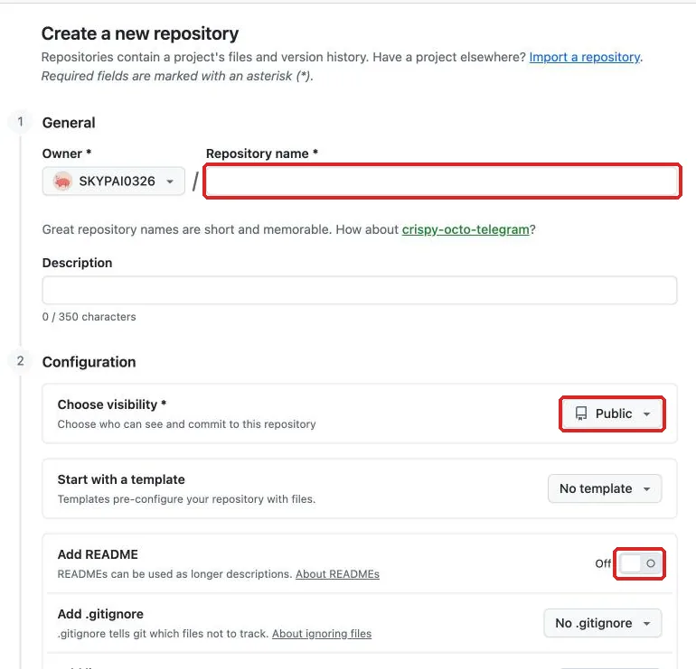
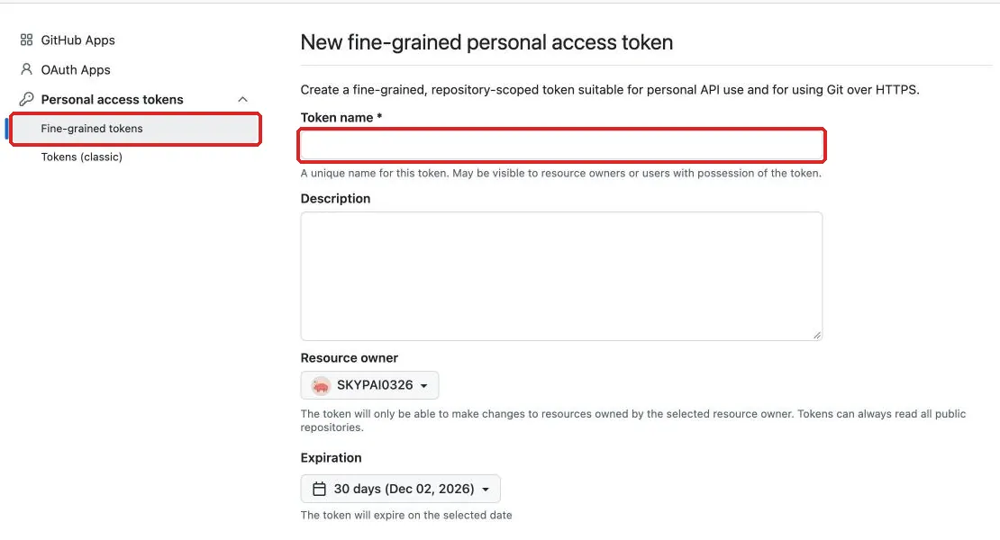
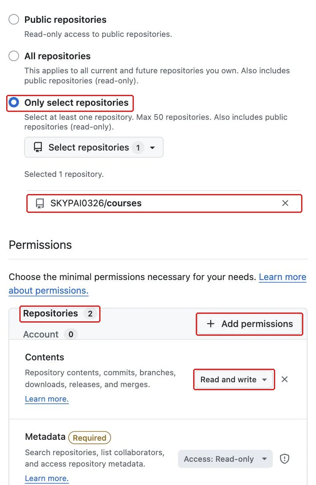
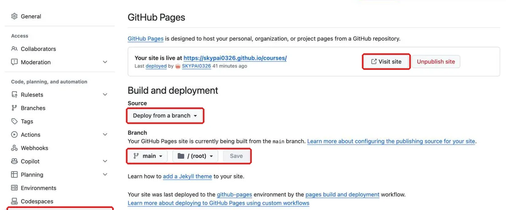

## 內部設計（不進學員頁）

本課新增能力：從完整可執行程式理解與修改網站，實作獨立Git基準／差異／遠端與公開部署更新。依 `_design/COURSE-BLUEPRINT.md` 的同檔案整合路徑；保留 99h 行政配置，未以真人試跑鎖定分鐘。

| 活動 | 素材／產物 | 操作與決策 | 認知工作／支援 |
|---|---|---|---|
| Demo | 正文提供的完整輸入／方法示範 | 講師建模本課首次方法與可見結果 | 完整理由及步驟 |
| Together | 同一工作室任務清單／學員自己的完成物 | 正文「跟著做」需自行選層、設定與判斷 | 支援遞減，自己定位欄位、解釋檢查結果 |
| Solo | 本課不同條件／修正後完成物 | 正文「自己完成」依新限制選擇方法 | 獨立診斷與遷移，依完成條件判斷 |

素材：正式正文的可複製資料、每課 START-HERE、完成檢查表、共用視覺參考，B7 有 PSD，B8 有下載 ZIP。素材存在／版本由驗證紀錄確認，不以本段自填 PASS。

<!-- learner-content:start -->
# 把設計做成網站，留下版本與公開網址
副標：把已整理好的工作室介面交付包轉成能操作的網站，讓接手者能從公開網址查看，也能從版本紀錄理解你改了什麼。
本堂完成物：一個本機能操作的工作室網站；一段看得出修改順序的版本紀錄；一個完成更新確認的公開網址

## 從設計交付包接到真正能開啟的網站

工作室準備把待處理清單交給合作夥伴使用。對方需要能登入、查看詳情、取消確認、完成任務，再回到清單查看結果的網站。這次要把既有設計對應到 HTML、CSS 與 JavaScript，並用 Git 留下修改紀錄。

這堂會用到上次整理好的交付資料夾，特別是主要色、按鈕規格、透明 PNG 徽章與畫面操作流程。先打開[網站製作起始材料](../../courses/uiux-designer/assets/B8-web-git-deploy/START-HERE.html)，確認要下載的專案與準備項目，再把[完成檢查表](../../courses/uiux-designer/assets/B8-web-git-deploy/reference/EXPECTED-CHECK.html)留在瀏覽器分頁中。完整專案放在[工作室網站下載包](../../courses/uiux-designer/assets/shared/studio-tasks-web.zip)，想先看成品行為時，也可以開啟[完整網站參考](../web-starter/index.html)。

下載包已經能執行，讓你先讀懂網站再修改。解壓後會看到 `index.html`、`styles.css`、`app.js`、`README.md` 與 `assets` 資料夾；先用瀏覽器開啟 `index.html`，走過登入、詳情、取消、確認與已完成清單。重新整理會恢復預設資料，因為狀態只留在當次頁面記憶體裡。確認流程後，以 VS Code 的 File → Open Folder 開啟專案，再從 Terminal → New Terminal 開啟終端機。

## 先想清楚：網站三個檔案與版本紀錄各管一件事

先分清楚內容、外觀、行為、版本與公開網址各由誰負責，後面才能找對檔案並拆開提交。

| 你想改的事情 | 主要位置 | 它負責什麼 | 改完先看哪裡 |
|---|---|---|---|
| 頁面標題、按鈕文字、登入與彈窗結構 | `index.html` | 決定頁面有哪些內容，以及內容之間的結構 | 瀏覽器畫面是否出現正確文字與區塊 |
| 主要色、間距、字級、手機排列 | `styles.css` | 決定相同內容看起來如何，以及窄畫面怎麼重新排列 | 按鈕、導覽、卡片與手機寬度 |
| 任務資料、畫面切換、確認與清單更新 | `app.js` | 決定資料是什麼，以及按下控制項後發生什麼事 | 登入、詳情、取消、確認與已完成清單 |
| 修改說明與操作範圍 | `README.md` | 告訴接手者如何開啟、怎麼測、有哪些簡化 | 檔案說明是否和實際成品一致 |
| 每次可回看的修改節點 | Git commit | 保存某一個清楚目的的檔案狀態 | `git log` 與該次差異 |
| 遠端檔案與公開網站 | GitHub 與 GitHub Pages | 保存推送上去的版本，並從指定分支發布靜態網站 | repo 檔案、Actions 與 Pages 網址 |

例如，作品名稱在 `index.html`，共用主要色在 `styles.css` 的 `--primary`，任務內容則在 `app.js` 開頭的陣列。HTML 的 `id` 是單一物件名稱，`class` 是可重複使用的分類；CSS 與 JavaScript 會用這些名稱找到正確物件。

```html
<button id="complete-task" type="button">標記完成</button>
```

CSS 開頭的 `:root` 集中色彩角色。`--primary` 同時控制主要按鈕與導覽選中狀態，做法與設計檔裡的共用規則相同。

```css
:root {
  --primary: #245B45;
  --text: #1E293B;
  --muted: #5F6C80;
  --surface: #F5F7FA;
}
```

JavaScript 開頭的 `tasks` 是任務陣列；`title`、`due` 與 `done` 分別是標題、期限與完成狀態；`due` 的文字會出現在清單卡片的狀態後面，也會出現在詳情畫面。後方迴圈補出長清單，用來檢查捲動與固定導覽。

Git 的工作資料夾放正在編輯的內容，暫存區放下一次準備提交的內容，commit 保存附有說明的版本。`git diff` 看尚未暫存的修改，`git diff --cached` 看即將提交的修改。GitHub 收到推送的版本後，Pages 才能部署公開網站；因此要分別確認 repo、Actions 與公開畫面。

## 示範：先保存原始網站，再逐項修改與發布

先把下載包原封不動保存成基準，再分別修改標題、主要色與長任務資料，最後推到 GitHub Pages 並確認更新。

| 類型 | 名稱或位置 | 現稿設計值／用途 | 完成時看見的結果 |
|---|---|---|---|
| 樣式檔 | `styles.css` | 主要色 `#245B45`；文字色 `#1E293B`；次要文字 `#5F6C80`；表面色 `#F5F7FA` | 內容有清楚層次與共用色彩 |
| 主要按鈕 | `button` | 最小高度 48；圓角 8 | 點擊範圍與設計稿一致 |
| 任務卡片 | `.task-card` | 內距 16；間距 16；圓角 8 | 長標題可換行，操作仍清楚 |
| 清單間距 | `.task-list` | 卡片間距 12 | 相鄰任務保持可辨識 |
| 狀態徽章 | `.badge` | 32 × 32；檔案 `assets/status-badge.png` | 已完成項目顯示透明徽章 |
| 確認彈窗 | `#confirm-dialog` | 寬度上限 320；內距 24；圓角 8 | 窄畫面仍保留左右空間 |
| 底部導覽 | `#bottom-nav` | 最小高度 64；固定在視窗底部 | 長清單捲動時仍可切換狀態 |
| 主內容 | `main` | 底部留白 160 | 最後一筆資料留在導覽上方 |
| 漂浮按鈕 | `#scroll-top` | 48 × 48；距底部 88 | 長清單可回到頂端 |
| 手機排列 | `@media (max-width: 560px)` | 任務卡改為上下排列，卡片按鈕全寬 | 長文字和按鈕各自保有空間 |

1. 解壓下載包並進入含 `index.html` 的資料夾。完成後，主要檔案與 `assets` 會在同一層。
2. 用瀏覽器走過登入、詳情、取消與確認。完成後，原始流程可以操作。
3. 用 VS Code 開啟專案，再選 Terminal → New Terminal。完成後，終端機位於專案資料夾。
4. Windows 從 `git-scm.com` 安裝 Git for Windows，再重開 VS Code。完成後，終端機能辨識 Git。
5. Mac 執行 `git --version`，依系統視窗安裝開發者工具，也可執行 `xcode-select --install`。重開終端機後會顯示版本。
6. 到 `github.com` 註冊並驗證 Email。完成後，帳號可建立 repo 與發布網站。
7. 到 GitHub 頭像 → Settings → Emails，開啟 Keep my email addresses private 並複製 noreply 地址。完成後，你會取得 commit Email。
8. 初始化專案並設定提交身分。完成後，Git 會使用指定名稱與 Email。

```bash
git init -b main
git config user.name "你的姓名"
git config user.email "你的 noreply 地址"
git status
```

9. 用明確檔名加入原始專案。完成後，`git status` 與暫存差異會列出即將提交的內容。

```bash
git add index.html styles.css app.js README.md assets/status-badge.png
git status
git diff --cached
```

10. 提交原封不動的第一個版本。完成後，紀錄會出現基準版本，工作區會乾淨。

```bash
git commit -m "Create studio task website"
git log --oneline
git status
```

11. 分頁底部出現 `:` 或 `(END)` 時按 `q`。完成後，終端機會回到命令列。
12. 把頁首改成自己的工作室名稱。完成後，瀏覽器只更新標題。
13. 檢查並提交標題差異。完成後，版本只包含 `index.html` 的文字修改。

```bash
git diff -- index.html
git add index.html
git diff --cached -- index.html
git commit -m "Update studio heading"
```

14. 把 `--primary` 換成已確認的主要色。完成後，主要按鈕與導覽會同步換色。
15. 檢查並提交樣式差異。完成後，版本只包含主要色修改。

```bash
git diff -- styles.css
git add styles.css
git diff --cached -- styles.css
git commit -m "Update primary color"
```

16. 把長任務改成「核對本週活動報名名單並補齊聯絡電話與到場時間」。完成後，清單與詳情顯示同一筆長內容。
17. 在窄畫面檢查後提交 `app.js`。完成後，版本只包含資料修改。

```bash
git diff -- app.js
git add app.js
git diff --cached -- app.js
git commit -m "Update long task content"
```

18. 執行 `git log --oneline`。完成後，資料、色彩、標題與基準各有一筆紀錄。
19. 從 GitHub 右上「+」選 **New repository**，Repository name 填 `studio-tasks-web`，visibility 維持 **Public**；Add README 保持 Off，.gitignore 與 license 保持 No，再按 **Create repository**。完成後，會得到空白 repo 網址。



20. 加入遠端並推送 `main`。完成後，repo 會顯示檔案與版本紀錄。

```bash
git remote add origin https://github.com/USERNAME/studio-tasks-web.git
git remote -v
git push -u origin main
```

21. Windows 依首次推送的瀏覽器畫面完成授權。完成後，repo 會收到檔案。
22. Mac 到 GitHub 頭像 → Settings → Developer settings → Personal access tokens → Fine-grained tokens，按 Generate new token：Token name 自訂，Repository access 選 **Only select repositories** 並選 `studio-tasks-web`，Permissions 按 **Add permissions** 加入 **Contents**，設為 Read and write，最後按 Generate token 並複製。推送時填帳號並把 token 貼到 Password；完成後會顯示推送結果。






23. Windows 若未出現瀏覽器登入，也使用 fine-grained token。完成後，repo 會收到檔案。
24. 在 repo 開啟 Settings → Pages；窄視窗可從「…」找到 Settings。完成後會出現 Build and deployment。
25. 選 Deploy from a branch、`main` 與 `/(root)`，再按 Save。完成後會開始部署。



26. 到 Actions 查看進度並預留約十分鐘。完成後，Pages 會顯示網址與 Visit site。
27. 開啟 Pages 顯示的網址。完成後，線上網站可以走完主要流程。
28. 修改 README 的作品名稱，提交並推送。完成後，Actions 會再次部署。

```bash
git add README.md
git commit -m "Clarify project title"
git push
```

29. 等部署完成後比對公開網站與最新提交。完成後，整條更新路徑已接通。

## 跟著做：用較少提示重走一輪版本流程

示範已走過每個入口，現在請自行判斷檔案位置，完成一個小型更新。

1. 改一段頁面文字。完成後，瀏覽器只出現預期文字變化；提示：從結構檔找原文。
2. 查看工作區狀態與普通差異。完成後，你能指出修改前後的行。
3. 加入該檔案並查看暫存差異。完成後，暫存區只含這次修改。
4. 寫一則說明目的的 commit 訊息。完成後，`git log --oneline` 最上方會出現新版本。
5. 推送到既有遠端。完成後，repo 顯示相同檔案與版本。
6. 等 Actions 完成後開啟公開網址。完成後，新文字出現，登入、取消與確認仍可操作。

最後讀一次 `git log --oneline`，確認每筆訊息都能回答「這次為什麼改」。

## 看兩種版本紀錄，判斷哪一種容易接手

這個判斷練習要檢查你是否真的理解「一項修改一個版本」的價值。先讀兩個版本的畫面描述，再決定哪一版能讓接手者較快找到問題。

版本一的網站外觀看起來正確，`git log` 只有一筆「修改網站」。打開那筆差異後，同時看到頁首名稱、主要色、長任務內容、README 與徽章都改了。現在公開網站的主要色顯示錯誤，接手者需要逐一翻找所有變更，才能猜出是哪個檔案造成。

版本二的網站外觀看起來相同，`git log` 依序列出建立網站、更新標題、更新主要色、更新長任務內容、替換徽章與補充說明。打開「更新主要色」只看到 `styles.css` 的色彩角色變化；若公開網站顏色有問題，接手者能直接檢查那筆差異，也能把問題範圍縮到樣式檔。

你會選哪一版作為交付版本？除了「比較整齊」之外，請說出它如何協助找錯、回看與溝通。

<details><summary>看完自己的判斷再展開</summary><p>版本二較容易接手，因為每筆 commit 只回答一個修改目的。顏色出錯時可以直接查看主要色那筆差異，資料出錯時則查看資料版本；版本訊息、檔案差異與畫面結果形成清楚對應。版本一雖然也保存了成品，卻把多種原因混在一起，查找與回復都需要更多判斷。</p></details>

## 卡住時，先看現象落在哪一層

遇到問題時，先用畫面現象判斷是資料夾、瀏覽器、Git、GitHub 登入還是 Pages 部署，再做對應修正。這樣能保留目前已完成的版本，也能避免在不同層重複改同一件事。

| 看到的現象 | 通常的原因 | 怎麼修 |
|---|---|---|
| 畫面有內容，但樣式消失或徽章破圖 | 相對路徑、檔名大小寫或資料夾層級改變 | 核對 `styles.css`、`app.js` 與 `assets/status-badge.png` 的位置和引用文字 |
| `git add` 出現 LF／CRLF 提示 | Windows 與專案使用的換行格式不同 | 把它視為換行提醒，繼續檢查暫存差異與本次檔案即可 |
| `git diff` 看起來完全沒有內容 | 檔案尚未儲存、修改已進暫存區，或目前資料夾不是專案根目錄 | 先儲存檔案，再用 `git status` 判斷該看普通差異或暫存差異 |
| `git log` 停在 `(END)`，終端機無法輸入 | 內容正在分頁檢視器中 | 按 `q` 離開分頁畫面，回到命令提示符號 |
| 第一次 `git push` 要求 Password，輸入時畫面沒有字元 | Mac 或備用登入路徑正在讀取 token，終端機會隱藏敏感輸入 | 貼上具備指定 repo Contents 讀寫權限的 fine-grained token，再送出 |
| Pages 顯示 404 或舊內容 | 發布來源有誤、部署仍在進行，或最新 commit 尚未 push | 對照 repo 與 Actions，再核對 `main`、`/(root)` 及根目錄的 `index.html` |

## 換你做：報名確認 App

活動主辦單位的行政人員需要用手機逐筆確認報名資料。請把網站改成報名確認情境，並讓公開網址顯示你的資料與設計。

要達成的條件：

- 把標題、登入、清單、詳情、彈窗與完成提示改成一致的報名用詞。
- 把陣列改成 `SIGNUP-DATA.csv` 的三筆報名；姓名放 `title`，備註放原本寫期限的 `due`，並納入張家豪的長備註。
- 檢查陣列後方自動產生示範任務的迴圈；選擇把它改成產生「報名者 n」，或移除這段迴圈，並在 README 寫下選擇與理由。
- 換上自己的透明 PNG 徽章，並把 `--primary` 換成已檢查對比的主色。
- 資料、透明徽章、主要色各自形成一筆 commit；每筆提交前都先看差異，提交後都能從版本訊息說出修改目的。
- 推送到 repo，等 Pages 完成，再確認公開網站的資料、徽章、主色與操作。

合格的結果要能通過這些自我檢查：

- 公開網址能走完清單、詳情、取消與確認；張家豪的備註會自然換行。
- 完成後的狀態、提示與徽章一致，README 說明重新整理後的資料行為。
- 自動資料與報名情境一致，或迴圈已移除；README 解釋這項選擇。
- 版本紀錄分得出資料、徽章與主色，Actions 與 Pages 也對應最新版本。

<details><summary>真的卡住再看：提示</summary><p>先按「畫面文字、資料、圖片、色彩」把問題分到 index.html、app.js、assets 或 styles.css。資料換完後若備註沒有出現，檢查它是否放在 due 欄位、引號與逗號是否成對。</p></details>

## 收尾：把一次成品變成可持續更新的交付

回到工作室交付情境，你現在交出的不只是能開啟的頁面。下載包先以原始狀態建立基準，之後的標題、色彩與資料都有各自版本；GitHub repo 保存遠端檔案，Pages 網址讓合作夥伴直接操作，最後一次小更新則確認這條發布路徑能繼續使用。當畫面出現問題時，你也能從檔案分工、commit 差異、Actions 狀態與公開網站逐層找到原因。

這是整套作品從設計走到交付的最後一步。之後再增加新功能或調整內容時，仍沿用同一節奏：先在本機完成一個清楚改變，檢查畫面與差異，提交版本，推送，再確認線上部署。這樣每一次更新都能被理解，也能在需要時回看。

想一想：為什麼下載包解壓後立刻執行普通 `git diff`，可能看不到任何檔案內容；而建立基準版本之後，同一個命令卻能顯示修改？

<details><summary>展開參考答案</summary><p>剛初始化時，下載包裡的檔案仍是未追蹤內容，普通 git diff 沒有已保存基準可供比較。先用明確檔名加入暫存區，以 git diff --cached 檢查並提交原始版本後，Git 就有了基準；接下來的檔案修改可由普通 git diff 顯示。</p></details>

完成條件：

- 本機網站可以走完登入、詳情、取消、確認與已完成清單，長內容和最後一筆資料都能完整查看。
- 版本紀錄包含原始基準與分項修改，每一筆訊息都能對應實際差異。
- GitHub repo 收到最新版本，Pages 公開網址可操作，後續更新也已在線上確認。
- 報名確認 App 的資料、徽章與主色完成遷移，公開畫面與 README 說明一致。

## 本堂查證來源

- [Git 官方下載](https://git-scm.com/downloads)
- [Git：第一次設定提交身分](https://git-scm.com/book/en/v2/Getting-Started-First-Time-Git-Setup)
- [Git：記錄檔案修改與提交](https://git-scm.com/book/en/v2/Git-Basics-Recording-Changes-to-the-Repository)
- [GitHub：建立新 repository](https://docs.github.com/en/repositories/creating-and-managing-repositories/creating-a-new-repository)
- [GitHub Pages：設定發布來源](https://docs.github.com/en/pages/getting-started-with-github-pages/configuring-a-publishing-source-for-your-github-pages-site)

來源查證：2026-11-02。
<!-- learner-content:end -->

## 講師授課筆記（不進講義）

先用正文入口題檢查前提，再以短示範讓學員同步操作。每次核心狀態改變立即檢查；主要時間用於自行製作、同儕解釋、錯誤修復與新條件作品。先核對學員真實工具權限與檔案；未達完成條件回到本堂修復位置，不以教師代做當成完成。此稿為作者設計與自審，真人理解／遷移與平台實測須另留證據。
