# ACP Premiere Pro 學科詳解（截圖支撐 25 題）

- 日期：2026-11-03
- 範圍：有考試截圖支撐的學科題，題號沿用 [`../MOCK-EXAM-SOURCE-MAP.md`](../MOCK-EXAM-SOURCE-MAP.md)。
- 題目與選項都是英文原文，照「來源」那張截圖逐字轉錄。只有講解用中文。
- 正解：選項以粗體加「← 正解」標示。點選介面題的正解在圖上用紅框標出。
- 考試每次作答的選項順序都不一樣，記答案要記選項內容，不要記字母。

---

### A02｜複選（Choose 3）
來源：`145435.png`

Which three codecs or container types are specific to video files? (Choose 3.)

- A) MP3
- **B) MOV** ← 正解
- C) PNG
- **D) MPEG4** ← 正解
- E) AAC
- **F) H.264** ← 正解

**講解**：題目問的是 video files 專用的格式。MOV 是影片容器（container），MPEG4 和 H.264 是影片編碼（codec）。MP3、AAC 是音訊格式，PNG 是靜態圖片。記法：看到 audio 格式（MP3、AAC）和 image 格式（PNG）就排除。

---

### A07｜點選介面（可多種方法）
來源：`145309.png`

You need to temporarily silence all tracks except A2. All tracks must remain editable.

What should you do?

Select the appropriate option or options in the answer area.

Note: There might be more than one correct method to meet the requirements. You will receive credit for any correct method.

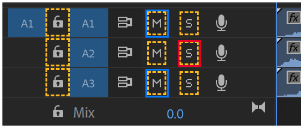

**正解**：點 A2 的 **S（Solo Track）**（紅框）。另一種同樣給分的方法：點 A1 和 A3 的 **M（Mute Track）**（藍框）。

**講解**：temporarily silence 是暫時不出聲，Solo 和 Mute 都只影響播放，不影響編輯。題目要求 remain editable，所以不能按鎖頭（Toggle Track Lock），鎖住的軌道就不能編輯。Solo A2 只要按一次，是最快的方法。

---

### A10｜點選介面
來源：`144809.png`

You need to uniformly change the vertical spacing between lines of type within a multiline paragraph.

Which setting should you modify in the Properties panel?

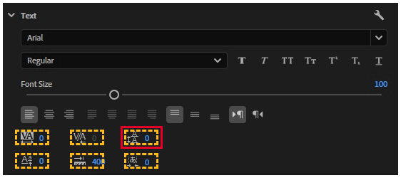

**正解**：**Leading**（第一排第三個，A 疊 A 加上下箭頭的圖示）。

**講解**：vertical spacing between lines 是行與行之間的垂直距離，也就是 Leading（行距）。同一排前兩個是 Tracking 和 Kerning，調的是字元左右的間距，和 A16 是同一組設定。

---

### A12｜複選（Choose 3）
來源：`IMG_4777`

Before creating a video for a client, which three questions are important to ask the client? (Choose 3.)

- **A) Video purpose** ← 正解
- B) Target video codec
- **C) Target audience** ← 正解
- **D) Client goals** ← 正解
- E) Marketing strategy

**講解**：開拍前要先問清楚三件事：影片要做什麼（purpose）、給誰看（audience）、客戶想達成什麼（goals）。codec 是輸出時的技術設定，不需要問客戶；marketing strategy 是客戶自己的事，不是影片需求。

---

### A15｜點選介面
來源：`145459.png`

You need to add a video clip from the Source Monitor to the Timeline and move all other clips to the right of the added clip.

Which button should you select? Select the appropriate button in the answer area.

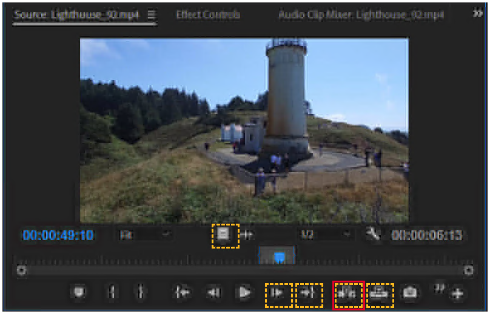

**正解**：**Insert**（快捷鍵 `,`）。在右下角兩個並排的置入按鈕中，是左邊那個。

**講解**：move all other clips to the right 就是把後面的片段往後推，這是 Insert。右邊的 Overwrite（快捷鍵 `.`）會直接蓋掉原本位置的片段，不會往後推。記法：Insert 插入、會推；Overwrite 覆蓋、不推。

---

### A16｜點選介面（Choose 2）
來源：`IMG_4775`；對照 `IMG_4819`

Which two settings can you modify to change the space between the characters in the word THAI? (Choose 2.)

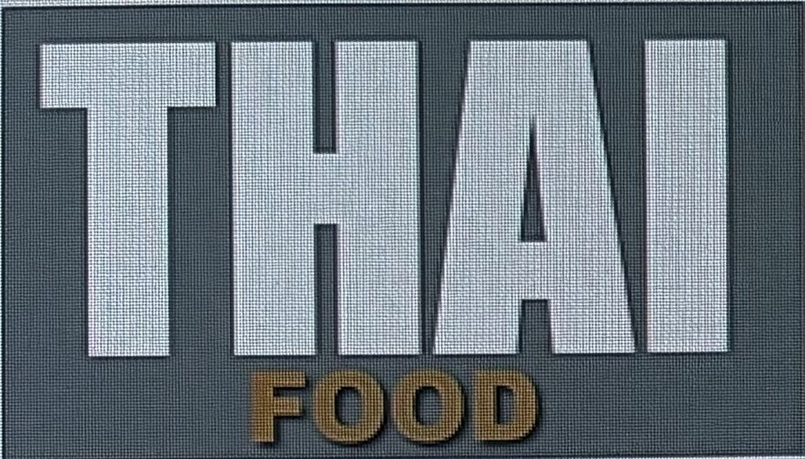

Note: You will receive partial credit for each correct response.

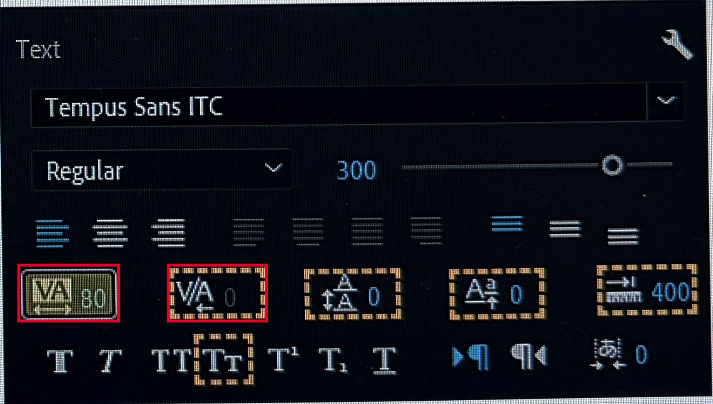

**正解**：**Tracking**（VA 下方有雙向箭頭，數值 80）和 **Kerning**（V/A）。

**講解**：space between the characters 是字元之間的距離。Tracking 一次調整整段文字的字距，Kerning 調整兩個字元之間的字距，兩個都算。旁邊的 Leading 管行距（A10），Baseline Shift 管文字上下位移，都不是字距。

---

### A19｜單選
來源：`IMG_4787`；題圖取自主檔 S64

You need to make image 1 look like image 2.

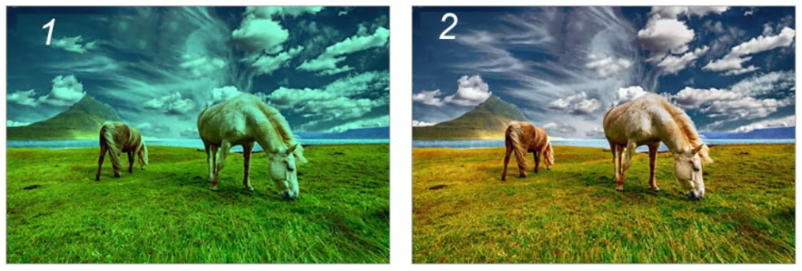

Which element should you adjust?

- A) aperture
- **B) white balance** ← 正解
- C) resolution
- D) room tone
- E) contrast

**講解**：兩張圖只差在顏色，image 1 整體偏青綠，image 2 是自然色，這是色偏問題，要調 white balance（白平衡）。contrast 只改明暗反差，resolution 是解析度，aperture 是拍攝時的光圈，room tone 是環境音，都和色偏無關。

---

### A21｜拖曳配對
來源：`145031.png`；對照主檔 S66

Move the audio adjustment to the area on the right that describes its result.

Note: You will receive credit for each correct response.

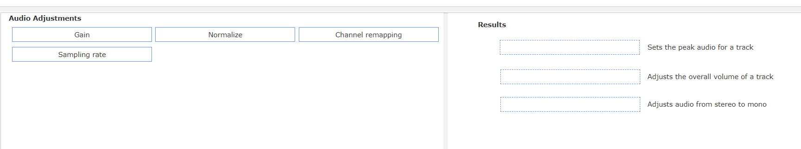

| Results（右側描述） | 正解（左側項目） |
|---|---|
| Sets the peak audio for a track | **Normalize** |
| Adjusts the overall volume of a track | **Gain** |
| Adjusts audio from stereo to mono | **Channel remapping** |
| （不使用） | Sampling rate |

**講解**：
- Normalize 是把音量自動調到指定的峰值（peak），對應 sets the peak。
- Gain 是整體放大或縮小音量，對應 overall volume。
- Channel remapping 是重新分配聲道，例如立體聲改單聲道，對應 stereo to mono。
- Sampling rate 是取樣率，屬於錄音規格，右邊沒有對應的描述，是干擾項。

---

### A22｜點選介面
來源：`IMG_4778`

You need to import this Photoshop file as a single image that includes only layers 1 and 2.

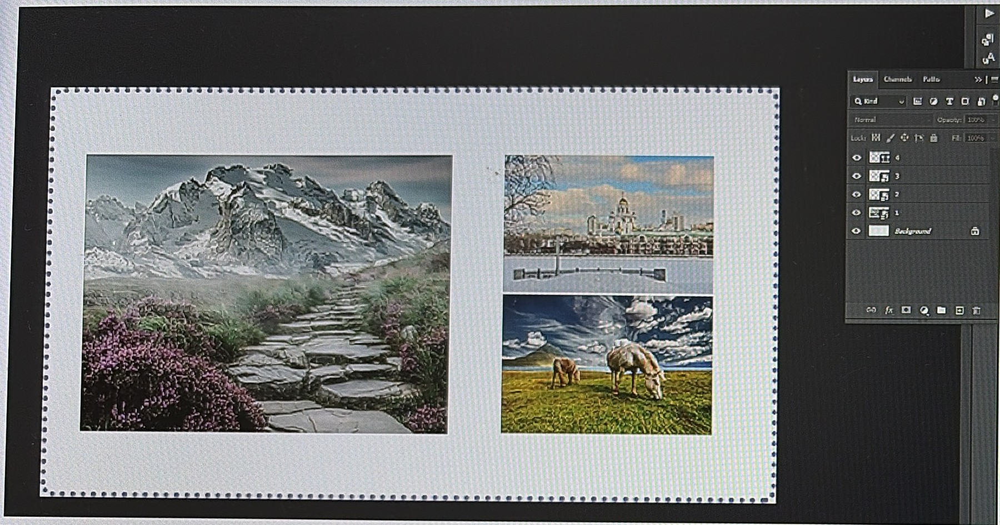

A Photoshop document and the import requirements are shown on the left.

Which import options should you select to meet the requirements?

To answer, select the correct import dialog options in the answer area.

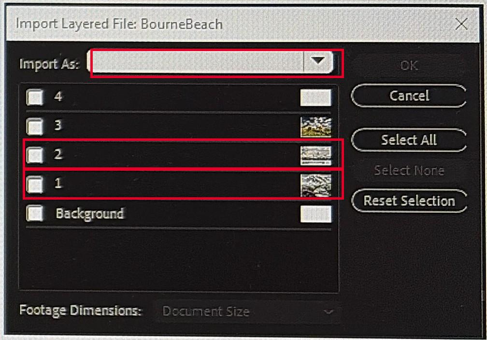

**正解**：
1. Import As 選 **Merged Layers**。
2. 只勾選圖層 **2** 和 **1**，不勾 4、3、Background。

**講解**：single image 代表要合併成一個檔案，only layers 1 and 2 代表只取部分圖層，所以用 Merged Layers 並只勾 1、2。Import As 的四個選項（主檔 S67）：
- Merge All Layers：所有圖層合併，不能挑選圖層。
- Merged Layers：只合併勾選的圖層，就是本題。
- Individual Layers：每個圖層各自成為一個檔案。
- Sequence：每個圖層各自成為檔案，並自動建立分軌序列（A35）。

---

### A23｜單選
來源：`IMG_4776`；對照 `IMG_4817`

During review, a team member notes that the on-screen title text is difficult to read on mobile devices and for users with low vision.

Which adjustment will improve accessibility?

- **A) Add a solid background box of a complementary color of the text.** ← 正解
- B) Replace the current stroke with a drop shadow of the same color.
- C) Replace the sans serif font with a serif font.
- D) Decrease the frame rate of the project from 30fps to 24fps.

**講解**：difficult to read 的關鍵是文字和背景對比不夠。在文字後面加一個顏色對比強的實色底框（solid background box），在小螢幕上也看得清楚。同色的 drop shadow 沒有增加對比；換成 serif 字體也沒有改善對比，筆畫細節在小螢幕上還更容易糊掉；frame rate 和閱讀無關。

---

### A24｜單選
來源：`IMG_4779`

Your client requests a 4K video in Ultra HD with a 16:9 aspect ratio.

Which frame size should you select when creating your sequence?

- A) 1280 x 720
- **B) 3840 x 2160** ← 正解
- C) 1920 x 1080
- D) 2560 x 1440

**講解**：4K Ultra HD（UHD）是 3840 × 2160，剛好是 Full HD 1920 × 1080 的長寬各兩倍。1280 × 720 是 HD（720p），2560 × 1440 是 QHD（1440p）。記法：UHD＝3840。

---

### A25｜單選
來源：`IMG_4780`；對照 `IMG_4820`

You add a music track to your commercial project. The track license requires attribution.

What must you do to use the track legally?

- **A) Include the creator's name, track title, source, and license in the credits.** ← 正解
- B) Include the creator's name, track title, source, and license in the metadata.
- C) Remix the track and apply for a Creative Commons license for the new track.
- D) Have the cast thank the creator at the end of the credits.

**講解**：attribution 是姓名標示，要讓觀眾看得到，所以寫在片尾名單（credits）。內容要有四項：作者、曲名、來源、授權（Creative Commons 稱為 TASL）。寫在 metadata 觀眾看不到；口頭感謝資訊不完整；改編後也不能自己換授權。

---

### A26｜單選
來源：`145240.png`；對照 `IMG_4781`、`IMG_0595`

Which method should you use to remove a green screen background?

- A) Extract
- B) Color Correction
- C) Adjustment Layer
- **D) Ultra Key** ← 正解

**講解**：去綠幕在 Premiere 叫「去背（keying）」，用 Effects > Video Effects > Keying > Ultra Key，用吸管點選綠色就能去掉。Extract 是剪掉一段時間範圍（A30），Color Correction 是調色，Adjustment Layer 是套效果用的空白圖層，都不能去背。

---

### A27｜單選
來源：`IMG_4782`；對照 `IMG_4816`

You are using a sequence as a source. Insert and overwrite sequences as nests or individual clips is not selected on the timeline.

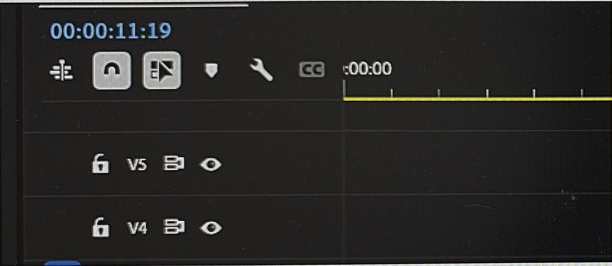

How will the clips be placed in the timeline?

- A) As Grouped Clips
- B) As Associated Clips
- C) As Nested clips
- **D) As Individual Clips** ← 正解

**講解**：Timeline 左上角這個按鈕切換的是「把序列當成一整塊（nest）放入」還是「拆成原本的個別片段放入」。題目說 is not selected（關閉），所以會拆成個別片段（Individual Clips）。按鈕開啟時才是 Nested。Grouped 和 Associated 不是這個按鈕的選項。

---

### A28｜是非（True／False）
來源：`145337.png`；對照 `IMG_4783`、`IMG_4818`

For each statement about the use of captions with video in Adobe Premiere Pro, select whether the statement is True or False.

| Statement | 正解 |
|---|:---:|
| You can only make edits to captions through the transcript in the Text panel. | **False** |
| Captions only show filler words represented as [...] in both the transcript and caption track. | **False** |
| When added to the timeline, the first closed captions added are automatically placed on track C1. | **True** |

**講解**：
1. 看到 only 要特別小心。字幕可以在 Text panel 的 Captions 分頁編輯，也可以直接在 Program Monitor 上改，不是只能透過 transcript。
2. transcript 裡的 [...] 代表停頓（pause），不是贅字（filler words）。這句把兩者混在一起，所以是 False。
3. 第一條字幕軌在 Timeline 上的名稱就是 C1，正確。

---

### A29｜單選
來源：`IMG_4784`；對照 `IMG_4815`

You are working on a small laptop screen and need to limit your view to only the Timeline and Program Monitor.

You want these panels to remain in this configuration each time you launch Premiere Pro on this laptop.

How can you apply this change?

- A) Drag and drop the panels and save the project
- B) Use the View menu
- **C) Use Workspaces** ← 正解
- D) Use Preferences

**講解**：要讓面板配置每次開啟都保留，就要把它存成工作區：Window > Workspaces > Save as New Workspace。只拖拉面板再存專案，下次不一定會沿用；View 選單和 Preferences 都不是存面板配置的地方。

---

### A30｜點選介面
來源：`IMG_4786`

Select the button that will remove the selection between the in and out points from the timeline without leaving a gap.

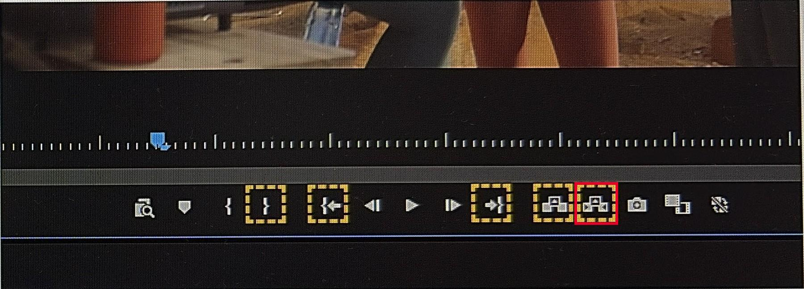

**正解**：**Extract**（快捷鍵 `'`）。在右側兩個並排的移除按鈕中，是右邊那個。

**講解**：without leaving a gap 是關鍵字。Extract 移除 In 到 Out 的範圍後，後面的片段會往前補，不留空隙。左邊的 Lift（快捷鍵 `;`）也會移除範圍，但會留下空隙（gap）。記法：Lift 拿起來、留洞；Extract 抽出來、補齊。

---

### A31｜單選
來源：`IMG_4788`

You open a project and receive a Media Offline warning for a large number of video clips.

Which action will efficiently resolve the warning?

- A) Use the Render and Replace option.
- B) Delete the cache files.
- **C) Use the Link Media option.** ← 正解
- D) Create a new project and import the old project into the new one.

**講解**：Media Offline 是專案找不到原始檔案，通常是檔案被搬走或改名。用 Link Media 指定新位置後，同資料夾裡的其他檔案會自動一起重新連結，所以大量離線時最有效率。Render and Replace 是轉檔，刪快取或開新專案都不會修好檔案路徑。

---

### A32｜複選（Choose 3）
來源：`144724.png`

Which three activities are pre-production activities? (Choose 3.)

- **A) Location scouting** ← 正解
- **B) Creating a shot list** ← 正解
- C) Ingesting media
- **D) Storyboarding** ← 正解
- E) Color grading
- F) Reviewing dailies

**講解**：pre-production 是開拍前的準備：勘景（location scouting）、列鏡頭清單（shot list）、畫分鏡（storyboard）。ingesting media（匯入素材）和 reviewing dailies（看每日拍攝毛片）是拍完之後才做的事，color grading（調色）屬於後製。

---

### A33｜單選
來源：`144907.png`

You are starting a new Premiere Pro project and want to ensure smooth playback for a large documentary edit.

Where should you save your scratch disk to optimize performance?

- A) A network drive
- B) A Micro SD card
- C) Your local OS drive
- D) Your local project drive
- **E) A local non-OS/project SSD** ← 正解

**講解**：scratch disk 存放預覽檔、快取等暫存資料，讀寫非常頻繁。放在一顆獨立的本機 SSD，不和系統碟（OS）、專案碟搶讀寫，播放最順。網路磁碟有延遲，Micro SD 太慢。記法：local、non-OS、SSD 三個條件都要有。

---

### A34｜單選
來源：`145112.png`

You are filming a documentary in a crowded public park. There are people's faces in your shot and a very popular song is playing from a portable music player.

Which option describes what you should do to be able to legally and ethically use the footage?

- A) Do not use the song. Assume no further permissions are needed for the people in public spaces.
- B) Credit the song's artist in the end credits. Obtain talent releases for identifiable individuals.
- **C) Purchase a commercial license for the song or mute the audio for this segment. Obtain talent releases for identifiable individuals.** ← 正解
- D) Use the song under fair use. Blur the faces of people in the footage.

**講解**：題目有兩個問題要一起解決。歌曲：要買授權，不然就把那段靜音。人臉：拍得到臉的人要簽肖像授權（talent release）。只有 C 兩個都處理到。B 只在片尾掛名，不等於取得授權；A 以為公共場所就不用徵得同意；D 的 fair use 不能拿來當保證。

---

### A35｜單選
來源：`145146.png`

You need to import a layered Adobe Photoshop file (.psd) into your project. Each layer must remain a separate layer in your project.

Which import method preserves all the individual layers for editing?

- A) Use the Import dialog and select Merge Layers.
- **B) Use the Import dialog and select Sequence.** ← 正解
- C) Open the file in Photoshop and save as animated GIF before importing.
- D) Open the file in Photoshop and save as PNG before importing.

**講解**：Import As 選 Sequence，每個圖層會各自變成一個檔案，並自動建立一個每層一軌的序列，可以分開編輯。Merge Layers 會合成一張；存成 GIF 或 PNG 圖層就消失了。和 A22 是同一個對話框：A22 要合併成單張，選 Merged Layers；本題要保留所有圖層，選 Sequence。

---

### A36｜單選
來源：`145215.png`

Which modification ensures accessibility for visually impaired audiences?

- A) Add closed captions that explain the visuals.
- **B) Insert an audio description track that explains the visuals.** ← 正解
- C) Add open captions that describe text located in the scene.
- D) Add alt text that describes the visuals in the metadata of the project.

**講解**：visually impaired 是視障，看不到畫面，所以要用聲音說明畫面內容，也就是口述影像（audio description）。closed captions 和 open captions 都是文字，是給聽障觀眾的；metadata 裡的 alt text 不會在播放時出現。記法：視障配聲音，聽障配字幕。

---

### A37｜單選
來源：`145408.png`

Why would an editor choose to use proxy files?

- **A) To improve playback performance** ← 正解
- B) To export the final video at a lower resolution
- C) To reduce rendering time during final export
- D) To create duplicates of all media files for backup purposes

**講解**：proxy 是原始素材的低解析度替身，剪輯時播放比較順，輸出時 Premiere 會自動換回原檔。所以 proxy 不會降低成品解析度，也不負責縮短最後的輸出時間，更不是備份。

---

### A38｜單選
來源：`144945.png`

What is the aspect ratio of this photo?

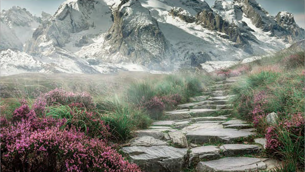

- A) 720p
- **B) 16:9** ← 正解
- C) 1:1
- D) 1080p
- E) 9:16

**講解**：aspect ratio 是寬高比。這張照片寬 600、高 338，600 ÷ 338 ≈ 1.78，就是 16:9 的橫幅。720p、1080p 是解析度，不是比例；1:1 是正方形；9:16 是直式。
