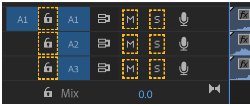
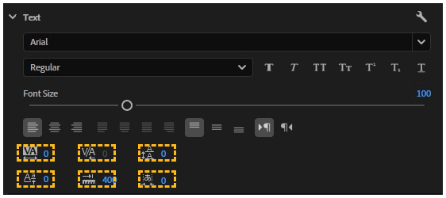
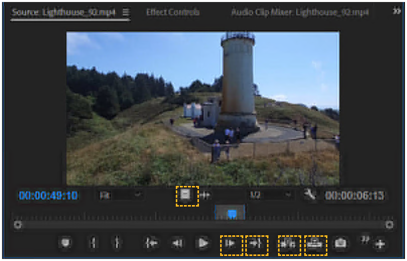
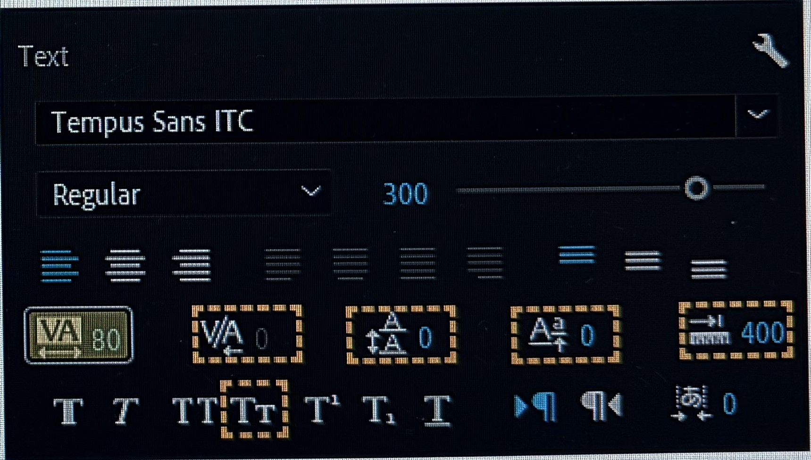
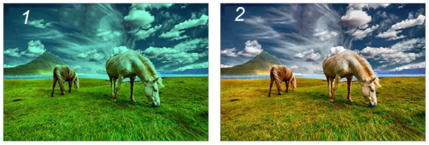
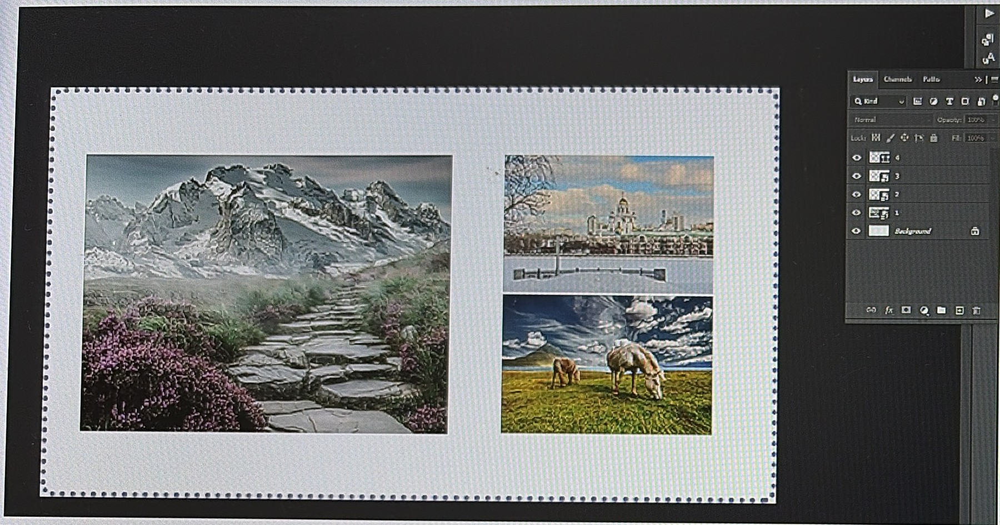
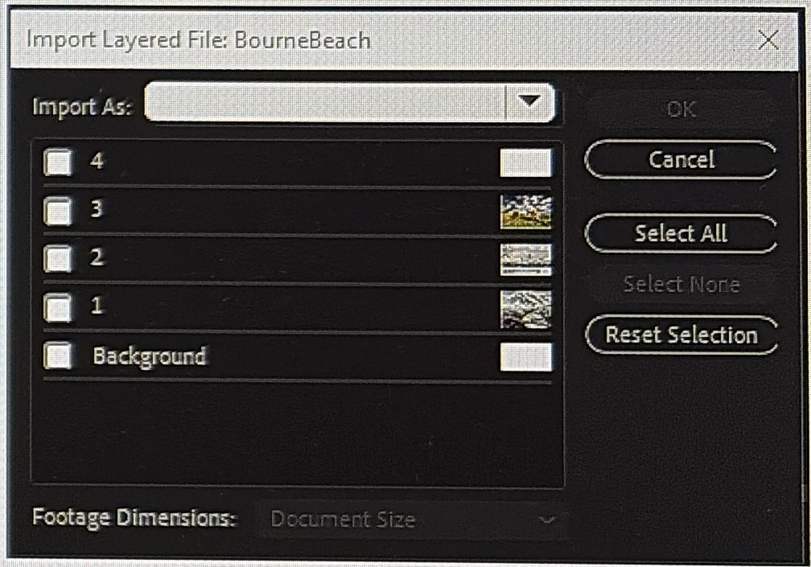
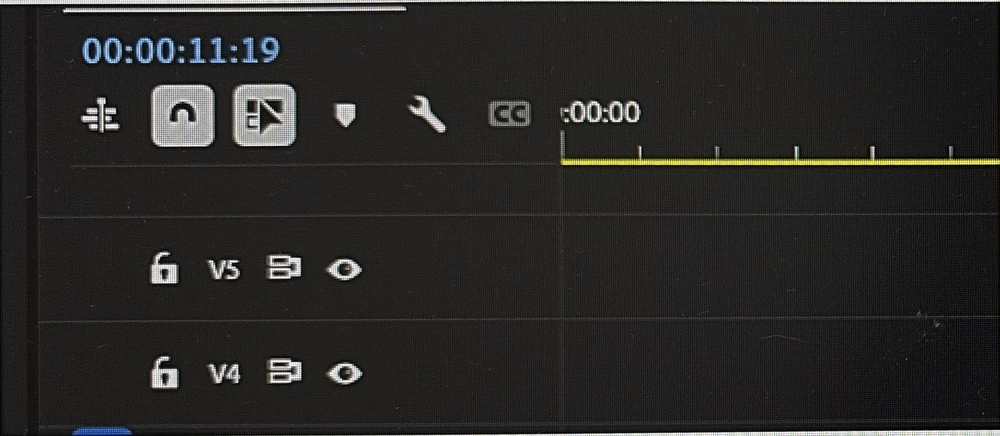
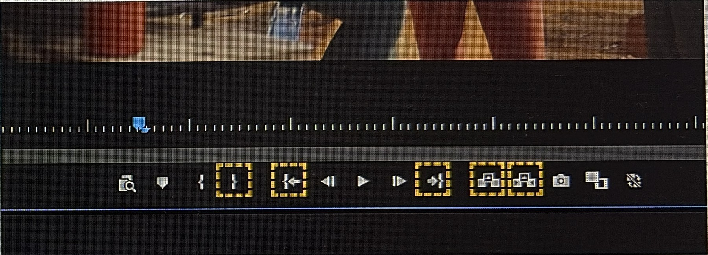
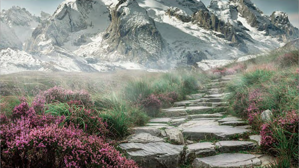

# ACP Premiere Pro 截圖題庫

- 日期：2026-11-03
- 收錄範圍：有考試截圖支撐的 58 題，包括學科 25 題、術科 33 題。只有主檔 PPT 手打文字的 22 題不收，名單見文末。
- 題號：沿用 [`../MOCK-EXAM-SOURCE-MAP.md`](../MOCK-EXAM-SOURCE-MAP.md)，所以題號不連續。
- 轉錄方式：英文逐字照「來源」那張截圖。OCR 抽字後，再用同題的其他截圖交叉比對；比對不一致或 OCR 讀不到的地方，看原圖確認。
- 選項字母：照「來源」那張截圖。考試每次作答都會打亂選項順序，換一張截圖字母就會不同。
- 未保留的格式：原題用斜體或底線標示的檔名、序列名（例如 *all clips*、*THAI*），這裡沒有標出來。
- 不含答案。

---

## 學科題（25 題）

### A02｜複選（Choose 3）
來源：`145435.png`

Which three codecs or container types are specific to video files? (Choose 3.)

- A) MP3
- B) MOV
- C) PNG
- D) MPEG4
- E) AAC
- F) H.264

### A07｜點選介面（可多種方法）
來源：`145309.png`

You need to temporarily silence all tracks except A2. All tracks must remain editable.

What should you do?

Select the appropriate option or options in the answer area.

Note: There might be more than one correct method to meet the requirements. You will receive credit for any correct method.

### A10｜點選介面
來源：`144809.png`

You need to uniformly change the vertical spacing between lines of type within a multiline paragraph.

Which setting should you modify in the Properties panel?

### A12｜複選（Choose 3）
來源：`IMG_4777`

Before creating a video for a client, which three questions are important to ask the client? (Choose 3.)

- A) Video purpose
- B) Target video codec
- C) Target audience
- D) Client goals
- E) Marketing strategy

### A15｜點選介面
來源：`145459.png`

You need to add a video clip from the Source Monitor to the Timeline and move all other clips to the right of the added clip.

Which button should you select? Select the appropriate button in the answer area.

### A16｜點選介面（Choose 2）
來源：`IMG_4775`；對照 `IMG_4819`

Which two settings can you modify to change the space between the characters in the word THAI? (Choose 2.)

Note: You will receive partial credit for each correct response.

### A19｜單選
來源：`IMG_4787`；題圖取自主檔 S64（比翻拍清楚）

You need to make image 1 look like image 2.

Which element should you adjust?

- A) aperture
- B) white balance
- C) resolution
- D) room tone
- E) contrast

### A21｜拖曳配對
來源：`145031.png`

Move the audio adjustment to the area on the right that describes its result.

Note: You will receive credit for each correct response.

| Audio Adjustments | Results |
|---|---|
| Gain | Sets the peak audio for a track |
| Normalize | Adjusts the overall volume of a track |
| Channel remapping | Adjusts audio from stereo to mono |
| Sampling rate | |

左欄 4 項、右欄 3 格，有 1 項用不到。左右同一列不代表配對。

### A22｜點選介面
來源：`IMG_4778`

You need to import this Photoshop file as a single image that includes only layers 1 and 2.

A Photoshop document and the import requirements are shown on the left.

Which import options should you select to meet the requirements?

To answer, select the correct import dialog options in the answer area.

截圖裡 Import As 下拉選單沒有展開。主檔 S67 列的選項是 Merge All Layers、Merged Layers、Individual Layers、Sequence。

### A23｜單選
來源：`IMG_4776`；對照 `IMG_4817`

During review, a team member notes that the on-screen title text is difficult to read on mobile devices and for users with low vision.

Which adjustment will improve accessibility?

- A) Add a solid background box of a complementary color of the text.
- B) Replace the current stroke with a drop shadow of the same color.
- C) Replace the sans serif font with a serif font.
- D) Decrease the frame rate of the project from 30fps to 24fps.

### A24｜單選
來源：`IMG_4779`

Your client requests a 4K video in Ultra HD with a 16:9 aspect ratio.

Which frame size should you select when creating your sequence?

- A) 1280 x 720
- B) 3840 x 2160
- C) 1920 x 1080
- D) 2560 x 1440

### A25｜單選
來源：`IMG_4780`；對照 `IMG_4820`

You add a music track to your commercial project. The track license requires attribution.

What must you do to use the track legally?

- A) Include the creator's name, track title, source, and license in the credits.
- B) Include the creator's name, track title, source, and license in the metadata.
- C) Remix the track and apply for a Creative Commons license for the new track.
- D) Have the cast thank the creator at the end of the credits.

### A26｜單選
來源：`145240.png`；對照 `IMG_4781`、`IMG_0595`

Which method should you use to remove a green screen background?

- A) Extract
- B) Color Correction
- C) Adjustment Layer
- D) Ultra Key

### A27｜單選
來源：`IMG_4782`；對照 `IMG_4816`

You are using a sequence as a source. Insert and overwrite sequences as nests or individual clips is not selected on the timeline.

How will the clips be placed in the timeline?

- A) As Grouped Clips
- B) As Associated Clips
- C) As Nested clips
- D) As Individual Clips

### A28｜是非（True／False）
來源：`145337.png`；對照 `IMG_4783`、`IMG_4818`

For each statement about the use of captions with video in Adobe Premiere Pro, select whether the statement is True or False.

| Statement | True | False |
|---|:---:|:---:|
| You can only make edits to captions through the transcript in the Text panel. | ○ | ○ |
| Captions only show filler words represented as [...] in both the transcript and caption track. | ○ | ○ |
| When added to the timeline, the first closed captions added are automatically placed on track C1. | ○ | ○ |

### A29｜單選
來源：`IMG_4784`；對照 `IMG_4815`

You are working on a small laptop screen and need to limit your view to only the Timeline and Program Monitor.

You want these panels to remain in this configuration each time you launch Premiere Pro on this laptop.

How can you apply this change?

- A) Drag and drop the panels and save the project
- B) Use the View menu
- C) Use Workspaces
- D) Use Preferences

### A30｜點選介面
來源：`IMG_4786`

Select the button that will remove the selection between the in and out points from the timeline without leaving a gap.

### A31｜單選
來源：`IMG_4788`

You open a project and receive a Media Offline warning for a large number of video clips.

Which action will efficiently resolve the warning?

- A) Use the Render and Replace option.
- B) Delete the cache files.
- C) Use the Link Media option.
- D) Create a new project and import the old project into the new one.

### A32｜複選（Choose 3）
來源：`144724.png`

Which three activities are pre-production activities? (Choose 3.)

- A) Location scouting
- B) Creating a shot list
- C) Ingesting media
- D) Storyboarding
- E) Color grading
- F) Reviewing dailies

### A33｜單選
來源：`144907.png`

You are starting a new Premiere Pro project and want to ensure smooth playback for a large documentary edit.

Where should you save your scratch disk to optimize performance?

- A) A network drive
- B) A Micro SD card
- C) Your local OS drive
- D) Your local project drive
- E) A local non-OS/project SSD

### A34｜單選
來源：`145112.png`

You are filming a documentary in a crowded public park. There are people's faces in your shot and a very popular song is playing from a portable music player.

Which option describes what you should do to be able to legally and ethically use the footage?

- A) Do not use the song. Assume no further permissions are needed for the people in public spaces.
- B) Credit the song's artist in the end credits. Obtain talent releases for identifiable individuals.
- C) Purchase a commercial license for the song or mute the audio for this segment. Obtain talent releases for identifiable individuals.
- D) Use the song under fair use. Blur the faces of people in the footage.

### A35｜單選
來源：`145146.png`

You need to import a layered Adobe Photoshop file (.psd) into your project. Each layer must remain a separate layer in your project.

Which import method preserves all the individual layers for editing?

- A) Use the Import dialog and select Merge Layers.
- B) Use the Import dialog and select Sequence.
- C) Open the file in Photoshop and save as animated GIF before importing.
- D) Open the file in Photoshop and save as PNG before importing.

### A36｜單選
來源：`145215.png`

Which modification ensures accessibility for visually impaired audiences?

- A) Add closed captions that explain the visuals.
- B) Insert an audio description track that explains the visuals.
- C) Add open captions that describe text located in the scene.
- D) Add alt text that describes the visuals in the metadata of the project.

### A37｜單選
來源：`145408.png`

Why would an editor choose to use proxy files?

- A) To improve playback performance
- B) To export the final video at a lower resolution
- C) To reduce rendering time during final export
- D) To create duplicates of all media files for backup purposes

### A38｜單選
來源：`144945.png`

What is the aspect ratio of this photo?

- A) 720p
- B) 16:9
- C) 1:1
- D) 1080p
- E) 9:16

---

## 術科題（33 題）

術科任務在考試畫面右側的 Certification Test 面板，每項任務都標出專案名稱和任務名稱。

### Drone 專案

#### B01｜Create a sequence
來源：`IMG_4805`；對照 `IMG_4836`

Use the Lighthouse_93.mp4 clip to create a sequence. Rename the new sequence Oregon Coast.

Note: You can click the underlined text to copy it. If a dialog is opened during the task, the text must be copied before the dialog is opened.

#### B02｜Trim a clip
來源：`IMG_4800`；對照 `IMG_4838`

On track V1 of the Lighthouse sequence, trim the Lighthouse_99.mp4 clip so it ends at the same time as the clip on track V2, and the sequence duration changes.

Do not change the length of any other clip. Ensure that there are no gaps in the sequence.

#### B03｜Create a clip marker
來源：`IMG_4802`；對照 `IMG_4839`

On the clip Lighthouse01, create a clip marker named Establishing Shot that starts at 00:00:01:00 and has a duration of 00:00:09:18

Note: You can click the underlined text to copy it. If a dialog is opened during the task, the text must be copied before the dialog is opened.

#### B04｜Organize clips
來源：`IMG_4801`；對照 `IMG_4840`

Create a top-level bin named sequences and move all existing sequences into the sequences bin. Rename the Drone_05 sequence as Drone View.

Note: You can click the underlined text to copy it. If a dialog is opened during the task, the text must be copied before the dialog is opened.

#### B25｜Apply an effect
來源：`IMG_4804`；對照 `IMG_4837`

In the Lighthouse sequence, create an adjustment layer and apply an SL Blue Ice Lumetri Color creative look to change the appearance of the entire Lighthouse02 clip.

Keep the adjustment layer name and creative look settings at default.

#### B26｜Add and scale a graphic
來源：`IMG_4803`；對照 `IMG_4841`

In the Lighthouse sequence, add the LighthouseTitle.ai title graphic to the beginning of track V2 and scale it to 70%. Do not move the existing footage on the timeline.

### Getaway 專案

#### B05｜Manage settings
來源：`152831.png`

Configure Premiere to automatically save open projects every 5 minutes, and to save a maximum of 30 project versions.

#### B07｜Adjust opacity
來源：`152637.png`

Adjust the opacity of the Mountain Getaway graphic so that it fades in from 0.0 to 100.0 percent over the first three seconds, then fades out from 100.0 to 0.0 percent over the last three seconds.

### Food Around the World 專案

#### B10｜Apply color correction
來源：`150722.png`

Use the Lumetri Color tools to set the white balance in the Tiramisu sequence. Select the neutral gray swatch in the Tiramisu video, circled in green at 00:00:00:00, as the spectrally neutral point.

Do not add any effects.

#### B11｜Apply an effect
來源：`IMG_4809`；對照 `IMG_4832`

At the start of the Thai Curry sequence, apply the Track Matte Key effect to reveal the Thai_Food_06 clip on track V2 through the word THAI on track V4. Your result should look like the following image at 00:00:01:10.

#### B12｜Adjust audio
來源：`150823.png`；對照 `IMG_4808`、`IMG_4834`

Use an effect to fade out the music on track A1 at the end of the Thai Curry sequence over a one-second time span.

#### B13｜Manage clips on the timeline
來源：`IMG_4807`；對照 `IMG_4831`

Adjust the Sushi sequence so that the audio clips for Sushi Pan and Sushi Pan 3 meet the following requirements:

- The audio clips for Sushi Pan and Sushi Pan 3 are located on track A2.
- Each audio clip is aligned with its corresponding video clip.
- Without grouping, ensure that each audio clip will move with its corresponding video clip.

#### B14｜Prepare for export
來源：`IMG_4810`；對照 `IMG_4833`

Prepare the Thai Curry sequence for export by ensuring that it meets the following specifications:

- There are no gaps in the video. (Do not change the duration of any clip.)
- The Welcome title clip is visible from 00:00:08:29 to 00:00:12:07. (Do not delete any clips or change their opacity.)

Note: Do not export the sequence.

### Transportation 專案

#### B15｜Place a clip on the timeline
來源：`151408.png`

In the Subway sequence, place the InsideTrain clip at 00:00:03:20 on the same tracks as the OutsideTrain clip to meet the following requirements:

- Use the existing In and Out points on the InsideTrain clip.
- Do not delete any frames in the OutsideTrain clip.

主檔 PPT 這題還有第 3 條要求，截圖裡沒有，待補拍確認。

#### B17｜Create a frame hold
來源：`151242.png`；對照 `151250.png`

In the airshow sequence, create a two-second frame hold segment of the airshow footage at 00:00:03:00 so that the video continues when the freeze frame ends. Do not remove any of the original footage.

Note: Use a method other than time remapping.

### Aspirations 專案

#### B21｜Prepare for publishing
來源：`152309.png`

You need to prepare to export the first 30 seconds of the ArtistInterview. Ensure the sequence meets the following specifications:

- Only the audio from tracks A2 and A3 is audible.
- Use sequence in and out points to ensure only the first 30 seconds of the sequence will export.

Do not delete any content from the project or the timeline.

Note: Do not export the sequence.

#### B22｜Organize assets
來源：`152423.png`

Create bins named images and videos. Place images in the images bin and videos in the videos bin.

Note: You can click the underlined text to copy it. If a dialog is opened during the task, the text must be copied before the dialog is opened.

#### B42｜Create a sequence
來源：`152118.png`

Create a sequence that meets the following requirements:

- Name: Promo
- Preset: HD 1080p 25 fps (HDV 1080p25)
- Tracks: Three video and two audio tracks.

You do not need to add content to the sequence.

Note: You can click the underlined text to copy it. If a dialog is opened during the task, the text must be copied before the dialog is opened.

### Africa 2 專案

#### B27｜Interpret the clip
來源：`IMG_4789`；對照 `IMG_4847`

Interpret Jackal.mp4 so that the new frame rate is 24.

#### B28｜Create a rough cut
來源：`IMG_4790`；對照 `IMG_4846`

Set In and Out points on the clips based on the table.

Starting at 00:00 place the clips on track V1 in the Rough Cut sequence by Clip Order with no gaps between the clips

AFRICAN T 120.WAV should replace audio for all three clips on A1.

| Clip # | File Name | Source Timecode Used | Notes |
|---|---|---|---|
| Clip 1 | Elephant.mp4 | 01:00 – 03:00 | Add to timeline |
| Clip 2 | Hippos.mp4 | 02:09 – 03:24 | Add to timeline |
| Clip 3 | Giraffe.mp4 | 00:00 – 03:12 | Add to timeline |
| Audio | AFRICAN T 120.WAV | 03:27 – 10:27 | Overwrite existing audio |

### Kittens 專案

#### B29｜Adding Clips to a Rough Cut
來源：`IMG_4793`；對照 `IMG_4843`

Using the FosterIntro sequence:

- Set the source video Kitten1_Adopt.mp4 to have an in point at 00:10 and an out point of 4:03.
- Put only the video clip on track V1 after clip Kitten1_Pet1.mp4.
- Set the source audio CutePianoStrings.mp3 to have an In point of 00:20.
- Place CutePianoStrings.mp3 on track A3 so that it starts at the beginning and ends at 20:00.

Note: Both video and audio for V1, A2, and A3 on the timeline should end at 20:00.

#### B30｜Manage clips and tracks
來源：`IMG_4794`；對照 `IMG_4844`

In the sequence FosterIntro:

- Delete only the video of the Kitten1_Bath.mp4 clip.
- Keeping the same start and end times, move the Kitten1_BathWB.mp4 video clip to track V1.
- Link the video clip for Kitten1_BathWB.mp4 to the audio clip for Kitten1_Bath.mp4.
- Remove tracks V3 and A4

### Fitness World 專案

#### B31｜Auto reframe the sequence
來源：`IMG_4824`；對照 `IMG_4796`

Auto Reframe the sequence with the following settings:

- Vertical 4:5
- Slower Motion
- Do not nest clips.
- Leave the default name.

#### B40｜Remove unused assets
來源：`152541.png`

Remove all the unused assets from the project.

### Commute 專案

#### B32｜Modify the timeline
來源：`152925.png`；對照 `IMG_4798`、`IMG_4822`

Rename the sequence to Daily Commute and unlink the audio from the commute1 clip.

#### B41｜Fill the timeline gap
來源：`153009.png`

Delete the commute3 clip from the timeline.

Lengthen the commute4 clip to fill the gap on the timeline without using generative extend.

### Africa 專案

#### B33｜Delete pauses
來源：`IMG_4812`；對照 `IMG_4826`、`151644.png`

Open the Sequence named Hyena-Rock.

In the transcript, set minimum pause length to 1 second.

Filter and delete all pauses.

#### B38｜Change the sequence
來源：`151516.png`

Use auto reframe to create a 9:16 version of the African Animals sequence.

#### B39｜Reconfigure the sequence
來源：`151854.png`

Rename the sequence Maasai Mara to Zebras.

In the timeline:

- Delete all unused tracks.
- Mute the Zebras.mp4 audio.

### School 專案

#### B34｜Adjust Audio Tracks in a Sequence
來源：`IMG_4814`；對照 `IMG_4829`

In Study Session sequence:

- Add StudyMusic.mp3 to track A2
- Adjust the length of the StudyMusic.mp3 clip on the timeline to match the length of the video clips.
- Mute the audio on track A1.

### Pizza Time 專案

#### B35｜Remove section
來源：`150430.png`

Change the all clips sequence as follows:

- Set an in point at 2:43:00 seconds and set an out point at 2:48:00 seconds.
- Remove that section of the timeline.
- Do not leave any gap or extend any clip.

#### B36｜Manage clip markers
來源：`150605.png`

On sequence pizza build, complete the following tasks:

1. Delete all the current markers.
2. Add a timeline marker named cutting overhead at 17:06 and set the marker duration to 5 seconds.
3. Change the marker color to white (#FFFFFF).

Note: You can click the underlined text to copy it. If a dialog is opened during the task, the text must be copied before the dialog is opened.

### Social 專案

#### B37｜Nest the clips
來源：`150955.png`

Open the sequence Social Title for Nesting.

- In the Sequence for Nesting bin, place the clips from the Keith_Company_Role 1920x1080 bin on the timeline.
- Place the longest clip on track V1, beginning at 00:00, the shortest clip on V3, and the medium length clip on V2.
- Position the clips on V2 and V3 so that they end at the same timecode as the clip on V1.
- Nest the clips and name the nested sequence Nested Name + Title.
- In the bin, change the label color of the nested sequence to Cerulean.

Note: You can click the underlined text to copy it. If a dialog is opened during the task, the text must be copied before the dialog is opened.

---

## 未收錄（只有主檔 PPT，待補拍）

- 學科 13 題：A01、A03、A04、A05、A06、A08、A09、A11、A13、A14、A17、A18、A20
- 術科 9 題：B06、B08、B09、B16、B18、B19、B20、B23、B24

另外，PNG 那次作答的學科第 14 題沒有截圖，題目內容不明。
