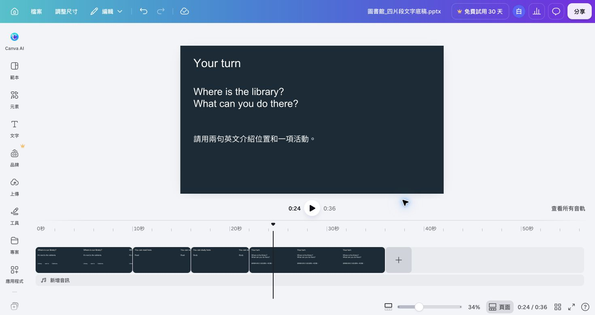

# 從四片段底稿恢復 36 秒主作品

找不到第一場的畫面版、只剩 MP4，或直接從第二場開始時，先判斷今天要做到哪裡：只想接著練聲音與字幕，用畫面版 MP4 開一份有聲字幕版即可；要能修改原有文字、影片與片長，就用[圖書館_四片段文字底稿.pptx](../downloads/圖書館_四片段文字底稿.pptx)重建可編輯的畫面版，再補上[三支實拍原片](../downloads/canva-stock-practice.zip)。

## 只想接著練聲音與字幕

這條路最快，但畫面已合成成一支影片，文字與背景不能再分開修改。

1. 下載[36 秒畫面版 MP4](../assets/media/footage-v1.mp4)，用電腦播放器確認能從頭播到 36 秒。
2. 在 Canva 首頁「建立」→「影片」建立橫式影片，命名 `姓名_圖書館_有聲字幕版`。
3. 「上傳」→「上傳檔案」加入這支 MP4，拖到主軌，確認從第 0 秒開始、到第 36 秒結束。
4. 把設計網址貼進[專案紀錄](../downloads/專案紀錄.txt)有聲字幕版的欄位，接著從[錄下自己的講解，再用 AI 語音做英文示範](../../../_lessons/canva-video-teaching/CH2-2.md)繼續。

用這份作品時，四個片段的起點仍是 0、10、16、22 秒，聲音照單元頁放即可。要修改畫面文字或片長時，改走下一節重建。

## 重建可編輯的畫面版

依序取回素材、版面、時間與可編輯性，完成後才建立有聲字幕版。

1. 解壓實拍包，用電腦播放器確認走道、閱讀、自習三支 MP4 都可播放。
2. 在 Canva 新建 1920 × 1080 橫式影片，命名 `姓名_圖書館_畫面版`。確認下方有主軌、上方軌與音訊軌。
3. 匯入四片段 PPTX，逐頁複製可修改文字、矩形與位置圖到新影片的上方軌。不要把整頁匯成一支已合成的 MP4。
4. 將走道、閱讀、自習影片依序放到主軌，提問段用一段圖庫影片或單色背景。走道保留十秒，閱讀與自習各六秒，提問十四秒。
5. 四段起點應為 0、10、16、22 秒，全片 36 秒。把位置答案設為第 2 秒後出現，閱讀與自習句只留在對應片段。
6. 播放頭各停在第 9、11、17、23 秒。背景影片、文字與位置圖都要能單獨選取，沒有黑畫面或多餘空白。
7. 把設計網址存進[專案紀錄](../downloads/專案紀錄.txt)畫面版的欄位，再回[從畫面版複製出有聲版](../../../_lessons/canva-video-teaching/CH2-1.md)建立有聲字幕版。

## 找不到多軌時間軸時

先確認你建立的是新的影片設計，不是直接打開舊 PPTX 設計。若新建影片仍沒有主軌、上方軌與音訊軌，重新整理後再從 Canva 首頁建立一次。只有維護 2025 年 10 月以前建立的舊設計時，才使用[舊專案相容處理](舊專案相容處理.md)。

## 保留的三頁舊底稿

[圖書館_三頁起始設計.pptx](../downloads/圖書館_三頁起始設計.pptx)仍保留給既有教材維護。它把閱讀與自習合在同一頁，不能直接接本課第二場。需要取回舊文字時，只複製內容到上方的四片段作品；需要維護原專案時，依相容頁完成。

匯入後字太擠時，拉寬文字框或更換字型，再播放檢查。若 PPTX 無法匯入，直接依[開一支新影片，認識 Canva 的剪輯桌面](../../../_lessons/canva-video-teaching/CH1-1.md)從空白影片重建；不要用已合成的 MP4 取代可編輯的主軌、文字與音訊。
