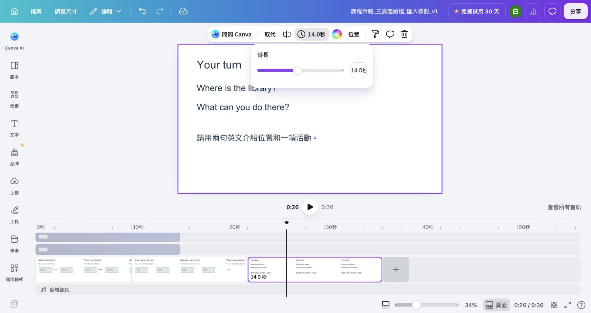

# 從四片段底稿接續製作

找不到第一場作品、只剩 MP4，或從第二場開始時，先用[圖書館_四片段文字底稿.pptx](../downloads/圖書館_四片段文字底稿.pptx)恢復可修改版面，再補上[三支實拍原片](../downloads/canva-stock-practice.zip)。底稿是 PPTX，包含四頁可修改文字；它尚未包含實拍或旁白。

## 恢復到能錄音的起點

1. 解壓實拍包，先用電腦播放器確認走道、閱讀、自習三支 MP4 都可播放。下載四片段 PPTX，到 Canva「上傳 → 上傳檔案」匯入並開啟。
2. 依序確認四頁為走道位置、閱讀、自習、提問。第一頁標題改一字再復原，確認文字可修改。這四頁對應三個教學場景。
3. 若先開成簡報，進「網格檢視」，點一頁再 Ctrl+A／Command+A 選四頁；「顯示更多 → 以影片格式編輯」。頁面式應出現秒數與播放控制；新版按主要片段操作。找不到轉換入口時，建立橫式影片，再依 CH1-2/3 用原片及底稿文字重建四片段，不以整片 MP4 取代可編輯物件。
4. 在上傳區加入三支原片。頁面式選位置頁，把走道拖入畫布，再用影片的右鍵選單「設為背景」；若自動新增頁面，先復原，重新拖入正確頁。閱讀頁用閱讀片、自習頁用自習片；最後提問頁再用走道或保留單色。新版將原片放主軌，文字放上層。
5. 走道裁為約 2–12 秒的十秒片段；閱讀與自習各約 2–8 秒的六秒；提問背景十四秒。頁面長度與背景素材保留長度都要核對。按[裁短與裁切教學](../../../_lessons/canva-video-teaching/CH1-2.md)保留人物、書與筆電，不把底稿文字一起裁掉。
6. 原版順序及起點應為走道 0、閱讀 10、自習 16、提問 22 秒，全片 36 秒。將底稿中「Library next to Cafeteria」的文字占位換成[位置圖](../assets/diagrams/library-map.svg)，按[元素起訖實作](時間軸與字幕實作.md)讓位置答案第 2 秒出現，閱讀與自習標籤只在對應片段，最後的問題沒有答案。背景影片與文字要能分別選取；第 9、11、17、23 秒各停一次確認順序。
7. 命名 `姓名_圖書館_v1`，記下設計網址與[時間表](../downloads/片段與聲音時間表.csv)。若有多餘空白頁、黑畫面或文字選不到，回本頁第 4–6 步修復；通過後回[第二場第一單元](../../../_lessons/canva-video-teaching/CH2-1.md)「確認素材與文字仍可各自選取」，再建立 v2。

四片段 PPTX 只提供文字起點；先完成第 6 步檢查，才進第二場。完整軌道與聲音交接見[時間軸與字幕實作](時間軸與字幕實作.md)。

此底稿於 2026-10-11 實測四頁匯入、標題可單獨改字、轉影片及全片 36 秒。圖中仍是文字底稿，不能跳過替換實拍背景及元素起訖的步驟。

## 保留的三頁文字版起始檔

下列原三頁底稿供文字排版、舊剪輯與補字幕練習。它的活動頁合併 read and study，配置為 10／12／14 秒；若要接目前實拍課程，使用上方四片段恢復流程。

展開舊三頁底稿的匯入步驟

### 從三頁起始檔接續製作

第一場作品找不到、只剩 MP4，或從第二場開始學習時，可用這份檔案建立自己的可編輯作品。三頁依序包含位置、活動、練習，文字和矩形都能修改。

## 下載並匯入自己的帳號

1. [下載圖書館_三頁起始設計.pptx](../downloads/圖書館_三頁起始設計.pptx)，到電腦的「下載」資料夾確認檔案已下載完成。
2. 開啟 [Canva 首頁](https://www.canva.com/)，登入自己要保存作品的帳號。
3. 選「上傳 → 上傳檔案」，選取剛下載的 PPTX。等到提示「已上傳 1 個項目」，按該項目的「開啟」。
4. 新設計會先以簡報開啟。確認下方有三頁；點兩下第一頁標題，選取 library 再輸入 library，確認可以改字。點文字框外完成編輯。

## 改成影片編輯格式

1. 按右下角「網格檢視」，讓三頁縮圖一起出現。
2. 點一頁縮圖，按 Ctrl+A（Mac 為 Command+A）選全部頁面。上方應顯示「複製 3 頁」「刪除 3 頁」等選項，表示三頁都已選到。
3. 在上方按「顯示更多」，選「以影片格式編輯（3 頁）」。下方會改成有秒數及播放按鈕的時間軸。
4. 點第一段背景縮圖，按工具列的「5.0 秒，編輯時長」。在「時長」欄填 10，按 Enter。第二、第三段用相同方式改為 12、14 秒。
5. 從開頭播放，應依序出現位置、活動和提問，總長 36 秒。若改到文字條，先復原，重新選背景縮圖再改秒數。

轉換後頁面名稱可能仍顯示「簡報」；以時間軸、頁面秒數和整片播放結果確認影片格式。若工具列未出現秒數，點該頁空白背景，確認選到頁面。

## 命名並回到第二場

1. 將上方設計名稱改為 `姓名_圖書館_v1`，用自己的名字取代「姓名」。
2. [下載專案紀錄.txt](../downloads/專案紀錄.txt)，以記事本或文字編輯開啟。複製目前瀏覽器網址，貼在「v1 專案網址：」後方，儲存檔案。
3. 回到[第二場第一單元](../../../_lessons/canva-video-teaching/CH2-1.md)，先按本頁上方四片段恢復流程補齊實拍，再從「確認素材與文字仍可各自選取」繼續。

匯入後字太擠時，拉寬文字框或更換字型，再播放檢查。若無法匯入 PPTX，先確認下載完整且登入自己的帳號；改用第一場[從空白影片建立三頁](../../../_lessons/canva-video-teaching/CH1-1.md)的步驟補做，完成後回第二場。這個補做流程需要較多時間，可先閱讀剪輯和字幕示例。

## 將文字底稿接到實拍版本

PPTX 提供可修改文字和圖形，尚未包含這次的外部活動影像。下載[實拍練習包](../downloads/canva-stock-practice.zip)，依[匯入影片](../../../_lessons/canva-video-teaching/CH1-2.md)和[剪接場景](../../../_lessons/canva-video-teaching/CH1-3.md)把走道、閱讀、自習放入。新版以主軌片段操作；既有三頁需將活動頁拆成閱讀與自習兩頁，各六秒；提問改在第四頁。先播放確認影片真的在相應時間出現，再接回第二場。

