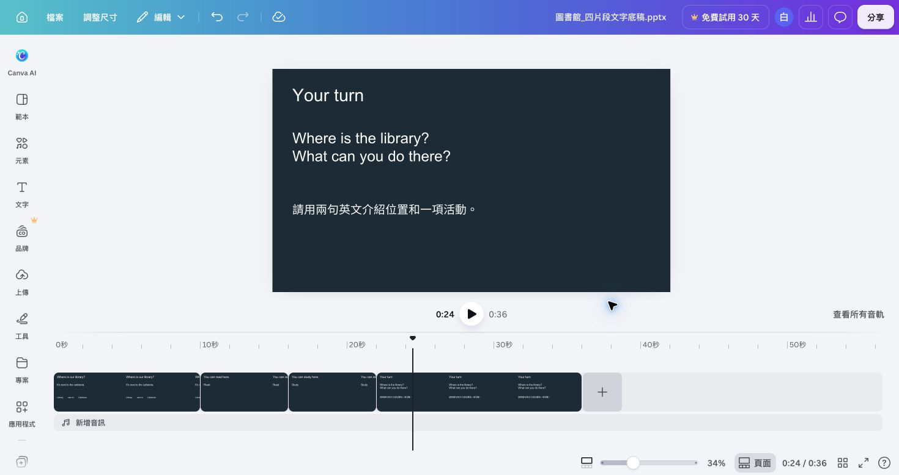

# 從四片段底稿恢復 36 秒主作品

找不到第一場作品、只剩 MP4，或從第二場開始時，先用[圖書館_四片段文字底稿.pptx](../downloads/圖書館_四片段文字底稿.pptx)取回可修改的文字與版面，再在新建多軌影片中補上[三支實拍原片](../downloads/canva-stock-practice.zip)。底稿只是搬運內容的材料，不是要沿用頁面式編輯器。

## 恢復到可接第二場的起點

依序取回素材、版面、時間與可編輯性，完成後才建立 v2。

1. 解壓實拍包，用電腦播放器確認走道、閱讀、自習三支 MP4 都可播放。
2. 在 Canva 新建 1920 × 1080 橫式影片，命名 `姓名_圖書館_v1_恢復`。確認下方有主軌、上層視覺軌與音訊軌。
3. 匯入四片段 PPTX，逐頁複製可修改文字、矩形與位置標示到新建影片的上層軌。不要把整頁匯成一支已合成的 MP4。
4. 將走道、閱讀、自習與提問背景依序放到主軌。走道保留十秒，閱讀與自習各六秒，提問十四秒。
5. 四段起點應為 0、10、16、22 秒，全片固定 36 秒。將位置答案設為第 2 秒後出現，閱讀與自習標籤只留在對應片段。
6. 在第 9、11、17、23 秒各停一次。背景影片、文字與位置圖都要能單獨選取，且沒有黑畫面或多餘空白。
7. 保存可編輯網址與[片段時間表](../downloads/片段與聲音時間表.csv)，再回[第二場第一單元](../../../_lessons/canva-video-teaching/CH2-1.md)建立 v2。

## 找不到多軌時間軸時

先確認你建立的是新的影片設計，不是直接打開舊 PPTX 設計。若新建影片仍沒有主軌、上層軌與音訊軌，重新整理後再從 Canva 首頁建立一次。只有維護 2025 年 10 月以前建立的舊設計時，才使用[舊專案相容處理](舊專案相容處理.md)。

## 保留的三頁舊底稿

[圖書館_三頁起始設計.pptx](../downloads/圖書館_三頁起始設計.pptx)仍保留給既有教材維護。它把閱讀與自習合在同一頁，不能直接接本課第二場。需要取回舊文字時，只複製內容到上方四片段多軌作品；需要維護原專案時，依相容頁完成。

匯入後字太擠時，拉寬文字框或更換字型，再播放檢查。若 PPTX 無法匯入，直接依[第一單元](../../../_lessons/canva-video-teaching/CH1-1.md)從空白影片重建；不要用已合成 MP4 取代可編輯的主軌、文字與音訊。
