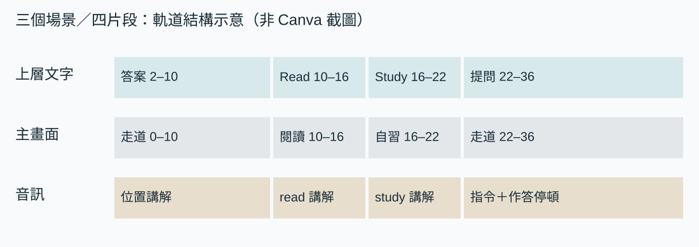
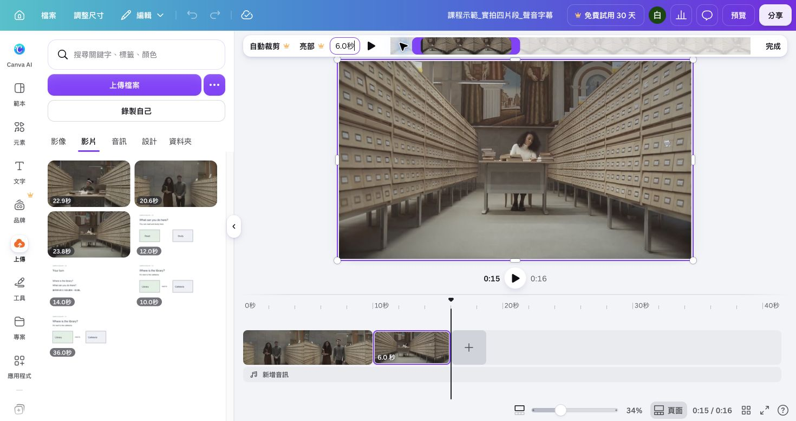
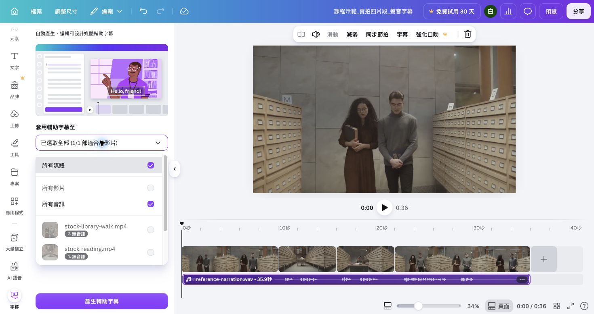
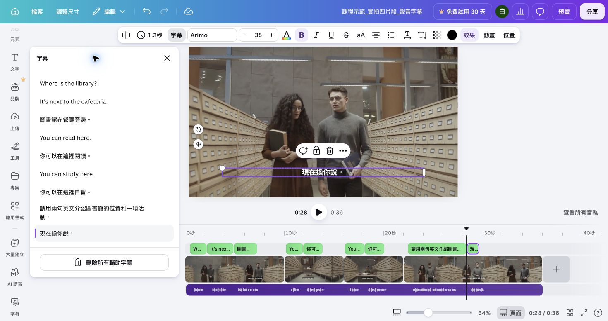
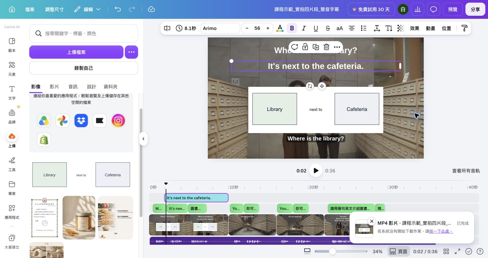

# 在 Canva 選對物件、剪好聲音並完成字幕

這份資源接在單元頁之後，放正文沒有展開的對照與練習：時間軸三層怎麼分、改片長會連帶影響什麼、另用十秒素材練分割、輔助字幕漏句時怎麼手動補，以及用課程 WAV 代替錄音時怎麼剪和上字幕。主作品仍照單元頁完成；這裡的練習都在複本或練習檔進行，不改動 `姓名_圖書館_畫面版` 與 `姓名_圖書館_有聲字幕版`。

需要的檔案：[三支實拍原片](../downloads/canva-stock-practice.zip)、[十秒位置練習片段](../assets/media/practice-clip-1.mp4)、[36 秒旁白 WAV](../assets/media/reference-narration.wav)、[片段時間表 CSV](../downloads/片段與聲音時間表.csv)。

## 先看懂這支作品的三層

| 層次 | 本課放什麼 | 選對時會看到什麼 |
|---|---|---|
| 主軌 | 位置、閱讀、自習、提問四個主要片段 | 片段依序接合，起點是 0、10、16、22 秒 |
| 上方軌 | 問答、位置圖、底板、活動句、提問文字、輔助字幕、選用的畫中畫 | 能單獨拖起訖，不會改變主片段長度 |
| 音訊軌 | AI 英文語音、自己錄的中文講解、配樂 | 看得見波形，能單獨修剪、分割、移動與調音量 |

先點你要改的物件，再看畫布外框、工具列與時間軸是否同時對得上。只看到影片裁切時，選到的是畫布上的影片；只看到字型時，選到的是文字；看見波形和音量時，才是音訊。

## 從原片修剪，分清兩種時間

用閱讀片段練習，分清「取用原片哪一段」與「在成片哪裡出現」。

1. 「上傳」→「上傳檔案」加入閱讀 MP4，拖到主軌走道片段之後。
2. 選閱讀影片，按工具列剪刀「裁短」，拖紫色框兩端框住原片約第 2–8 秒，按「完成」。
3. 回主時間軸讀取位置。閱讀片段在成片中是 10–16 秒；原片 2–8 秒表示取用原素材的哪一段。
4. 播放這六秒。人物持續閱讀、書本沒有被裁掉，才算選段完成。

拖片段邊緣修剪與剪刀「裁短」改的是「播放原片哪一段、播多久」，裁切改的是「畫面看哪裡」。兩種操作各管一件事，不要互相代替。

## 選對背景、文字與音訊

改動前先把目標和選取物件對上，能避免修一項卻破壞另一項。

| 你要改什麼 | 先選什麼 | 操作與完成訊號 |
|---|---|---|
| 閱讀長度 | 主軌的閱讀片段 | 拖邊緣後仍位於 10–16 秒 |
| 人物構圖 | 畫布上的閱讀影片 | 移動畫面內容後，人物與書都保留 |
| Read 標籤 | 上方軌的活動句 | 改字與起訖時，主軌長度不變 |
| 講師小視窗 | 自己的錄影物件 | 只有小錄影被選，主影片仍在主軌 |
| 講解或 AI 語音 | 有波形的音訊條 | 可單獨回聽、移動、修剪與分割 |

開啟「位置」→「圖層」可分別選問題文字、位置圖、字幕與背景。要刪標籤時，先在圖層清單確認名稱；不要用刪除整個主片段來修一個文字物件。

## 時間實驗：位置延長兩秒會怎樣

畫面版完成後，可以用一份複本觀察「改片段長度」和「移動上方物件」的差別。這份實驗不接第二場，完成後回到 36 秒的畫面版。

1. 在畫面版開啟「檔案」→「建立複本」，命名 `姓名_圖書館_時間實驗`。
2. 把主軌的位置片段由 10 秒拖長到 12 秒。主軌現在是 0–12、12–18、18–24、24–38 秒，全片 38 秒。
3. 播放頭各停在第 11、13、19、25 秒，看閱讀、自習、提問文字是否仍對到正確畫面。
4. 沒有跟著移動的文字與底板，整段向右拖兩秒；位置答案維持第 2 秒開始，在第 12 秒結束。
5. 能說出「拖主軌邊緣會推動後面所有片段，拖上方文字只改它自己」之後，關閉這份複本。

實驗複本不加旁白與字幕，也不要把 38 秒寫回畫面版。之後換教材需要延長某一段時，先更新[片段時間表](../downloads/片段與聲音時間表.csv)，再依新起點放文字與聲音。

## 十秒分割練習

[剪掉停頓、配上音樂](../../../_lessons/canva-video-teaching/CH2-3.md)在有聲字幕版剪掉提問錄音裡的一處停頓。想再練一次分割，用這支十秒片段另開練習，不動主作品。

1. 建立一份空白橫式影片，命名 `姓名_分割練習`，「上傳」[十秒位置練習片段](../assets/media/practice-clip-1.mp4)後拖到主軌。
2. 從頭播放，聽出問句之後約 2.3–4.3 秒那段多餘的停頓。
3. 選取片段，播放頭放在約第 2.3 秒按 S，再移到約第 4.3 秒按一次 S。
4. 選中間那一小段，播放確認裡面沒有字音，再刪除；後段會接回前段，全長約八秒。
5. 從接點前一秒播放，問句尾音與回答開頭都要完整。對照 Canva 實際匯出的[八秒分割結果](../assets/media/split-practice-result.mp4)。

切點吃到字音時，按復原，把切點往安靜處移一點再做。實際停頓位置以你聽到的為準，2.3 與 4.3 秒只是起始值。

## 輔助字幕漏句時，手動補一句

輔助字幕有時會漏掉一句，或帳號暫時看不到輔助字幕入口。這時用文字方塊補上那一句，讓下載的 MP4 仍有字幕。

1. 播放找出漏掉的句子，記下說話開始與結束時的播放頭讀值。
2. 「文字」→「新增文字方塊」，輸入正確句子，放在畫面底部預留區，字型與大小對齊其他字幕。
3. 在上方軌把文字條左邊緣拖到句子開始、右邊緣拖到句子結束；畫面複雜時加一個深色底板，起訖相同。
4. 播放頭各停在開始前、說話中、結束後一次：開始前看不到，說話時讀得到，結束後消失。

想先練習再補到主作品，可用[十秒位置練習片段](../assets/media/practice-clip-1.mp4)讓「圖書館在餐廳旁邊。」約在 6.3–8.8 秒出現，再對照 Canva 匯出的[手動補句示例](../assets/media/manual-caption-example.mp4)。

Canva 播放器裡「無障礙」的顯示字幕只在 Canva 中觀看時看得到，不會跟著下載的 MP4；交給學生的成片要用輔助字幕或上面的手動字幕。

## 用課程 WAV 代替錄音時

麥克風無法使用或 AI 語音額度用完時，可以用課程提供的 36 秒旁白 WAV 完成聲音與字幕。這條 WAV 是英文 Lisa 與台灣中文子晴的 AI 語音，只對得上原本的圖書館版本；換題材的作品要重新錄或重新產生。

1. 在有聲字幕版「上傳」[36 秒旁白 WAV](../assets/media/reference-narration.wav)，從第 0 秒放進音訊軌，不要和其他旁白重疊。
2. 選取這條音訊，播放頭依序放在第 10、16、22 秒各按一次 S，切成四段；四段保持原位，分別對到位置、閱讀、自習與提問。
3. 在第 0–10 秒的位置段找出一處回聽確認過的停頓，用兩次分割移除中間安靜段，後段向左接回。
4. 重新從第 9、15、21 秒播放，確認各段聲音在相應畫面開始後才出聲。

產生字幕時，選取 WAV 後按工具列「字幕」，在「套用輔助字幕至」只勾這條 WAV，不勾配樂與無聲影片。這條 WAV 同時有英文與中文，Canva 會自動判斷語言，混在一起時容易辨識錯；另一種語言的句子要在字幕清單逐句改正，或依上一節手動補上。

逐句回聽時，把「图书馆在餐厅旁边。」改成「圖書館在餐廳旁邊。」，英文核對 `cafeteria`、空格與標點。分句 WAV 的用法見[配音與聲音製作](配音與聲音製作.md)。

## 下載後做最後檢查

由「分享」→「下載」→「MP4 影片」下載全部 36 秒，用電腦播放器確認：

- 位置、閱讀、自習、提問依 0、10、16、22 秒出現。
- 分割處沒有爆音、截字或長空白，講解始終比配樂清楚。
- 英文字幕與英文語音對得上，中文字幕是繁體字，字幕跟聲音同步。
- 提問段保留作答時間，影片結束在 36 秒。

下列影片是課內已驗證的 36 秒匯出結果，可用來比對順序、旁白與字幕；它不取代你的可編輯 Canva 設計。

<video controls preload="metadata" poster="../assets/media/canva-footage-poster.png" aria-label="Canva 實際匯出的四片段有聲字幕示範"><source src="../assets/media/canva-footage-demo.mp4" type="video/mp4"></video>

保存 `姓名_圖書館_有聲字幕版.mp4`、可編輯設計網址、[片段時間表](../downloads/片段與聲音時間表.csv)與[個人操作紀錄](../downloads/個人Canva操作紀錄.txt)。在紀錄寫下實際修復，例如「第 24 秒切除一段停頓，再從第 23 秒回聽確認尾音完整」。
