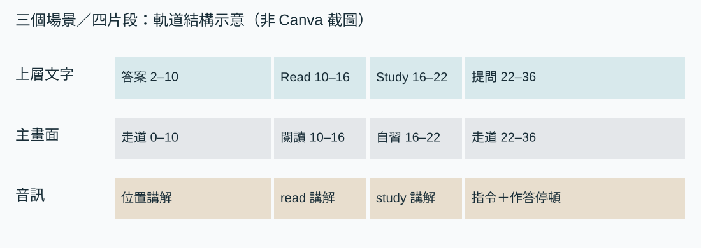
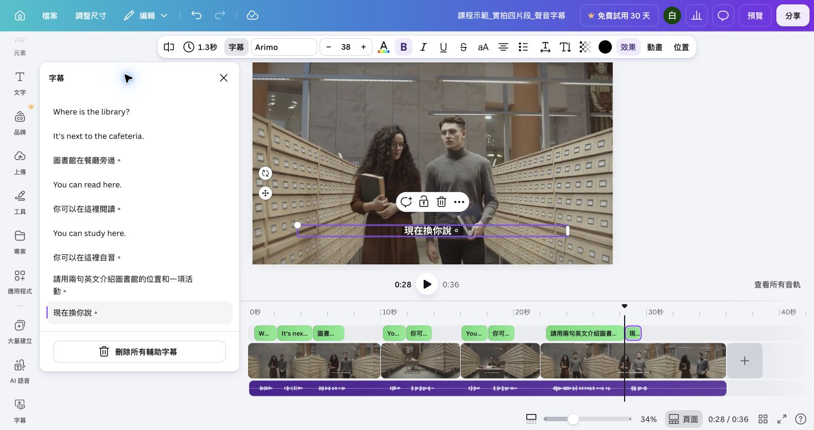
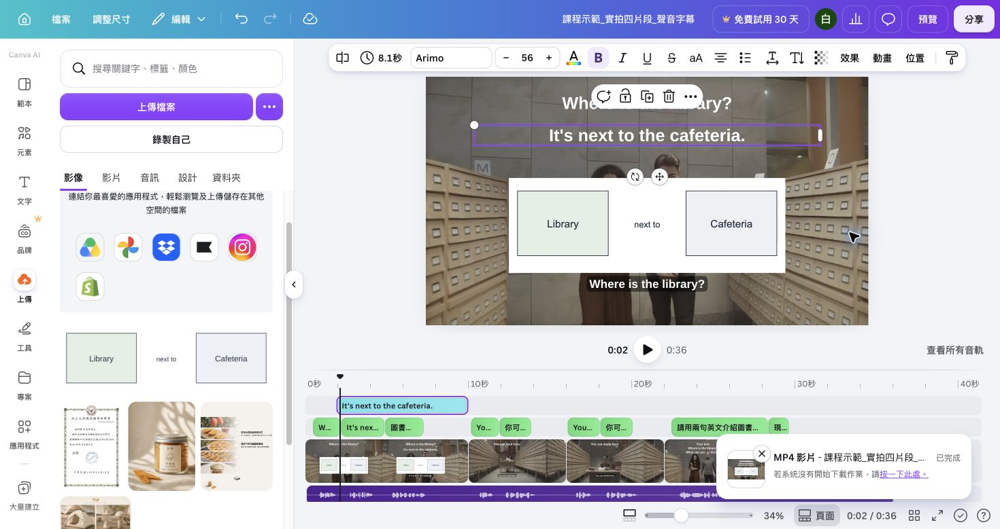

# 在 Canva 選對物件、剪好聲音並完成字幕

開啟 `姓名_圖書館_v2`。這份實作只處理同一支 36 秒主作品，不另外建立 10 秒字幕檔。你會在多軌時間軸中辨認主軌、上層視覺軌與音訊軌，修掉一個旁白停頓，再讓字幕跟著實際聲音出現。

使用[三支實拍原片](../downloads/canva-stock-practice.zip)、[36 秒旁白 WAV](../assets/media/reference-narration.wav)與[片段時間表 CSV](../downloads/片段與聲音時間表.csv)。若要分句安排，可用[十秒位置旁白與分句檔](配音與聲音製作.md)接續操作。

## 先看懂這支作品的三層

| 層次 | 本課放什麼 | 選對時會看到什麼 |
|---|---|---|
| 主軌 | 位置、閱讀、自習、提問四個主要片段 | 片段依序接合，起點是 0、10、16、22 秒 |
| 上層視覺軌 | 位置圖、標籤、底板、字幕、選做畫中畫 | 能單獨拖起訖，不會改變主片段長度 |
| 音訊軌 | 真人旁白或備援 WAV、練習配樂 | 可看見波形，能單獨裁短、分割、移動與調音量 |

先點你要改的物件，再看畫布外框、工具列與時間軸是否同時對得上。只看到影片裁切時，你選到的是畫布影片；只看到字型時，你選到的是文字；看見波形和音量時，才是音訊。

## 從原片裁短，分清兩種時間

先用閱讀片段練習，分清原片取用範圍與成片出現位置。

1. 「上傳 → 上傳檔案」加入閱讀 MP4，拖到主軌走道片段之後。
2. 選閱讀影片。拖原片開始邊緣到約第 2 秒、結束邊緣到約第 8 秒，保留六秒。
3. 回主時間軸讀取位置。閱讀片段在成片中應為 10–16 秒；原片 2–8 秒表示取用原素材的哪一段。
4. 播放這六秒。人物持續閱讀、書本沒有被裁掉，才算選段完成。

裁短是改「播放多久」；裁切是改「畫面看哪裡」。拖主軌片段邊緣做裁短，選畫布影片後用裁切調構圖。兩個操作不要互相代替。

## 選對背景、文字與音訊

改動前先把目標和選取物件對上，能避免修一項卻破壞另一項。

| 你要改什麼 | 先選什麼 | 操作與完成訊號 |
|---|---|---|
| 閱讀長度 | 主軌的閱讀片段 | 拖邊緣後仍位於 10–16 秒 |
| 人物構圖 | 畫布上的閱讀影片 | 移動畫面內容後，人物與書都保留 |
| Read 標籤 | 標籤文字或上層視覺條 | 改字與起訖時，主軌長度不變 |
| 講師小視窗 | 自己的錄影物件 | 只有小錄影被選，主影片仍在主軌 |
| 真人／WAV 旁白 | 有波形的音訊條 | 可單獨回聽、移動、裁短與分割 |

開啟「位置 → 圖層」可分別選問題文字、位置圖、字幕群組與背景。要刪標籤時，先在圖層清單確認名稱；不要用刪除整個主片段來修一個文字物件。

## 在主作品錄製旁白

先完成一句測試，再錄完整旁白，能提早發現麥克風或音量問題。

1. 把播放頭放到 0 秒，依 Canva 的[錄製旁白說明](https://www.canva.com/help/record-voiceover/)開啟「應用程式 → 音訊 → 錄製配音」；使用過後可直接由左側「音訊」進入。英文介面對應 `Audio → Record Voiceover`。
2. 第一次使用時允許麥克風權限；看到「麥克風就緒」後先錄一句並按「完成」。等待上傳結束，確認「語音錄製」出現在獨立音訊軌，再播放確認麥克風與音量。
3. 四個聲音群組依序對到 0、10、16、22 秒；位置段錄成一條並刻意留下停頓，背景原音維持靜音。
4. 找出位置段中刻意多留的停頓，記住播放頭位置。下一節會直接在這條主旁白上分割。

若帳號沒有錄製旁白入口，依[配音與聲音製作](配音與聲音製作.md)選一條備援：AI 位置英文問答須為同一條且含可辨認停頓；分句檔以十秒位置旁白搭配第 04–09 檔；36 秒 WAV 則先在 10、16、22 秒分割。不要同時保留兩份旁白。

## 在主 v2 修掉一個停頓

只處理一個明確停頓，修好後立刻從接點前一秒回聽。

1. 建立 v2 副本後，選取目前路徑指定的位置音訊條，回聽並將播放頭停在多餘停頓開始處。
2. 用「更多 → 分割」或快捷鍵 `S` 分成兩段；在停頓結束處再分割一次。
3. 刪除中間的無聲小段，把後段向左接回。從接點前一秒回聽，不能切掉前一句尾音或後一句開頭。
4. 重新核對四個畫面接點：0 秒位置、10 秒閱讀、16 秒自習、22 秒提問。若聲音和畫面錯位，只移動受影響的音訊段；36 秒 WAV 在 10、16、22 秒切出的後三段保持原位。
5. 加入 36 秒練習配樂，將音量降到旁白清楚可辨；片頭與片尾各做短淡入淡出。若配樂有皇冠或要求付款，換成免費曲目。

分割練習直接留在主 v2，因為下一步字幕要依這條修好的聲音生成。只有操作失敗、需要重練時，才另開 10 秒副本。

## 從實際旁白生成字幕

字幕來源先鎖定旁白，產生後再處理文字與時間。

1. 選取真人旁白或獨立音訊條，依[產生與編輯影片字幕](https://www.canva.com/help/generate-edit-captions-on-videos/)開啟字幕功能。
2. 若可選辨識來源，只勾旁白，不勾配樂與無聲影片。產生後逐句回聽。
3. 把「图书馆在餐厅旁边。」改為「圖書館在餐廳旁邊。」；英文核對 `cafeteria`、空格與標點。
4. 找一個跟聲音不同步或漏掉的句子，直接在主 v2 調整文字或顯示起訖。調完從前一句開始播放。
5. 確認字幕底板在明暗畫面都清楚，且沒有遮住人物、位置圖或原教材句子。

Canva 播放器的「觀看字幕」只影響觀看，不會自動燒進下載影片；本課使用可編輯、會隨 MP4 匯出的影片字幕。生成入口不可用時，在原 v2 以文字框與底板手動補句子，仍按實際旁白調起訖。

## 下載後做最後檢查

由「分享 → 下載 → MP4 影片」下載全部 36 秒。用電腦播放器確認：

- 位置、閱讀、自習、提問依 0、10、16、22 秒出現。
- 分割處沒有爆音、截字或長空白，旁白始終比配樂清楚。
- 「圖書館」「餐廳」是繁體字，字幕跟聲音同步。
- 提問段保留作答時間，影片結束在 36 秒。

下列影片是課內已驗證的 36 秒匯出結果，可用來比對順序、旁白與字幕；它不取代你的可編輯 Canva 設計。

<video controls preload="metadata" poster="../assets/media/canva-footage-poster.png" aria-label="Canva 實際匯出的四片段有聲字幕示範"><source src="../assets/media/canva-footage-demo.mp4" type="video/mp4"></video>

保存 `姓名_圖書館_v2.mp4`、可編輯設計網址、[片段時間表](../downloads/片段與聲音時間表.csv)與[個人操作紀錄](../downloads/個人Canva操作紀錄.txt)。在紀錄寫下實際修復，例如「第 7 秒切除一段停頓，再從第 6 秒回聽確認尾音完整」。
