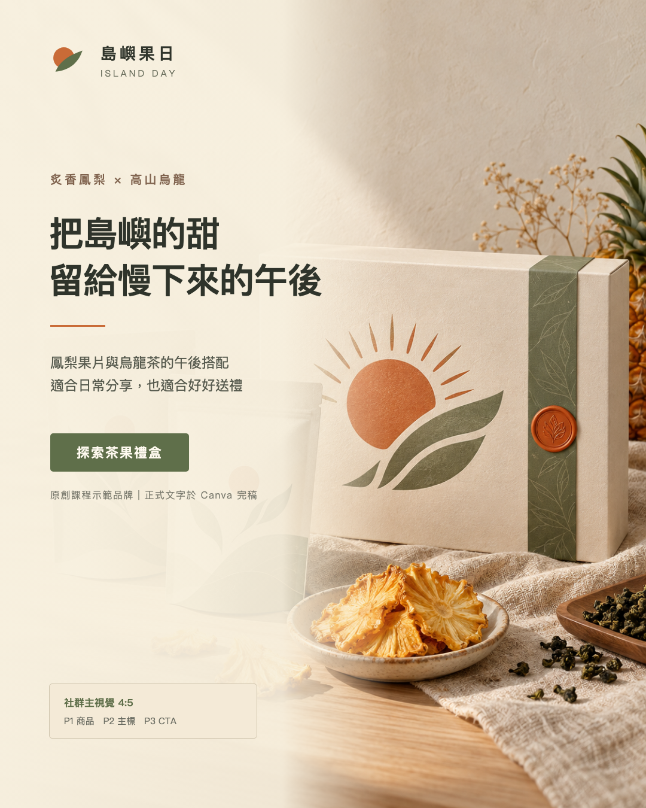
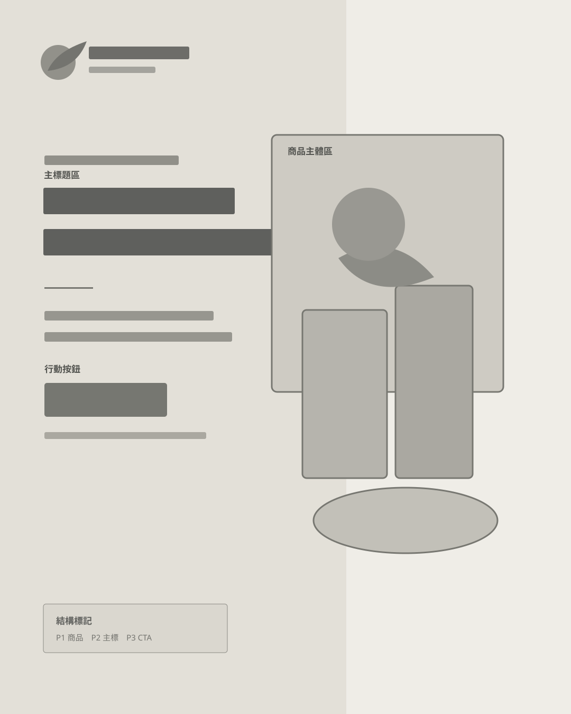
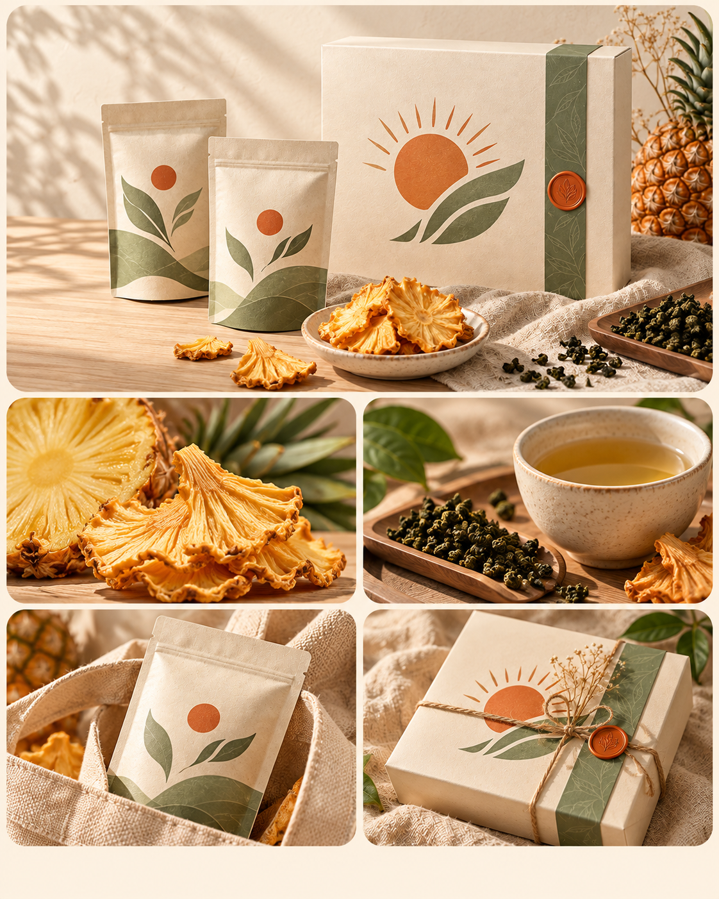
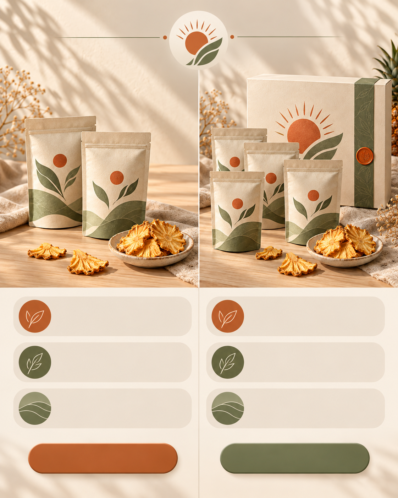
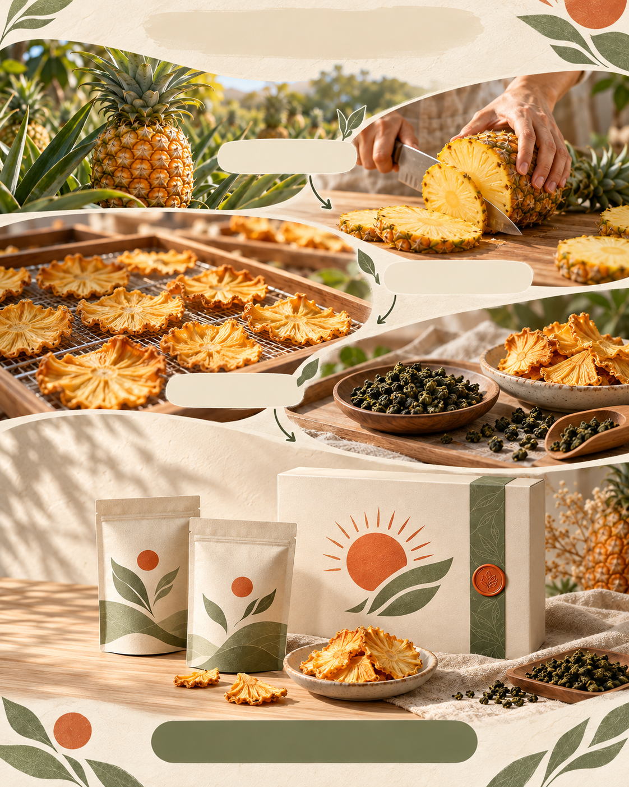
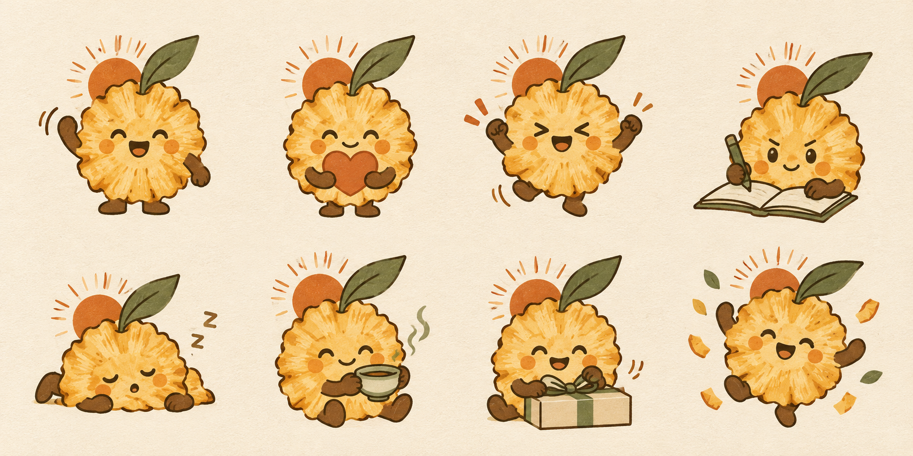
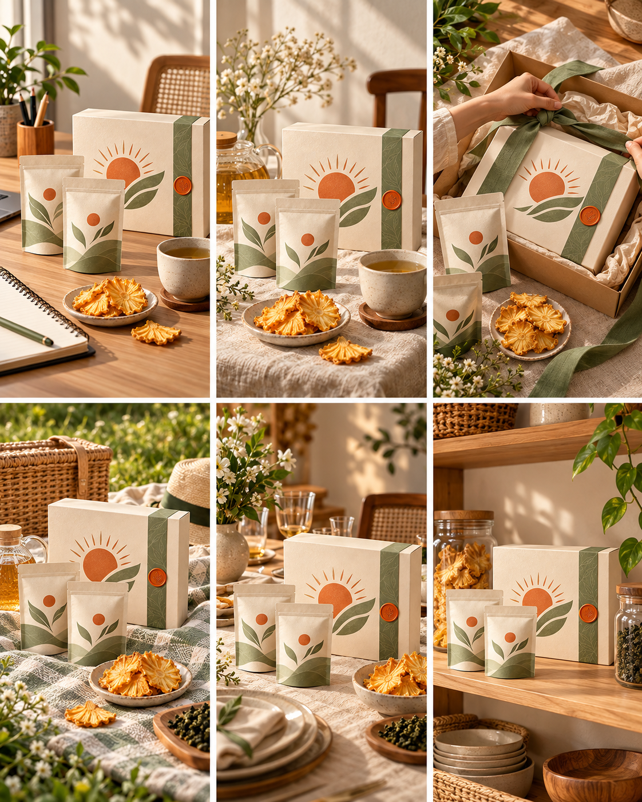

## 內部設計（不進學員頁）

### Learner Task Contract

| 欄位 | 凍結內容 |
|---|---|
| 學習者與情境 | 第一次製作商業社群視覺的學員，接到一個要在社群發布的品牌主題。 |
| 問題與後果 | 只有主題、文案與零散圖片，還沒有可發布的版型；直接要求 AI「做漂亮一點」會讓結構、文字與品牌調性失控。 |
| 起始材料 | 本講義內的 8 用途版型速查、原創品牌「島嶼果日」商品基準圖、同版 L2 線稿／L4 完稿、六張社群視覺 READY 範例與六段式工作紙；學員也可使用自己的主題與已取得權利的素材。 |
| 目標完成物 | 一份視覺 brief、一段可重跑的六段式 prompt、一張 1080×1350 PNG、一張 1080×1080 PNG，以及一份完稿檢核。 |
| 成果用途與後續使用 | 4:5 作為 IG／社群主視覺，1:1 作為貼文、縮圖或跨平台版本；六段式 prompt 可換主題再用。 |
| 第一個動作 | 先填「目的、讀者、唯一重點、發布尺寸」四格，不開生圖工具。 |
| 第一個可觀察結果 | 得到一句「我要讓誰在什麼平台看懂什麼」的任務句；寫不出時回到四格刪除次要資訊。 |
| 失敗時的回復位置 | 版型不符回到六種結構選型；構圖混亂回到文字線稿；生成失敗改用 READY 範例；中文字錯誤回到 Canva 重建；輸出裁切回到 1:1 重排。 |

### Environment Contract

| 工具 | 起始狀態 | 成功結果 | 備援 |
|---|---|---|---|
| ChatGPT 或 Gemini | 可輸入文字；若帳號支援，可生成或編修圖片 | 產出一張可下載的 4:5 視覺底圖 | 使用講義中的 Bento Grid READY 圖進行 Canva 完稿；仍可完成版型、文字與尺寸能力 |
| Canva | 可建立 1080×1350 與 1080×1080 自訂尺寸 | 可放入底圖、重建文字、輸出 PNG | 介面名稱不同時使用搜尋；若無自動調整尺寸，建立新尺寸後複製元素並手動重排 |

### 素材存在 Gate

| 材料與用途 | 實檔／取得方式 | 驗證 | 狀態 |
|---|---|---|---|
| 原創商品基準圖 | `img/workshop2h/island-day-product-anchor.png` | 本次工作坊獨立生成；供提示詞參考與角色一致性練習 | READY |
| L4 完稿與 L2 線稿對照 | `img/workshop2h/l4-commercial-poster.png`、`img/workshop2h/l2-commercial-wireframe.svg` | 兩圖為同一商業海報的完稿與骨架；供 20 分鐘結構判讀 | READY |
| 六種社群視覺結構範例 | `img/workshop2h/c1-bento-campaign.png`～`img/workshop2h/c6-product-lookbook.png` | 六檔皆為本工作坊獨立生成，沿用同一虛構品牌 | READY |
| 無生圖權限備援 | `img/workshop2h/c1-bento-campaign.png` | 學員可直接下載後進 Canva 重建文字與尺寸 | READY |
| 六段式 prompt 與工作紙 | 正文內可直接複製 | 不依賴外部下載 | READY |

### 能力與證據對應

| 目標／核心方法 | 所需證據 | 正文位置 |
|---|---|---|
| 依目的選版型 | 六類選型表與情境判斷題 | 「六種社群視覺結構怎麼選」 |
| 從完稿讀結構 | L4／L2 對照、視覺重心／閱讀順序／留白三項判讀 | 「20 分鐘：版型與線稿機制」 |
| 寫出可重跑的生成指令 | 六段式結構與 Bento Grid 完整 worked example | 「20 分鐘：品牌視覺與提示詞」 |
| 完成生成與修正 | 初稿、單一變因修正、Checkpoint | 「25 分鐘：AI 社群視覺實作」 |
| 完成正式文字與尺寸延展 | Canva 4:5、1:1 操作與完稿檢核 | 「15 分鐘：Canva 完稿與尺寸延展」 |

<!-- learner-content:start -->
# 從 AI 生圖到設計完稿

你會把一個社群主題整理成可生成、可修改、可發布的視覺。今天的完成物是同一主題的兩張 PNG：一張 **1080×1350（4:5）主視覺**，一張 **1080×1080（1:1）延展圖**。過程會留下可重跑的 prompt 與完稿檢核，所以課後換品牌、換主題仍能再做一次。

## 開始前：準備材料與過關標準

請先準備 ChatGPT 或 Gemini 其中一項，以及 Canva。你可以使用自己的品牌主題；若沒有題目，就使用講義中的原創示範品牌「島嶼果日｜炙香鳳梨茶果禮盒」。若生圖功能當日不可用，下載 Bento Grid READY 範例，直接從 Canva 完稿開始。

示範品牌的商業任務很具體：讓正在挑選辦公室茶點或送禮商品的讀者，在社群動態中先看見禮盒，再看懂鳳梨與烏龍的搭配，最後知道可以進一步探索商品。六個模組都沿用同一商品、包裝、色板與攝影光線，學員能比較「同一品牌換版型」如何改變溝通任務。

現在先開啟兩份起始素材：[商品基準圖 PNG](../img/workshop2h/island-day-product-anchor.png) 用來維持包裝一致；[Bento Grid READY PNG](../img/workshop2h/c1-bento-campaign.png) 是無生圖權限時的 Canva 備援底圖。兩份素材都屬本工作坊的虛構品牌，不包含真實商標與產品宣稱。

本次要留下五項成果：

1. 一句任務句：「我要讓誰在什麼平台看懂什麼」。
2. 一份六段式視覺 brief。
3. 一段可複製、可重跑的 prompt。
4. 1080×1350 PNG 與 1080×1080 PNG 各一張。
5. 一份版型、文字、色彩、權利與輸出檢核。

完成品符合以下條件就過關：版型與溝通目的相符；第一眼知道先看哪裡；正式中文由 Canva 重建並逐字校對；全圖不超過三個主色與兩種字體；兩個尺寸都沒有裁掉標題、主體或 CTA。

### 120 分鐘路線圖

| 時間 | 你要完成的事 | 階段成果 |
|---|---|---|
| 0–20 分 | 商業視覺版型與線稿機制 | 看得出版面重心、閱讀順序與留白 |
| 20–50 分 | 六種社群視覺結構 | 為自己的任務選定一種合適結構 |
| 50–70 分 | 品牌視覺與提示詞架構 | 完成六段式 prompt |
| 70–80 分 | 休息與生成準備 | 備妥文字、素材與第一版生成條件 |
| 80–105 分 | AI 社群視覺實作 | 生成、比較並修正一張 4:5 底圖 |
| 105–120 分 | Canva 完稿與尺寸延展 | 輸出 4:5 與 1:1 兩張 PNG |

## 20 分鐘：版型與線稿機制

版型先回答「這張圖要完成什麼溝通任務」。同一個商品換版型，讀者感受到的重點也會改變。拿到需求時先查表，再選一種主結構，不要一開始就堆風格形容詞。

| 版型 | 最適合的任務 | 一眼要看到什麼 |
|---|---|---|
| A 主視覺版 | 廣告首圖、活動主視覺 | 商品或主題占畫面 80% 左右 |
| B 橫幅版 | 網站 banner、EDM | 商品與短標並列，橫向快速讀完 |
| C 社群版 | IG、Threads 日常貼文 | 主體清楚、文字少、留白多 |
| D 系列版 | 多款商品、系列比較 | 多個品項仍像同一品牌 |
| E 禮盒版 | 節慶、送禮、組合商品 | 包裝與整組價值感 |
| F 特寫版 | 食品、材質、細節 | 質地、流動、表面細節 |
| G 促銷版 | 折扣、檔期、立即轉換 | 優惠與期限比裝飾更醒目 |
| H 生活版 | 品牌故事、情境提案 | 人在什麼時刻使用商品 |

線稿是版面的骨架。完稿包含顏色、照片、材質與正式文字；L2 線稿只保留物件輪廓、文字區、大小比例與對齊關係。先讀骨架，才能判斷一張圖是否能換主題繼續使用。





看任何版面時，依序回答三題：

1. **最吸睛是誰？** 主體、標題或價格只能有一個第一名。
2. **看的順序是什麼？** 用 P1、P2、P3 寫下讀者前三個視線停點。
3. **空白夠不夠？** 重要元素旁要留出辨識空間，四周也要保留裁切安全區。

### 三分鐘判讀

看上面的 L2 線稿，寫下 P1、P2、P3。參考答案：P1 是右側商品主體，P2 是左上主標題區，P3 是左下說明與 CTA。若你的順序不同，請指出是哪個尺寸、對比或位置讓視線改道。這個理由就是後面驗收 AI 產出的依據。

## 六種社群視覺結構怎麼選

這六種形式分別處理不同的內容關係。先看資訊之間是並列、比較、順序、人物故事、角色反應或系列展示，再選版型。

| 代號與形式 | 選它的時機 | 核心結構 | 生成時先鎖定 |
|---|---|---|---|
| Bento Grid 便當格資訊圖 | 要在一張圖並列商品、原料、使用方式與送禮理由 | 大格放主商品，小格補充四個賣點 | 格數、主次比例、每格任務、統一包裝與色板 |
| Comparison 對比資訊圖 | 要讓讀者在兩種規格或方案中做合適選擇 | 兩欄逐行對應，底部放條件式結論 | 同一組比較項、兩欄同等視覺重量、可確認的規格 |
| Step by Step 步驟教學圖 | 要用製程、使用方式或服務流程建立理解與信任 | 3–7 步、編號與箭頭連續，最後回到商品 | 每步一個動作、視覺流向、完成結果與 CTA |
| Founder Portrait 創辦人肖像 | 要用人物、商品與工作場域建立品牌信任 | 人物＋自然動作＋工作環境＋方向光 | 本人同意或虛構人物、不得像名人、商品清楚、光線一致 |
| Sticker Set 角色貼圖組 | 要把品牌角色延伸到客服、限動或社群互動 | 角色基底固定，多格呈現不同溝通情境 | 角色細節、畫風、留白、動作不重複 |
| Lookbook Grid 系列拼貼 | 要展示多款商品或同一商品的多種使用情境 | 4–9 格，每格獨立、整組調性一致 | 包裝一致、格數、鏡位、光線、背景與色板 |

### 六種形式的參考圖

#### Bento Grid 便當格資訊圖



適合在同一張社群圖整理多個商品賣點。最大格呈現完整禮盒，其他格分別展示原料、茶飲搭配、隨身包與送禮情境。快速檢查：最大格是否真的最重要？每格是否支持同一個購買理由？色板與光線是否一致？

#### Comparison 對比資訊圖



適合協助讀者在兩種有效方案中選擇。案例比較「日常分享組」與「完整送禮組」，兩邊使用相同鏡位與光線。快速檢查：左右欄項目能否逐行配對？視覺是否先暗示某一方勝出？規格與結論是否有依據？

#### Step by Step 步驟教學圖



適合把製程轉成品牌信任。案例從鳳梨採收、手工切片、低溫乾燥、配茶到完成包裝。快速檢查：步驟是否連續？每一步是否有可觀察結果？最後是否回到商品與下一步行動？

#### Founder Portrait 創辦人肖像


適合用人物、場域與商品建立信任。案例使用虛構創辦人，避免名人相貌與真實人物授權問題。快速檢查：人物是否在合理工作場域？姿態是否自然？商品是否清楚？真人素材是否已取得用途與 AI 處理同意？

#### Sticker Set 角色貼圖組



適合品牌客服、限時動態與社群互動，定位為 campaign 延伸。快速檢查：每格是否為同一角色？動作是否對應實際溝通情境？角色周圍是否留有安全空間？正式送審規格須在送審日另查官方文件。

#### Lookbook Grid 系列拼貼



適合系列商品與使用情境。案例把同一禮盒放入辦公、下午茶、包裝、野餐、餐桌與收納六種場景。快速檢查：包裝是否維持一致？背景、光線與後製色調是否統一？每格能否獨立裁切使用？

### 一分鐘選型

依內容關係選擇：並列重點用 Bento Grid；公平比較用 Comparison；流程教學用 Step by Step；人物故事用 Founder Portrait；角色反應用 Sticker Set；系列展示用 Lookbook Grid。若一句需求同時命中兩種，先問「讀者最後要記住一個結論，還是看完整個系列？」主目的決定主版型，另一種只能作為下一張延伸圖。

## 20 分鐘：品牌視覺與六段式提示詞

AI 需要先知道任務、內容與結構，才有辦法穩定執行風格。請把需求拆成六段：

| 段落 | 要填的內容 | 具體寫法 |
|---|---|---|
| 1. 任務與尺寸 | 發布平台、用途、比例 | IG 主視覺、4:5 直立、1080×1350 |
| 2. 主題與讀者 | 誰要看懂什麼 | 讓正在挑選辦公室茶點或送禮商品的讀者看懂禮盒特色 |
| 3. 版型結構 | 選一種視覺結構並寫出空間關係 | Bento Grid：上方 1 大格＋下方 4 小格，底部留 CTA 區 |
| 4. 內容區塊 | 每格、每欄或每一步放什麼 | 五個短標、每格一行說明、底部 CTA |
| 5. 品牌視覺 | 色板、字感、影像風格 | 暖象牙白、茶葉綠、焦糖橘；自然側光商品攝影 |
| 6. 限制與驗收 | 禁止項、文字策略、成功條件 | 不生正式中文、色彩不超過三色、主次要清楚 |

### 先做文字線稿

在開生圖工具前，先用文字排出版面。以下是 Bento Grid 的文字線稿：

```text
標題：島嶼午後茶果時光
上方大格：完整茶果禮盒
左中小格：真實鳳梨果片
右中小格：高山烏龍搭配
左下小格：隨身小包裝
右下小格：送禮包裝情境
底部留白：探索茶果禮盒＋CTA
```

現在檢查：最大格是不是最重要的內容？五格字量是否接近？讀者第一眼能不能分辨標題與內容？通過後才寫 prompt。

### 完整示範：Bento Grid 便當格資訊圖

下面這段可直接複製。生成階段先取得構圖與圖像，正式中文在 Canva 重建，避免把無法校稿的生成文字當成成品。

```text
請生成一張品牌社群資訊圖的視覺底圖。

【任務與尺寸】
IG 4:5 直立主視覺，畫布比例 1080×1350，主題是虛構品牌「島嶼果日」的炙香鳳梨茶果禮盒。

【讀者與目的】
給正在挑選辦公室茶點或送禮商品的 25–40 歲社群讀者。讀者滑到圖片時，要先看見完整禮盒，再看懂鳳梨果片、高山烏龍、隨身包裝與送禮情境。

【版型結構】
使用 Bento Grid：1 個上方大格、4 個下方小格與 1 個底部 CTA 留白區。大格約為小格的兩倍，格間距一致，整體不對稱但平衡。

【內容區塊】
大格呈現完整禮盒、兩個霧面小包與鳳梨果片；四個小格依序呈現鳳梨原料特寫、烏龍茶搭配、隨身包裝與送禮包裝。生成圖保留乾淨標題與 CTA 空間，不生成正式中文、價格或成分宣稱。

【品牌視覺】
暖象牙白背景、茶葉綠與焦糖橘作品牌色；霧面紙材、亞麻、淺木與自然側光，呈現安靜、可信任的編輯式商品攝影。各格的光線方向、相機高度與後製色調一致。

【限制與驗收】
不要人物、不要名人、不要真實商標、不要其他品牌包裝、不要亂碼、不要價格與無法證實的宣稱。最大格必須最先被看見；商品包裝、抽象太陽葉片圖形與三色系統在所有格中一致；四周保留安全區。
```

這段 prompt 的關鍵不在形容詞數量。它先鎖定 4:5、Bento Grid、1 大＋4 小、五個內容區與文字後製策略，AI 才知道哪些條件不能自由改。

## 10 分鐘：生成準備

把下面工作紙複製到筆記，填完再進生圖工具：

```text
我的任務句：我要讓＿＿＿＿在＿＿＿＿平台看懂＿＿＿＿。
我選的類型：C＿＿＿＿，因為內容關係是＿＿＿＿。
尺寸：4:5，1080×1350。
主要內容：＿＿＿＿。
次要內容：＿＿＿＿。
色板：背景＿＿＿＿／主色＿＿＿＿／強調色＿＿＿＿。
必須保留：＿＿＿＿。
可以調整：＿＿＿＿。
禁止出現：＿＿＿＿。
正式文字策略：AI 留空間，Canva 重建＿＿＿＿。
```

生成前檢查三件事：內容已縮到一張圖能讀完；只有一個第一視覺；所有自有照片、人物或品牌素材都有使用權。人物同意、素材授權或資料控制任一項不清楚時，改用講義 READY 範例或虛構素材。

## 25 分鐘：AI 社群視覺實作

### 步驟 1｜生成第一版

把完整 prompt 貼進 ChatGPT 或 Gemini。若工具支援參考圖，先附上[商品基準圖](../img/workshop2h/island-day-product-anchor.png)維持包裝，再視需要附上六種結構的參考圖；說明「保留基準商品的一致性，只參考版面關係，不複製其他商標、人物與文字」。

預期結果是一張 4:5 視覺底圖，主要區塊數量與位置大致正確。若只得到文字建議而沒有圖片，確認當日帳號是否可生圖；功能不可用時，下載[Bento Grid READY 圖](../img/workshop2h/c1-bento-campaign.png)並跳到 Canva。

### 步驟 2｜只驗收結構

先忽略顏色與細節，回答：版型是否選對？P1、P2、P3 是否清楚？區塊數量是否正確？正式文字是否有乾淨空間？任何一題不通過，都先修結構，不要急著換色或加裝飾。

### 步驟 3｜一次只改一個變因

從下列修正句選一個使用：

- **主次不清**：「保留所有內容，只把主區塊放大到次區塊的兩倍；其他位置不變。」
- **閱讀順序混亂**：「保留色板與內容，重排視線為標題 → 主區塊 → 次區塊 → CTA。」
- **文字區太小**：「保留主體與風格，移除生成文字，增加可放兩行中文標題的乾淨留白。」
- **色彩太散**：「保留構圖，只使用暖象牙白、茶葉綠與焦糖橘；其他顏色改為自然材質色。」
- **系列不一致**：「保留人物或商品差異，統一背景、相機高度、光線方向與後製色調。」

每次修正後再比對前後版本。若同時要求改版型、人物、顏色與文字，你將無法判斷哪個指令有效。

### Checkpoint｜可以進 Canva 了嗎

現在應該看到：4:5 畫布、正確的 C 類型、清楚的第一視覺、完整主體與可排正式文字的空間。若沒看到，回到「版型結構」或「單一變因修正」。通過後下載 PNG，保留原始生成版本，不覆蓋。

## 15 分鐘：Canva 完稿與尺寸延展

本案例在 Canva 加上的正式文案是：品牌「島嶼果日」、主標「把島嶼的甜，留給慢下來的午後」、次標「炙香鳳梨 × 高山烏龍」、CTA「探索茶果禮盒」。這些文字屬虛構品牌示範，不代表真實商品宣稱。你的題目應改成自己的品牌名稱、可確認賣點與下一步行動。

### 4:5 主視覺

1. 在 Canva 建立 1080×1350 自訂尺寸設計。
2. 上傳 AI 底圖，鋪滿畫布並鎖定，避免排字時誤移。
3. 若底圖仍有錯字，用與背景相符的色塊或乾淨區域遮蓋；遮不乾淨就回 AI 取得無文字底圖。
4. 新增正式中文。主標只負責一件事，次標補充情境，內文說明細節，CTA 告訴讀者下一步。
5. 以兩種字體、三個字級建立層級；品牌色不超過三個主色。
6. 以手機觀看大小檢查標題、主體與 CTA，再輸出 PNG。

### 1:1 社群延展圖

建立新的 1080×1080 自訂尺寸頁，複製 4:5 的元素進來。不要直接把整張 4:5 壓扁或硬裁正方形。先固定主體與主標，再把次要內容向內收；四邊留安全區，必要時刪除最低優先資訊。

輸出前縮小到約 25% 檢查一次。這個尺寸接近讀者在動態牆快速滑動時的觀看狀態；如果標題與主體此時分不清，回去調整字級與對比。

## 完稿檢核

| 檢核面向 | 通過條件 | 未通過時回哪裡 |
|---|---|---|
| 版型 | 所選結構與內容關係相符，主目的清楚 | 回到六種結構選型表 |
| 結構 | P1、P2、P3 可說明，主體完整，留白足夠 | 回到文字線稿或 AI 結構修正 |
| 文字 | 中文逐字正確，沒有生成亂碼，標題／次標／內文層級清楚 | 回 Canva 重建文字 |
| 色彩 | 不超過三個主色，對比足以閱讀 | 回 Canva 色板與對比 |
| 權利 | 輸入素材有權使用；真人已同意此用途與 AI 處理；數據有來源 | 換 READY／虛構素材，或停止交付 |
| 輸出 | 1080×1350 與 1080×1080 均為 PNG，沒有裁切重要內容 | 回到對應尺寸手動重排 |

完成後，請把兩張 PNG、prompt 與檢核表放在同一資料夾。下次換主題時，先保留版型與限制，只替換內容與品牌視覺；這樣才知道新版本為什麼改變。

記住這句話：**先定版型，再讓 AI 執行；正式文字最後由你驗收。**
<!-- learner-content:end -->

## 講師授課筆記（不進講義）

- 0–20：8 用途版型只做目的判斷，不展開八種 prompt；以 L4／L2 對照帶 P1／P2／P3。
- 20–50：六張視覺類型圖快速判讀；讓學員用自己的題目完成一分鐘選型。
- 50–70：完整示範 Bento Grid；其他視覺類型沿用同一六段式結構，只替換類型專屬欄位。
- 70–80：休息；同時完成工作紙與素材整理。
- 80–105：學員只做一種版型。卡關優先回結構，不進入風格微調。
- 105–120：Canva 完稿與 1:1 手動重排；最後以檢核表互看。
- 真人冷讀、指定帳號平台重跑與授課節奏仍待實測；作者自驗不得標 HUMAN_READY。
