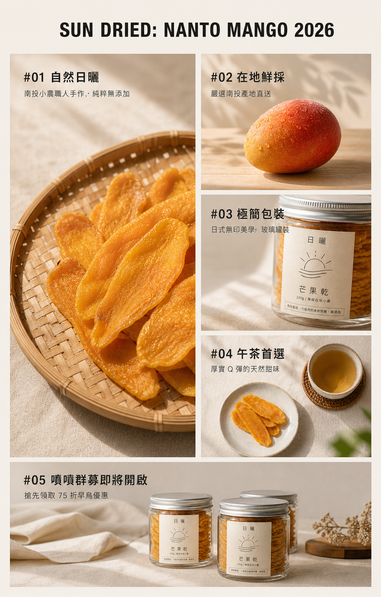
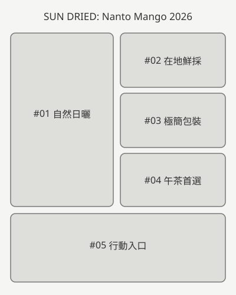
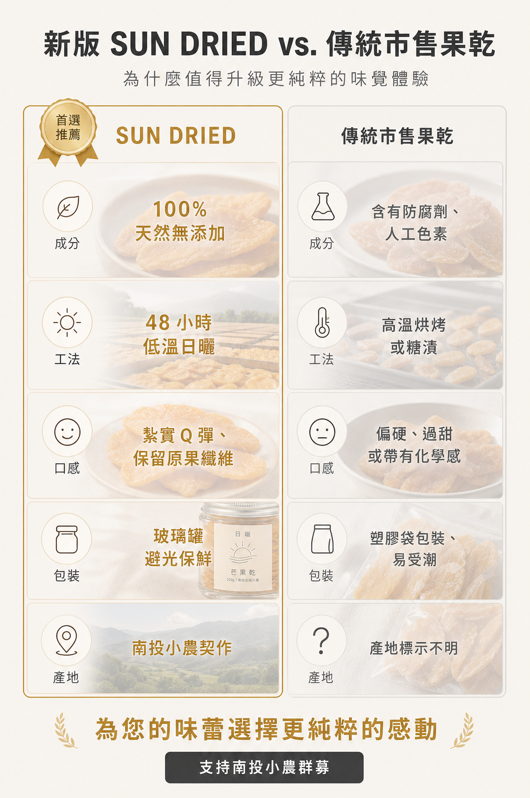
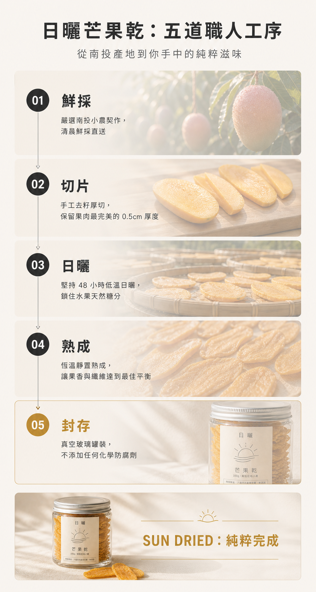
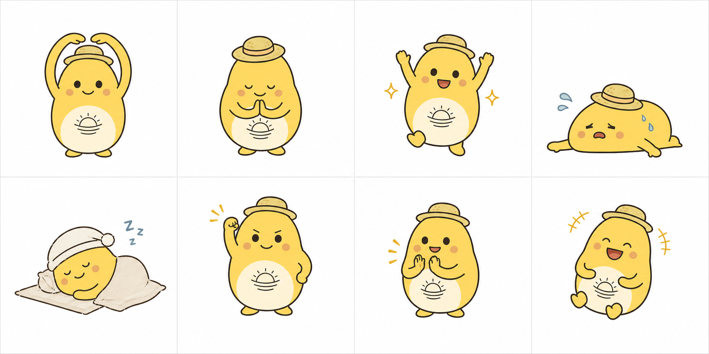
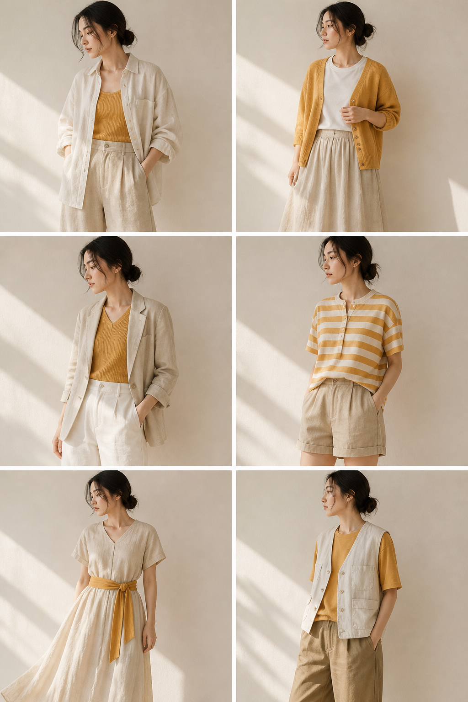

## 內部設計（不進學員頁）

### Learner Task Contract

| 欄位 | 凍結內容 |
|---|---|
| 學習者與情境 | 第一次製作商業社群視覺的學員，接到一個要在社群發布的品牌主題。 |
| 問題與後果 | 只有主題、文案與零散圖片，還沒有可發布的版型；直接要求 AI「做漂亮一點」會讓結構、文字與品牌調性失控。 |
| 起始材料 | 本講義內的 8 用途版型速查、SUN DRIED 範例圖、同版 L2 線稿／L4 範例、六張視覺形式參考圖與視覺 brief 工作紙；學員也可使用自己的主題與已取得權利的素材。 |
| 目標完成物 | 一份視覺 brief、一段可重跑的完整 prompt、一張 1080×1350 PNG、一張 1080×1080 PNG，以及一份完稿檢核。 |
| 成果用途與後續使用 | 4:5 作為 IG／社群主視覺，1:1 作為貼文、縮圖或跨平台版本；完整 prompt 可換主題再用。 |
| 第一個動作 | 先填「目的、讀者、唯一重點、發布尺寸」四格，不開生圖工具。 |
| 第一個可觀察結果 | 得到一句「我要讓誰在什麼平台看懂什麼」的任務句；寫不出時回到四格刪除次要資訊。 |
| 失敗時的回復位置 | 版型不符回到六種結構選型；構圖混亂回到文字線稿；生成失敗改用結構練習圖完成版型練習；中文字錯誤先局部修正、再於 Canva 重建；輸出裁切回到 1:1 重排。 |

### Environment Contract

| 工具 | 起始狀態 | 成功結果 | 備援 |
|---|---|---|---|
| ChatGPT 或 Gemini | 可輸入文字；若帳號支援，可生成或編修圖片 | 產出一張可下載的 4:5 視覺底圖 | 改用所選形式的結構練習圖進行 Canva 練習；題目同步改回示範品牌，不能因此宣稱完成可發布成品 |
| Canva | 可建立 1080×1350 與 1080×1080 自訂尺寸 | 可放入底圖、核對或重建文字、輸出 PNG | 介面名稱不同時使用搜尋；可拆分素材採元素重排，練習用扁平圖則整張等比例縮放、補品牌底色並在留白補文字 |

### 素材存在 Gate

| 材料與用途 | 實檔／取得方式 | 驗證 | 狀態 |
|---|---|---|---|
| L4 範例與 L2 線稿對照 | `img/workshop2h/pdf-source/bento.png`、`img/workshop2h/pdf-source/bento-wireframe.svg` | 彩色範例與對應五格線稿；供結構判讀 | READY |
| 六種視覺形式範例 | `img/workshop2h/pdf-source/` 中的六張 PNG | 六張形式範例圖分別對應六段提示詞；作為課堂範例與無生圖權限備援 | READY |
| 六種形式的提示詞與工作紙 | 六種形式的完整提示詞；正文與網頁均可直接複製 | 保留完整提示詞內容，將排版標記轉成純文字；未重新生成或驗收成圖 | 完整提示詞已同步；商業發布仍須核實宣稱 |

### 能力與證據對應

| 目標／核心方法 | 所需證據 | 正文位置 |
|---|---|---|
| 依目的選版型 | 六類選型表與情境判斷題 | 「六種社群視覺結構怎麼選」 |
| 從完稿讀結構 | L4／L2 對照、視覺重心／閱讀順序／留白三項判讀 | 「20 分鐘：版型與線稿機制」 |
| 寫出可重跑的生成指令 | 六項設計資訊、六種形式的完整 prompt 與學員自行改寫的版本 | 「20 分鐘：品牌視覺與提示詞」 |
| 完成生成與修正 | 初稿、單一變因修正、Checkpoint | 「25 分鐘：AI 社群視覺實作」 |
| 完成正式文字與尺寸延展 | Canva 4:5、1:1 操作與完稿檢核 | 「25 分鐘：Canva 完稿與尺寸延展」 |

<!-- learner-content:start -->
# 從 AI 生圖到設計完稿

你會把一個社群主題整理成可生成、可修改、可發布的視覺。今天的完成物是同一主題的兩張 PNG：一張 **1080×1350（4:5）主視覺**，一張 **1080×1080（1:1）延展圖**。過程會留下可重跑的 prompt 與完稿檢核，所以課後換品牌、換主題仍能再做一次。

### 第一個動作｜先寫任務句

先不要開生圖工具。請填四格：**目的、讀者、唯一重點、發布尺寸**。

```text
目的：＿＿＿＿
讀者：＿＿＿＿
唯一重點：＿＿＿＿
發布尺寸：＿＿＿＿
任務句：我要讓＿＿＿＿在＿＿＿＿平台看懂＿＿＿＿。
```

任務句寫不出來時，先刪掉次要資訊，直到一句話只剩一個溝通目的。後面的版型、提示詞與檢核都要回頭對照這句話。

## 開始前：準備材料與過關標準

請先準備 ChatGPT 或 Gemini 其中一項，以及 Canva。本課以「SUN DRIED」作為示範主題，六種形式各有一段完整提示詞與對應圖片；課堂只選一種。也可以使用自己有權使用的素材與已確認的商品事實。

先看[便當格範例](../img/workshop2h/pdf-source/bento.png)，觀察左側大格、右側三小格與底部橫格。其餘五種範例圖在下方。範例中的商品宣稱、產地、製程、優惠與競品敘述未附查證資料，課堂可用於練習；正式發布前必須核實。創辦人肖像是示範圖，不得直接稱為真實創辦人。

本次要留下五項成果：

1. 一句任務句：「我要讓誰在什麼平台看懂什麼」。
2. 一份涵蓋六項設計資訊的視覺 brief。
3. 一段可複製、可重跑的 prompt。
4. 1080×1350 PNG 與 1080×1080 PNG 各一張。
5. 一份版型、文字、色彩、權利與輸出檢核。

完成品符合以下條件就過關：版型與溝通目的相符；第一眼知道先看哪裡；AI 生成的繁體中文逐字正確，錯字已局部修正或在 Canva 重建；全圖不超過三個主色與兩種字體；兩個尺寸都沒有裁掉標題、主體或 CTA。

### 120 分鐘路線圖

| 時間 | 你要完成的事 | 階段成果 |
|---|---|---|
| 0–20 分 | 填任務句、判讀版型與線稿 | 寫出 P1／P2／P3，圈出要保留的留白 |
| 20–40 分 | 比較六種結構並選型 | 完成兩題選型判斷，再為自己的任務選一種結構並說明理由 |
| 40–60 分 | 改寫所選結構的完整提示詞 | 留下一份文字線稿與一段可直接生圖的 prompt |
| 60–70 分 | 休息與生成準備 | 備妥素材、正式文字與第一版生成條件 |
| 70–95 分 | AI 社群視覺實作 | 留下初稿、一次單一變因修正與前後比較 |
| 95–120 分 | Canva 完稿與尺寸延展 | 輸出 4:5 與 1:1 兩張 PNG 並互看檢核 |

## 20 分鐘：版型與線稿機制

版型先回答「這張圖要完成什麼溝通任務」。同一個商品換版型，讀者感受到的重點也會改變。拿到需求時先查表，再選一種主結構，不要一開始就堆風格形容詞。

| 版型 | 最適合的任務 | 一眼要看到什麼 |
|---|---|---|
| A 主視覺版 | 廣告首圖、活動主視覺 | 商品或主題占畫面 80% 左右 |
| B 橫幅版 | 網站 banner、EDM | 商品與短標並列，橫向快速讀完 |
| C 社群版 | IG、Threads 日常貼文 | 主體清楚、文字少、留白多 |
| D 系列版 | 多款商品、系列比較 | 多個品項仍像同一品牌 |
| E 禮盒版 | 節慶、送禮、組合商品 | 包裝與整組價值感 |
| F 特寫版 | 食品、材質、細節 | 質地、流動、表面細節 |
| G 促銷版 | 折扣、檔期、立即轉換 | 優惠與期限比裝飾更醒目 |
| H 生活版 | 品牌故事、情境提案 | 人在什麼時刻使用商品 |

線稿是版面的骨架。完稿包含顏色、照片、材質與正式文字；L2 線稿只保留物件輪廓、文字區、大小比例與對齊關係。先讀骨架，才能判斷一張圖是否能換主題繼續使用。





看任何版面時，依序回答三題：

1. **最吸睛是誰？** 主體、標題或價格只能有一個第一名。
2. **看的順序是什麼？** 用 P1、P2、P3 寫下讀者前三個視線停點。
3. **空白夠不夠？** 重要元素旁要留出辨識空間，四周也要保留裁切安全區。

### 三分鐘判讀

看上面的 L2 線稿，寫下 P1、P2、P3。參考答案：P1 是左側芒果乾大格，P2 是右側三個資訊格，P3 是底部行動入口。若你的順序不同，請指出是哪個尺寸、對比或位置讓視線改道。這個理由就是後面驗收 AI 產出的依據。

接著用自己的任務句重看線稿：在筆記畫出主要區域，圈出你會保留的第一視覺與標題留白，劃掉一個與任務無關的次要資訊。把筆記蓋住再重看三秒；若自己無法立即指出第一視覺，就先調整主次，再進入選型。有同伴時可交換筆記互看。

## 六種社群視覺結構怎麼選

這六種形式分別處理不同的內容關係。先看資訊之間是並列、比較、順序、人物故事、角色反應或系列展示，再選版型。

| 代號與形式 | 選它的時機 | 核心結構 | 生成時先鎖定 |
|---|---|---|---|
| Bento Grid 便當格資訊圖 | 要在一張圖並列產品、原料、包裝與使用情境 | 左側大格、右側三小格、底部橫格；每格照片加標題與說明 | 格數、主次比例、每格任務、色板 |
| Comparison 對比資訊圖 | 要讓讀者逐項比較兩種方案 | 兩欄五列對照，本例強調左欄推薦 | 同一組比較項、對照文字的資料來源 |
| Step by Step 步驟教學圖 | 要用製程、使用方式或服務流程建立理解與信任 | 3–7 步、編號與箭頭連續，最後回到商品 | 每步一個動作、視覺流向、完成結果與 CTA |
| Founder Portrait 創辦人肖像 | 要用人物、商品與工作場域建立品牌信任 | 人物＋自然動作＋工作環境＋方向光 | 本人同意或虛構人物、不得像名人、商品清楚、光線一致 |
| Sticker Set 角色貼圖組 | 要把品牌角色延伸到客服、限動或社群互動 | 角色基底固定，多格呈現不同溝通情境 | 角色細節、畫風、留白、動作不重複 |
| Lookbook Grid 系列拼貼 | 要展示服飾系列或多款商品 | 範例為三行兩欄六套穿搭，每格獨立、整組調性一致 | 模特與服裝設定、格數、鏡位、光線、背景與色板 |

### 六種形式的參考圖

以下六張範例圖對應下方六段完整提示詞，可用來判讀版面與質感；生成結果仍須按提示詞逐項核對。範例中的商品成分、產地、製程、優惠及競品描述未附查證資料，正式發布前須確認；創辦人肖像是示範圖，不能直接稱為真實創辦人。

#### Bento Grid 便當格資訊圖


並列品牌與產品資訊。

#### Comparison 對比資訊圖



逐項比較兩種果乾。

#### Step by Step 步驟教學圖



依序呈現五道工序。

#### Founder Portrait 創辦人肖像


以人物與工作環境建立敘事。

#### Sticker Set 角色貼圖組



固定角色外觀並變化動作。

#### Lookbook Grid 服飾系列拼貼



以六套服飾呈現系列調性。

### 一分鐘選型

並列重點用 Bento Grid；對照同一組條件用 Comparison；依序解釋工序用 Step by Step；呈現人物與工作場域用 Founder Portrait；同一角色的多種表情用 Sticker Set；多套穿搭的系列展示用 Lookbook Grid。課堂只選一種完成，不需生成六張。

### 先判斷兩題，再選自己的形式

題一：讀者要比較兩種果乾的成分、工法與包裝，應用哪一種結構？題二：要讓讀者依序看懂五道工序，應用哪一種？答案分別是 Comparison 與 Step by Step。再為自己的題目選一種形式，寫下「我選＿＿，因為讀者需要看懂＿＿；第一視覺是＿＿」。

## 20 分鐘：品牌視覺與完整提示詞

先看完整提示詞如何把任務拆成可觀察的設定：畫面比例與用途、主題與指定文字、格數與閱讀順序、每格主體及照片、材質與光線、色板與字體、限制。先用 5 分鐘拆解 Bento，再用 5 分鐘填自己的素材與事實，最後 10 分鐘選一段提示詞改寫並畫文字線稿。以下六段提供完整設定；課堂只複製自己選用的那一段。

範例包含未查證的商品、製程、折扣與競品敘述。複製範例做課堂試作可以保留原文；若要正式發布，須先取得資料並改成查證後的文案。Lookbook 範例是服飾系列，與果乾商品圖屬不同視覺任務。

### 從提示詞看版面骨架

Bento 指定左上大格、右側三小格、底部橫格，各格都有照片與文字。先在紙上畫出五格，再逐一填入芒果乾、鮮果、包裝、午茶與行動入口；對照提示詞核對格數、主次與閱讀順序。若畫不出相同骨架，先補版型設定，再生成圖片。

### Bento Grid 便當格資訊圖｜完整提示詞

```text
請生成一張 Bento Grid 資訊圖（日本便當格美學），且每一格均為實景攝影照片：

【整體】 4:5 直立比例、適合 IG / Threads 貼文。

【主題】 「SUN DRIED: Nanto Mango 2026」（畫面頂部標題、無襯線粗體、深色碳灰、置中）

【Grid 系統】 2 大 + 3 小不對稱排版：
• 左上大格（佔畫面左側 1/2）
• 右上 + 右中 + 右下 3 個小格（每格約大格 1/3 高）
• 底部橫向 1 個中格（佔畫面寬度 100%）

【格內容：全實拍照片 + 疊加文字】 每格均為高解析度照片，疊加極簡中文標題（粗體）與 1 行說明（細體）：
• 大格 #01（品牌核心）： 照片為「陽光灑在竹編平盤上的金黃芒果乾特寫」。文字：「自然日曬」 + 「南投小農職人手作，純粹無添加」。
• 小格 #02（原料）： 照片為「一顆完好、帶有露水的鮮豔愛文芒果立於木桌」。文字：「在地鮮採」 + 「嚴選南投產地直送」。
• 小格 #03（包裝）： 照片為「玻璃矮罐標籤的側拍，強調紙質紋理」。文字：「極簡包裝」 +「日式無印美學，玻璃罐裝」。
• 小格 #04（情境）： 照片為「芒果乾配上一杯清茶的俯視圖」。文字：「午茶首選」 + 「厚實Q 彈的天然甜味」。
• 底部中格 #05（CTA）： 照片為「遠景：果乾罐排列在亞麻布上」。文字：「嘖嘖群募即將開啟 — 搶先領取 75 折早鳥優惠」。

【色板與風格】
• 色板： 暖米白（背景底色）+ 碳灰（文字）+ 芒果金（照片主色）。
• 風格： 無印良品（MUJI）攝影風格。高亮度、低飽和度、自然光影、空氣感、大量的負空間（Negative Space）確保疊加文字清晰。

【字體】 2 種：標題用無襯線粗體、說明用無襯線細體。全繁體中文。

【格間距】 格與格之間留 2% 畫面寬度的純白溝路（Gutter）。

【限制】
嚴禁人物、嚴禁手持、嚴禁出現農會風紅綠色、嚴禁照片過於雜亂、嚴禁文字被背景干擾（必要時在文字下方加微量光暈）。
```

### Comparison 對比資訊圖｜完整提示詞

```text
請生成一張兩欄式品牌對比資訊圖（Brand Comparison Infographic）：

【整體】 4:5 直立比例、適合 IG / Threads 貼文、無印良品式清透視覺。

【主題】 「新版 SUN DRIED vs. 傳統市售果乾」（畫面頂部標題、無襯線粗體、深碳灰、置中）
副標： 「為什麼值得升級更純粹的味覺體驗」（細體、中灰色、置中）

【兩欄結構】
• 左欄（推薦欄）： 「SUN DRIED」+ 燙金細邊框 + 燙金「首選推薦」徽章在欄頂。
• 右欄（對照欄）： 「傳統市售果乾」+ 淺灰色細邊框、無徽章。

【對比項目（5 行、每行兩欄並列）】
底圖規範： 每一個儲存格皆有 30% 透明度的半透明照片，文字疊加其上。
1、成分： 100% 天然無添加（左、燙金強調）｜ 含有防腐劑、人工色素（右、中性灰）
2、工法： 48 小時低溫日曬（左）｜ 高溫烘烤或糖漬（右）
3、口感： 紮實 Q 彈、保留原果纖維（左）｜ 偏硬、過甜或帶有化學感（右）
4、包裝： 玻璃罐避光保鮮（左）｜ 塑膠袋包裝、易受潮（右）
5、產地： 南投小農契作（左）｜ 產地標示不明（右）

【結論區（底部）】
粗體大字：「為您的味蕾選擇更純粹的感動」（燙金）+ CTA 按鈕： 「支持南投小農群募」（深碳灰填充、米白文字）。

【色板】
米白背景底色 + 深碳灰（主文字）+ 燙金 Accent（強調左欄與結論）。嚴禁紅/綠配色。

【字體】
2 種：標題用無襯線粗體、項目內容用無襯線細體。全繁體中文。

【格內容視覺強化】
每格文字後方帶有微弱的毛玻璃效果（Soft Blur），確保即使有半透明照片底圖，文字依然清晰可見。

【限制】
嚴禁人物、嚴禁手持、嚴禁出現農會傳統紅綠配色、嚴禁兩欄字級不一、嚴禁項目超過 6 行、嚴禁照片底圖過於雜亂干擾文字。
```

### Step by Step 步驟教學圖｜完整提示詞

```text
請生成一張製作工序教學資訊圖（Step-by-step Infographic）：

【整體】 4:5 直立比例、無印良品（MUJI）空氣感攝影風格、適合 IG / Threads 貼文。

【主題】 「日曬芒果乾：五道職人工序」（畫面頂部標題、無襯線粗體、深碳灰、置中）
副標： 「從南投產地到你手中的純粹滋味」（細體、中灰色、置中）

【5 步驟（垂直排列、編號圈 + 向下細線連線）】
底圖規範： 每一步驟背景皆為一張 20% 透明度且高斯模糊 的實景照片。
1、鮮採（編號 01、深碳灰填充）：照片底圖為「晨間採收的愛文芒果」。說明：「嚴選南投小農契作，清晨鮮採直送」。
2、切片（編號 02）：照片底圖為「乾淨木質砧板與厚切芒果片」。說明：「手工去籽厚切，保留果肉最完美的 0.5cm 厚度」。
3、日曬（編號 03）：照片底圖為「陽光下的竹編盤與果乾」。說明：「堅持 48 小時低溫日曬，鎖住水果天然糖分」。
4、熟成（編號 04）：照片底圖為「整齊排列的乾燥果片」。說明：「恆溫靜置熟成，讓果香與纖維達到最佳平衡」。
5、封存（編號 05、燙金強調）：照片底圖為「玻璃矮罐封蓋特寫」。說明：「真空玻璃罐裝，不添加任何化學防腐劑」。

【視覺引導】 每步驟之間有向下細線（淡灰色）連結、編號圈極簡化（無襯線數字）、照片底圖需確保文字邊緣銳利清晰。

【底部成果區】
小張成品情境圖「陽光下的玻璃矮罐與 2 片果乾」+ 標題「SUN DRIED：純粹完成」（燙金、置中）。

【色板】
米白背景底色 + 深碳灰（主文字與線條）+ 燙金 Accent（用於步驟 05 與成果區）。

【字體】
2 種：標題與步驟名用無襯線粗體、詳細說明用無襯線細體。全繁體中文。

【限制】
嚴禁人物或手部局部出現、嚴禁箭頭過粗、嚴禁照片底圖色調過重導致文字難以辨識、嚴禁中文字以外之語系。
```

### Founder Portrait 創辦人肖像｜完整提示詞

```text
請生成一張品牌創辦人個人品牌肖像照（Founder Portrait）：

【人物】 亞洲男性、30-40 歲、台灣人、南投在地小農創辦人、個性純樸沉穩且專注。

【姿態】 半身構圖、坐在工作室內的木質大工作桌後方、身體角度 3/4 側對鏡頭、雙手輕扶著裝有金黃芒果乾的玻璃罐。
【臉部】 表情自然平靜、不需刻意微笑、視線微向下凝視著手中的產品（不要直視鏡頭），展現對作物與產品的重視。眼神專注、神情溫和。

【環境】 簡約工作室背景、淺色木紋桌面、背景高度虛化（淺景深）：可隱約見到遠處層疊的竹編曬盤、懸掛的亞麻布、質樸的木製貨架。

【服裝】 淺米色麻質襯衫 + 炭灰色棉質工作圍裙。袖子隨意捲起，展現職人勞作的氣息。

【光線】 自然光 + 暖黃側光（模擬午後 4 點從窗外灑入的陽光）、具有明顯的光影層次、營造出溫暖、靜謐的日系工作室氛圍。

【相機感】 像用 35mm 全幅相機 + 85mm 鏡頭拍攝（淺景深效果強）、輕微膠片顆粒、呈現真實人文紀實質感。

【風格】 日式無印風格、真實人文感。拒絕過度磨皮或假白感，保留皮膚真實質地，避免庫存圖片（Stock Photo）的刻意僵硬感。

【限制】
嚴禁直視鏡頭、嚴禁假笑、嚴禁純色背板、嚴禁硬光陰影、嚴禁工作場域以外的雜物、嚴禁中文字出現、嚴禁畫面過度飽和。
```

### Sticker Set 角色貼圖組｜完整提示詞

```text
請生成一張 LINE 貼圖組預覽 (Sticker Set Preview)：

【整體】 4×2 網格排列、共 8 張貼圖、每張正方形、白色背景。

【角色】 「小日芒」SUN DRIED 品牌吉祥物：
• 物種： 擬人化芒果（圓潤的水滴形體型，下方略寬）。
• 顏色： 柔和的芒果黃身體 + 米白色腹部 + 炭灰色極簡太陽圖騰（3 條曲線）在胸前。
• 配件： 頭戴頂部平坦的極簡小草帽 + 黑豆般的圓眼睛 + U 型微笑嘴。
• 個性： 陽光、職人精神、溫暖感。

【風格】
日式手繪卡通風、中等粗細的炭灰色線條、平塗上色（Flat Color，無漸層、無厚塗）。風格接近「北歐/日本雜貨」常見的簡潔插畫，營造無印良品式的溫潤感。

【8 個動作內容（每張角色細節需高度一致）】
1、OK（雙手比圓圈放在頭頂）
2、謝謝（雙手合十、微微鞠躬）
3、開心（雙手舉起、腳邊有小火花）
4、累（像果乾一樣扁掉趴下，冒汗）
5、晚安（戴著睡帽躺在亞麻布上睡覺）
6、加油（單手握拳、眼神認真）
7、拍手（開心的鼓掌動作）
8、笑（瞇瞇眼大笑、身體微微後仰）

【規格要求】
每張貼圖構圖置中、留 15% 邊緣空白、角色比例在 8 格中必須完全統一。

【角色一致性】
所有 8 張貼圖的芒果形狀、草帽比例、眼睛距離、線條粗細與黃色色值必須完全一致。

【限制】
嚴禁角色細節隨機漂移、嚴禁出現過於鮮豔的螢光黃、嚴禁複雜陰影、嚴禁文字超過 3 字、嚴禁出現咖啡豆元素。
```

### Lookbook Grid 服飾系列拼貼｜完整提示詞

```text
請生成一張 服飾品牌 Lookbook 6 格拼貼圖：

【整體】 4:5 直立比例、3×2 網格排版、風格為「日系文青品牌官方 Collection 頁面」。

【系列主題】 「SUN DRIED · Nanto 2026」（米色基調、芒果金點綴、職人剪裁）。

【Grid 系統】 3 行 × 2 欄、共 6 格、每格 1:1 比例、格間距 2%。

【模特規格】 6 格統一使用：
• 屬性： 亞洲女性（台灣感）、25-30 歲、氣質清新、體型纖瘦。
• 視線： 不直視鏡頭（側臉、低頭、或看向遠方）、表情平靜自然、不要笑容。

【6 套穿搭（每格 1 Look）】
重點： 以米白色（米）與亞麻色（麻）為底，加入芒果金（金）作為領帶、內搭或點綴。
1、米白 oversized 亞麻襯衫 + 內搭芒果金小背心 + 寬腳長褲。
2、芒果金細針織開衫 + 白色 T 恤 + 米色亞麻長裙。
3、米色西裝外套 + 內搭芒果金色針織衫 + 白色直筒褲。
4、芒果金與白色條紋相間的亞麻上衣 + 米色短褲。
5、淺杏色寬鬆連身裙 + 繫上芒果金色亞麻腰帶。
6、米白色工作背心（職人感） + 內搭芒果金 T 恤 + 卡其色長褲。

【背景與光線】
6 格共用米白色亞光背景、光線模擬午後斜射的自然暖陽感（強調日曬主題）、影子柔和。

【整組調性】
統一光線、低飽和度。色調融合「日曬」後的溫潤感，服裝布料需清晰可見亞麻與棉質的天然紋理。

【色板】
嚴格 3 色：米白色（基調）+ 亞麻原色（中性）+ 芒果金（點綴色 / 品牌色）。

【限制】
嚴禁模特直視鏡頭、嚴禁出現農會傳統強烈對照色、嚴禁背景混亂、嚴禁化學合成纖維質感、嚴禁飽和度過高、嚴禁中文字。
```

### 換成自己的提示詞

現在從六種提示詞中只選與自己任務相符的一段。先在上表圈出這種形式的必問項，並填入自己已確認的事實；再改讀者目的、版型、每格內容與確切文案。若使用自己的商品，註明商品基準圖固定哪些特徵，以及哪些資訊尚無證據、不能出現在圖中。遮住範例圖，只讀自己改好的 prompt，畫出預期的區塊位置；畫不出時，補上格數、順序或主次比例。再讓同伴只讀 prompt 畫一次線稿，比對兩人的第一視覺、格數與閱讀順序；若不同，修提示詞而非猜測模型會自行理解。完成後保留改寫版，下一段直接拿它生圖。

## 10 分鐘：休息與生成準備

把下面工作紙複製到筆記，填完再進生圖工具：

填寫時可按順序看成四段：前三行確認任務與商品事實；接下來七行安排生成比例、版面與素材；再四行寫限制與指定文字；最後兩行記錄驗收與下一次只改的一項。原工作紙可整塊複製，不需加入這些分段名稱。

「生成版面比例」寫給生圖工具，依你選的形式決定；「Canva 練習完稿」是稍後建立 4:5 主視覺的畫布尺寸。選 Sticker Set 時，生成圖仍保持橫向四欄兩列，進 Canva 後依後文的做法等比例放入畫布並補背景。

```text
我的任務句：我要讓＿＿＿＿在＿＿＿＿平台看懂＿＿＿＿。
商品與已確認事實：＿＿＿＿；不能推測的資訊：＿＿＿＿。
我選的視覺結構：＿＿＿＿，因為內容關係是＿＿＿＿。
生成版面比例：＿＿＿＿（貼圖預覽為橫向四欄兩列）；Canva 練習完稿：4:5，1080×1350。
版型必問項：格數／欄數／步數＿＿＿＿；閱讀順序＿＿＿＿；主次比例＿＿＿＿。
主要內容與位置：＿＿＿＿。
每格／每列／每步的主體、動作與文字：＿＿＿＿。
色板：背景＿＿＿＿／主色＿＿＿＿／強調色＿＿＿＿。
攝影或插畫設定：材質＿＿＿＿／光線方向＿＿＿＿／鏡位＿＿＿＿／背景＿＿＿＿。
參考圖分工：商品圖只固定＿＿＿＿；結構圖只參考＿＿＿＿；風格圖只參考＿＿＿＿。
必須保留：＿＿＿＿。
可以調整：＿＿＿＿。
禁止出現：＿＿＿＿。
指定短篇繁體中文：主標＿＿＿＿／區塊短標＿＿＿＿／CTA＿＿＿＿；不用文字的肖像照填「無」。
驗收：格數與順序＿＿＿＿／商品一致＿＿＿＿／材質與光線＿＿＿＿／文字逐字正確＿＿＿＿／裁切安全＿＿＿＿。
修正時一次只改哪一項：＿＿＿＿。
```

生成前檢查三件事：內容已縮到一張圖能讀完；只有一個第一視覺；所有自有照片、人物或品牌素材都有使用權。人物同意、素材授權或資料控制任一項不清楚時，改用講義結構練習圖或虛構素材。

## 25 分鐘：AI 社群視覺實作

### 步驟 1｜生成第一版

把所選的完整提示詞貼進 ChatGPT 或 Gemini，明確要求產出圖片。若工具支援參考圖，可附上對應的範例圖，並註明只參考版面與自然質感。使用自己的品牌時，只附有權使用的商品或角色圖，並先把未查證文案改成已確認的資訊。

預期結果是符合所選提示詞比例的候選圖：五種社群主視覺接近 4:5，Sticker Set 是橫向四欄兩列預覽。主要區塊數量與位置須正確；有指定文字的形式逐字核對，Founder Portrait 不應出現文字。工具不一定能輸出剛好 1080×1350，最後尺寸由 Canva 設定。若只得到文字建議而沒有圖片，確認當日帳號是否可生圖；功能不可用時，下載前面所選形式的結構練習圖，沿用所選的示範主題練習版面，記下原 prompt 作為後續可重跑版本，並跳到 Canva 練習。此時先保留自己原來的任務句與商品事實，範例圖只作練習，不當成自己品牌可發布的成品。

### 步驟 2｜驗收結構與文字

先直接對照所選的完整提示詞，回答：格數、照片位置、閱讀順序、商品或角色是否正確？各格的標題、說明與畫面是否相符？有指定繁體中文的形式逐字比對缺字、錯字、多字或遮擋；Founder Portrait 則檢查畫面沒有文字。範例圖也可能有生成誤差，仍以所選提示詞逐項驗收。選一項最影響任務句的差異寫在筆記，當作下一輪修正目標。

### 步驟 3｜一次只改一個變因

從下列修正句選一個使用：

- **主次不清**：「保留所有內容，只把主區塊放大到次區塊的兩倍；其他位置不變。」
- **閱讀順序混亂**：「保留色板與內容，重排視線為標題 → 主區塊 → 次區塊 → CTA。」
- **文字區太小**：「保留主體與指定文案，只把主標區加高，讓整句繁體中文完整可讀；其他位置不變。」
- **中文字錯誤**：「保留構圖、商品與其他文字，只把『錯字』改成『正字』；不要新增或刪除其他文字。」使用前把「錯字」和「正字」換成圖片上的實際字詞。
- **色彩太散**：「保留構圖，只使用所選提示詞【色板】指定的三種主色；其他顏色改為自然材質色。」
- **系列不一致**：「保留人物或商品差異，統一背景、相機高度、光線方向與後製色調。」

只用一個修正句再生成一次，保存初稿與修正版，並指出哪一項檢查從未通過變成通過。若第一版已通過所有結構檢查，就選一個可改善的細節，仍只改一項並說明是否值得採用；不要為了交作業強迫換圖。若帳號額度不足，先在 prompt 上寫出修正句，改用結構練習圖進入 Canva。若同時要求改版型、人物、顏色與文字，你將無法判斷哪個指令有效。

### Checkpoint｜可以進 Canva 了嗎

現在應該看到符合所選形式的生成比例：五種社群主視覺接近 4:5，Sticker Set 則是橫向四欄兩列預覽；同時檢查結構符合內容關係、第一視覺清楚、主體完整，文字可逐字核對或修正。若沒看到，回到「版型結構」或「單一變因修正」。通過後下載 PNG，保留原始生成版本，不覆蓋；Sticker Set 進 Canva 後再依後文等比例完整置入，不先裁成 4:5。

## 25 分鐘：Canva 完稿與尺寸延展

每種形式的指定文案已列在對應的完整提示詞中。便當格的主標與 CTA 以該段原文為準；若 AI 已正確生成且清楚可讀，保留即可，避免重複排字。這些文字屬虛構品牌示範，不代表真實商品宣稱；用自己的題目時，先核對品牌名稱與賣點再使用。

### 4:5 主視覺

1. 在 Canva 建立 1080×1350 自訂尺寸設計。
2. 上傳 AI 底圖。比例符合 4:5 時鋪滿畫布並鎖定；若使用橫向的 Sticker Set 練習圖或其他比例不符的扁平圖，就等比例縮到整張可見，以品牌底色補足空白，再鎖定。不要為了填滿畫布裁掉任何一格。
3. 對照 prompt 逐字檢查 AI 已生成的繁體中文。錯字先要求 AI 只修該字；仍錯時，用與背景相符的色塊遮蓋並在 Canva 重建。遮不乾淨就回 AI 取得留空間的無字底圖。
4. 只補上缺少或需重建的正式中文，不重複疊字。主標只負責一件事，短標補充情境，CTA 告訴讀者下一步。
5. 以兩種字體、三個字級建立層級；品牌色不超過三個主色。
6. 以手機觀看大小檢查標題、主體與 CTA，再輸出 PNG。

### 1:1 社群延展圖

使用可拆分素材時，建立新的 1080×1080 自訂尺寸頁，複製 4:5 的元素進來。先固定主體與主標，再把次要內容向內收；四邊留安全區，必要時刪除最低優先資訊。

若使用所選形式的**練習用扁平圖**，圖片內部元素無法分開選取。請在 1080×1080 畫布放入整張圖並保持比例，縮小到完整落在正方形內；用所選提示詞的背景色補滿留白，再依所選提示詞在留白處補上需要的文字。若生成圖的文字已嵌在扁平底圖裡，也不能直接移動；需要重排時回去取得無字底圖，再在 Canva 排文字。不要裁切、壓扁或使用付費分離功能。當圖本身已有無法遮蓋的錯字或細節錯誤，仍無法排除就不把它當成可發布成品。

輸出前縮小到約 25% 檢查一次。這個尺寸接近讀者在動態牆快速滑動時的觀看狀態；如果標題與主體此時分不清，回去調整字級與對比。

把 4:5 與 1:1 圖縮到手機觀看大小，各用三秒指出第一視覺與 CTA，再逐字看正式中文；有同伴時可互換檢查。若兩種尺寸的第一視覺不同、文字被裁掉或商品不一致，回到該尺寸調整後重新輸出；把最後採用的兩張 PNG 留在同一資料夾。

## 完稿檢核

| 檢核面向 | 通過條件 | 未通過時回哪裡 |
|---|---|---|
| 版型 | 所選結構與內容關係相符，主目的清楚 | 回到六種結構選型表 |
| 結構 | P1、P2、P3 可說明，主體完整，留白足夠 | 回到文字線稿或 AI 結構修正 |
| 文字 | 與所選 prompt 的指定繁體中文逐字相符，沒有多字、缺字或遮擋，層級清楚 | 先局部修正；仍錯時回 Canva 重建 |
| 色彩 | 不超過三個主色，對比足以閱讀 | 回 Canva 色板與對比 |
| 權利 | 輸入素材有權使用；真人已同意此用途與 AI 處理；數據有來源 | 換結構練習圖／虛構素材，或停止交付 |
| 輸出 | 1080×1350 與 1080×1080 均為 PNG，沒有裁切重要內容 | 回到對應尺寸手動重排 |

完成後，請把任務句、視覺 brief、完整 prompt、兩張 PNG 與檢核表放在同一資料夾。下次換主題時，先保留版型與限制，只替換內容與品牌視覺；這樣才知道新版本為什麼改變。

記住這句話：**先定版型，再讓 AI 執行；正式文字最後由你驗收。**
<!-- learner-content:end -->

## 講師授課筆記（不進講義）

- 0–20：8 用途版型只做目的判斷，不展開八種 prompt；以 L4／L2 對照帶 P1／P2／P3。
- 20–40：兩題短判斷後，各自用任務句選一種結構並互看理由；不要求六種都生圖。
- 40–60：前 5 分鐘用 Bento 示範 brief 到提示詞的轉換；接著 5 分鐘依六種形式的必問項填工作紙；後 10 分鐘只讀所選形式的完整 prompt，改寫並請同伴畫出預期結構。
- 60–70：休息；同時完成工作紙與素材整理。
- 70–95：學員完成初稿、結構與材質檢查及一次單一變因修正；額度不足則保留修正句，改用所選形式的結構練習圖。
- 95–120：Canva 完稿與 1:1 手動重排；最後以兩張 PNG 互看檢核。
- 真人冷讀、指定帳號平台重跑與授課節奏仍待實測；作者自驗不得標 HUMAN_READY。
